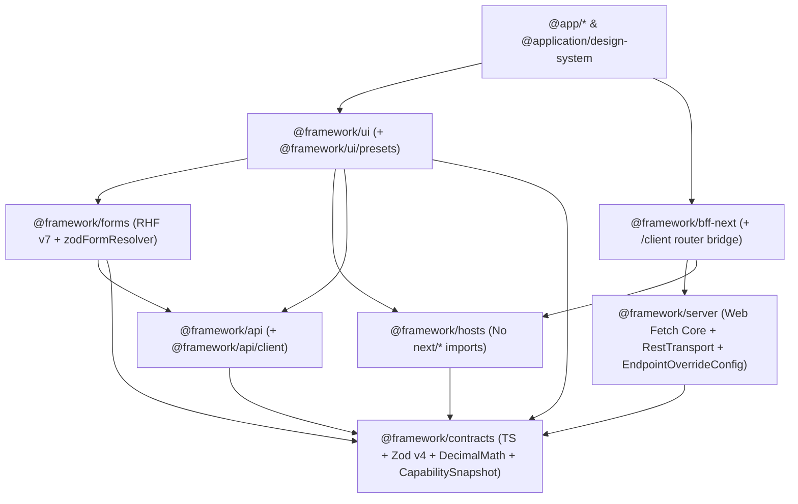
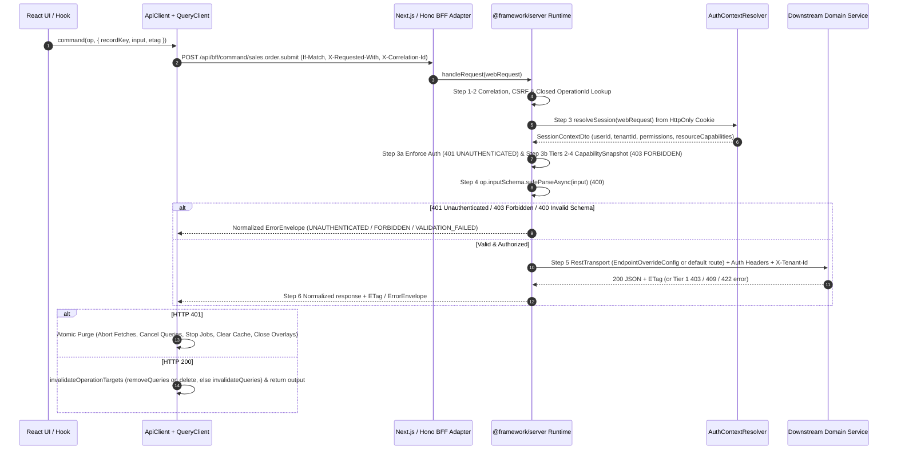
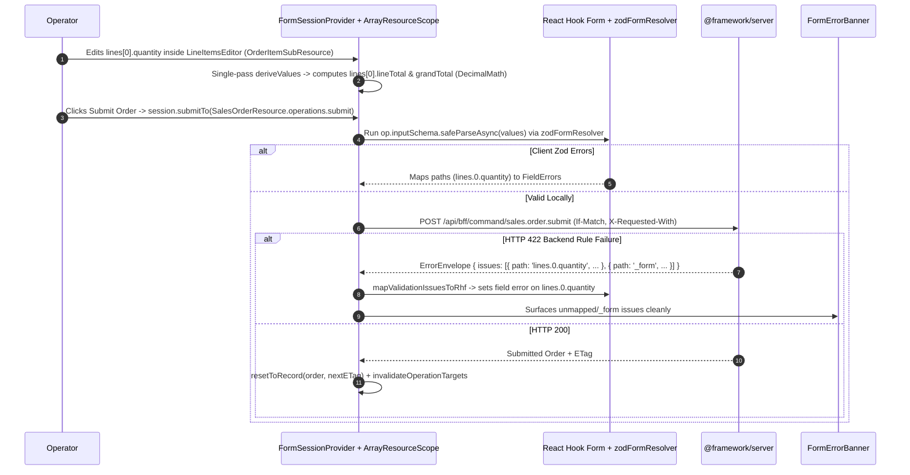
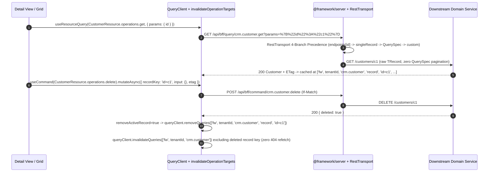

# Foundational Frontend Framework Specification

- **Version:** 0.5.0
- **Status:** Target Normative Architecture and Implementation Specification
- **Target Runtime & Tooling Pins:** TypeScript `5.9+` (verified on `5.9.3`), Zod `4.3+` (verified on `4.3.6`), React `19+`, React Hook Form `7+`, TanStack Query `5+`, Web Fetch Standard APIs
- **Target Product Suite:** Enterprise Resource and Process Planning and Management and Business Operational Applications

---

## How to Read This Document

This specification is the **self-contained, authoritative technical architecture and implementation manual** for the Sigma Foundational Frontend Framework. Every subsystem, public package boundary, TypeScript contract, lifecycle invariant, BFF endpoint, UI resolution precedence rule, error recovery path, and reference example is specified normatively below.

The key words **MUST**, **MUST NOT**, **REQUIRED**, **SHALL**, **SHALL NOT**, **SHOULD**, **SHOULD NOT**, **RECOMMENDED**, **MAY**, and **OPTIONAL** in this document are to be interpreted as described in RFC 2119.

Code contracts in this specification assume strict TypeScript compiler configuration (`strict: true`, `exactOptionalPropertyTypes: true`, `verbatimModuleSyntax: true`, `noUncheckedIndexedAccess: true`).

---

## 1. Design Principles, Anti-Patterns, and Conformance Rules

### 1.1. Core Architectural Principles

1. **Single Authoritative Resource Definition:** Domain semantics, schemas, labels, validation rules, relation metadata, grid/form presentation hints, and API operation descriptors for a domain entity MUST live in one discoverable resource module (`<resource>.resource.ts`) without requiring secondary build-time code generators. Lightweight nested child structures that have no independent HTTP lifecycle SHOULD be modeled as `SubResourceDescriptor`s via `defineSubResource()`, while cross-resource operations spanning aggregates SHOULD live in explicit shared `*.op.ts` modules bound via `resource` or `resourceKey`.
2. **Native Language & Library Idioms:** Data schemas MUST be authored directly with native Zod (`zod`). Form state MUST use native React Hook Form (`react-hook-form`). Server-state caching and invalidation MUST use native TanStack Query (`@tanstack/react-query`). UI customization MUST use native React components and props rather than custom DSL expression parsers.
3. **Explicit Over Generative (Deterministic Local Conventions Only):** Business validation rules, side-effecting workflows, confirmation policies, multipart/presigned upload modes, and custom endpoint routing MUST NEVER be synthesized silently by hidden build-time compilers or schema heuristics. Conversely, deterministic, inspectable descriptor initialization inside `defineResource()` and `defineSubResource()`—deriving `operationId` from resource + map key, deriving default `allowedFilters`/`allowedSorts` from explicit `searchable`/`filterable`/`sortable` attribute flags, defaulting `optimisticConcurrency` from `versionField && requiresRecordKey`, deriving `singleRecord` query key params/results from `keyFields` and `recordSchema`, propagating `[SCHEMA_CONTRACT_HINT]` format hints from schema helpers, and deriving static `required` from Zod `.isOptional()`—IS normative because every derived value is visible directly on the returned runtime descriptor and remains explicitly overridable per resource or operation.
4. **Thin, Replaceable CRUD Presets:** Standard back-office screens MAY compose `<CrudWorkspace>` from `@framework/ui/presets`, while operational consoles (WMS scanning, multi-step transactional orders, POS) compose the exact same `@framework/ui` primitives (`<ResourceField>`, `<LookupField>`, `<ResourceGrid>`, `<BulkActionBar>`) and hooks (`useFormSession`, `useCommand`) directly in React.
5. **Strict Server/Client Contract Parity:** The same TypeScript `OperationDescriptor` and Zod schemas imported by browser components MUST be registered in `@framework/server` so BFF validation, REST mapping, SSR loaders, and client calls share one runtime contract.
6. **Exact Precision for Financial & Quantity Data:** Financial totals, prices, tax percentages, weights, and inventory quantities MUST be represented as decimal strings validated by Zod and computed via `DecimalMath` (BigInt scaled fixed-point arithmetic)—NEVER native IEEE-754 `number` arithmetic.
7. **Framework-Agnostic Server Core:** Request validation, BFF routing, auth identity resolution, REST mapping, and file transfer brokering MUST execute on Web Standard `Request`/`Response`/`Headers` APIs in `@framework/server`, keeping Next.js App Router (`@framework/bff-next`) and standalone BFF adapters (Hono/Fastify/Express) interchangeable.

### 1.2. Explicit Architectural Exclusions (Hard Anti-Patterns)

Implementers **MUST NOT** reintroduce any of the following rejected mechanisms under new names:

- **No Two-Phase Resource Metadata Compiler:** No `buildCatalog()`, AST stripping pass, `FunctionRef` indirection table, or split browser JSON manifest + `LocalFunctionTable`. Resource modules are plain ESM modules loaded naturally by standard bundlers with route-level and `React.lazy()` splitting.
- **No Zod AST / SchemaNode Walker:** Framework code MUST NOT walk private internal Zod `_def`/`def` structures or arbitrary nested AST trees to synthesize nested CRUD UIs or form models. Metadata needed for presentation lives explicitly in `AttributeMeta`, `RelationMeta`, and `presentations`. Bounded inspection is strictly restricted to public Zod v4 surface APIs: top-level `.shape`, `.isOptional()`, `.unwrap()` wrapper peeling (bounded depth), `.in` pipe input extraction, and explicit `[SCHEMA_CONTRACT_HINT]` metadata attached by `@framework/contracts` schema helpers.
- **No Universal Action Abstraction:** Queries (`query`), single/state commands (`command`), bulk partial operations (`batch`), asynchronous long-running jobs (`async-job`), and client-only UI triggers (`client`) MUST remain distinct discriminated contracts.
- **No Mode Flag Forms:** Forms MUST NOT switch validation or authorization semantics based on a magic `'create' | 'edit' | 'view'` mode string; forms bind explicitly to an `OperationDescriptor` (`saveDraft`, `submit`, `update`, `create`) and capability snapshot.
- **No Unserializable RSC Props:** Live `ResourceDescriptor`, `SubResourceDescriptor`, or `OperationDescriptor` objects (which contain Zod validators and evaluation callbacks) MUST NEVER be passed as props across React Server Component (`'use server'` / async RSC) to `'use client'` boundaries.

### 1.3. Conformance Levels

A compliant application or library module MUST adhere to:

- **Tier 1 (Core Runtime Conformance):** Uses `@framework/contracts`, `@framework/api`, `@framework/server`; passes `validateResourceGraph()` with zero errors; registers 100% of API operations in `ServerRuntime`.
- **Tier 2 (UI & Form Conformance):** Uses `@framework/forms`, `@framework/hosts`, `@framework/ui`; wires `<FrameworkProvider>` and `<FormSessionProvider>`; respects all 6 `PresentationRegistry` precedence tiers and dirty-navigation guards.
- **Tier 3 (Enterprise Security & Scale Conformance):** Enforces BFF-only server credentials, CSRF/session cookie verification, atomic `401`/tenant-switch purges, exact `DecimalMath`, and presigned large-file transfer paths.

---

## 2. Purpose, Enterprise Product Scope, Goals, and Non-Goals

### 2.1. Target Product Suite Workloads

The framework MUST support six distinct enterprise workload profiles without forcing bespoke rewrites of shared infrastructure:

| Workload Category | Primary Products | Core Architectural Demands |
|---|---|---|
| **Master-Data CRUD** | PIM, ERP, CRM | Rapid grid/filter/sort/create/edit/delete screens; low per-resource boilerplate (~55–65 lines); inline validation & lookup selects. |
| **Multi-Intent Transactional Documents** | ERP, Retail (`SalesOrder`) | Same form submitting to `saveDraft` vs `submit`; nested master-detail line arrays via `SubResourceDescriptor`; derived totals (`DecimalMath`); dirty-patch `PATCH`; nested `422` path hydration. |
| **Operational Scanning & RF Consoles** | Sigma WMS | Hardware wedge barcode scanner (`useKeyboardScanner`); sequential drawer workflows (`HostController`); `409 ETag` conflict merge (`useConflictResolution`); keyboard-first UX. |
| **Bulk Operational Grids** | WMS, PIM | Row checkboxes + query-scoped bulk targeting (`target: { kind: 'query' }`); partial failure reporting (`PartialBatchResult`); audit reason confirmations; transparent `202` job promotion above sync caps. |
| **Long-Running Jobs & Large Files** | PIM Imports, WMS Wave Planning, ERP Exports | 10–100 MB presigned object-storage uploads bypassing BFF RAM; background `202 Accepted` tracking (`JobManagerProvider`); progress, cancel, and secure result/error-CSV download. |
| **Multi-Tenant & Dynamic Capabilities** | All SaaS / Multi-Org Deployments | Tenant-scoped query caches; `401` and tenant-switch atomic purge; record-level `_capabilities` and `_deniedAttributes` disabling restricted actions and redacting sensitive fields dynamically. |

### 2.2. Quantitative and Qualitative Goals

- **Concise Resource Definition:** Authoring a standard master-data CRUD resource (`Customer`, 6–10 fields, list/get/create/update/delete, grid & form layouts) requires ~55–65 lines of readable TypeScript via `defineResource()` conventions—without manual `deriveQueryPolicy()`, manual endpoint configuration, or duplicated key-schema boilerplate.
- **Unified Primitive Reuse:** A global change to a semantic attribute (e.g., customizing `currency` rendering, masking, or range filtering) updates both `<CrudWorkspace>` presets and custom React workflows in one `PresentationRegistry` registration.
- **Portability:** Identical business schemas, operations, and REST mappers run unmodified behind Next.js App Router (`@framework/bff-next`) or a standalone Vite SPA + Node/Hono BFF.

### 2.3. Non-Goals and Scope Boundaries (v1.1)

The following capabilities are **explicitly excluded from v1.1**:

- Visual WYSIWYG low-code form builders or drag-and-drop schema editors.
- Server-sent schema-to-HTML streaming engines or runtime-serialized Zod closures across HTTP boundaries.
- Offline-first local IndexedDB CRDT synchronization queues (transient network retry and offline error banners ARE included).
- Automatic GraphQL/gRPC codegen transports (can be added later via `Transport` interface without changing `@framework/contracts`).
- Browser-side cross-resource SQL-like client-side join engines.

---

## 3. Architectural Overview, Package Matrix, and Dependency Graph

### 3.1. Layered Runtime Architecture

```text
+---------------------------------------------------------------------------------------------------+
| APPLICATION LAYER (@app/*)                                                                        |
|   - Domain Resources (<entity>.resource.ts) & Cross-Resource Operations (*.op.ts)                 |
|   - @application/design-system (Design System Slots & Registry Setup)                             |
|   - App Routes (Next.js App Router RSC + 'use client' Views OR Standalone Vite SPA Routes)        |
+---------------------------------+------------------------------------------+----------------------+
                                  |                                          |
           Browser / React Tree   |                                          |  Server / BFF Edge
                                  v                                          v
+--------------------------------------------------------+    +-------------------------------------+
| @framework/ui (+ @framework/ui/presets)                |    | @framework/bff-next                 |
|   PresentationRegistry | LookupRegistry | Formatters   |    |   createNextBffHandler              |
|   ResourceField | LookupField | ResourceGrid | Forms   |    |   createNextServerContext (RSC SSR) |
|   Optional Presets: CrudWorkspace | Dialog | Drawer    |    |   createNextRouterAdapter (client)  |
+---------------------------+----------------------------+    +------------------+------------------+
                            |                                                    |
             +--------------+--------------+                                     v
             |                             |                  +-------------------------------------+
             v                             v                  | @framework/server (Web Fetch Core)  |
+-------------------------+   +--------------------------+    |   createServerRuntime               |
| @framework/forms        |   | @framework/hosts         |    |   createRestTransport               |
|   useFormSession        |   |   HostController         |    |   AuthContextResolver               |
|   FormSessionProvider   |   |   DialogHost | DrawerHost|    |   PresignTransferBroker             |
|   ArrayResourceScope    |   |   DirtyNavigationGuard   |    +------------------+------------------+
|   zodFormResolver       |   |   useKeyboardScanner     |                       |
+------------+------------+   +-------------+------------+                       |
             |                              |                                    |
             v                              |                                    |
+-------------------------+                 |                                    |
| @framework/api          |                 |                                    |
|   ApiClient (fetch)     |                 |                                    |
|   SessionProvider       |                 |                                    |
|   JobManagerProvider    |                 |                                    |
|   TanStack Query Hooks  |                 |                                    |
+------------+------------+                 |                                    |
             |                              |                                    |
             +--------------+---------------+------------------------------------+
                            |
                            v
+---------------------------------------------------------------------------------------------------+
| @framework/contracts (Isomorphic: TS + Zod Only — Zero React, Zero DOM, Zero Node-Only APIs)       |
|   ResourceDescriptor | SubResourceDescriptor | AttributeMeta | RelationMeta | LookupDefaults      |
|   OperationDescriptors | defineEnumOptions | SCHEMA_CONTRACT_HINT | DecimalMath | KeyCodec       |
|   QuerySpec | ErrorEnvelope | validateResourceGraph | Session & 4-Tier Capability Contracts      |
+---------------------------------------------------------------------------------------------------+
```

### 3.2. Authoritative Seven-Package Workspace Matrix

| Package | Runtime Target | Direct Internal Framework Dependencies | Primary Responsibility & Key Exports |
|---|---|---|---|
| `@framework/contracts` | Isomorphic (Browser, Edge, Node) | *None* (`zod` peer/direct only) | Semantic Zod schemas (`[SCHEMA_CONTRACT_HINT]`, `getSchemaContractHint`, `defineEnumOptions`), `DecimalMath`, `KeyCodec`, `AttributeMeta`, `RelationMeta`, `LookupDefaults`, `QuerySpec`, `OperationDescriptor`s, `ResourceDescriptor`, `SubResourceDescriptor`, `defineResource`, `defineSubResource`, `deriveQueryPolicy`, `validateResourceGraph`, `ErrorEnvelope`, `CapabilitySnapshot`, `createCapabilitySnapshot`, `LookupRegistry`, Presign & Capability DTOs. *(Zero server HTTP endpoint config.)* |
| `@framework/api` | Browser / React (and `@framework/api/client` pure fetch) | `@framework/contracts` | `ApiClient`, `SessionProvider` + `useSession`/`useCapabilities`, `JobManagerProvider` + `useJobManager`, `frameworkQueryKey`, `useResourceQuery`, `useCommand`, `useBatchCommand`, `useAsyncJob`, `invalidateOperationTargets`. |
| `@framework/forms` | Browser / React | `@framework/contracts`, `@framework/api` | Built-in `zodFormResolver`, `useFormSession`, `<FormSessionProvider>`, `<ArrayResourceScope>`, `useResourceFieldArray`, `useFormAttribute`, `extractDirtyPatch`, `mapValidationIssuesToRhf`, `useConflictResolution`. |
| `@framework/hosts` | Browser / React | `@framework/contracts` | `HostController`, `<HostRoot>`, `<DialogHost>`, `<DrawerHost>`, `FrameworkRouterAdapter`, `useHostController`, `useHostFrame`, `useFrameworkRouter`, `useDirtyNavigationGuard`, `useKeyboardScanner`. *(Zero `next/*` imports.)* |
| `@framework/ui` | Browser / React | `@framework/contracts`, `@framework/api`, `@framework/forms`, `@framework/hosts` | `PresentationRegistry`, `LookupRegistry` & `createLookupRegistry` *(re-exported from `@framework/contracts`)*, `Formatters`, `<FrameworkProvider>`, UI primitives (`<ResourceField>`, `<FieldSection>`, `<TabSection>`, `<LookupField>`, `<ResourceGrid>`, `<FilterBar>`, `<BulkActionBar>`, `<LineItemsEditor>`, `<ResourceRecordView>`, `<RelatedCollectionSection>`, `<ResourceForm>`, `<FormErrorBanner>`, `<WizardFlow>`). |
| `@framework/ui/presets` | Browser / React *(subpath)* | `@framework/ui` | Optional tree-shakeable higher-level CRUD shells: `<CrudWorkspace>`, `<ResourceFormDialog>`, `<ResourceRecordDrawer>`, `<BatchResultModal>`, `<JobActivityDrawer>`. |
| `@framework/server` | Server / Edge (Web Fetch) | `@framework/contracts` | `createRestTransport`, `EndpointOverrideConfig`, `createServerRuntime`, `ServerRuntime`, `AuthContextResolver`, `PresignTransferBroker`, REST defaults & error parser, normalized `/api/bff/*` dispatcher, SSR execution entrypoints. |
| `@framework/bff-next` | Next.js App Router | `@framework/server`, `@framework/hosts` (`@framework/bff-next/client`) | `createNextBffHandler`, `createNextServerContext`, plus client subpath `@framework/bff-next/client` exporting `createNextRouterAdapter`. |

### 3.3. Strict Architectural Boundary Invariants

1. **Invariant B-1 (Zero Circular Package Dependencies):** The internal framework dependency graph MUST remain strictly acyclic as shown in §3.2 (`@framework/contracts` <- `@framework/api`, `@framework/hosts`, `@framework/server`; `@framework/api` -> `@framework/forms` -> `@framework/ui`).
2. **Invariant B-2 (Browser Sandbox Isolation):** Client bundles MUST NEVER import `@framework/server`, `@framework/bff-next` server entrypoints, backend service base URLs, bearer secrets, or `RestTransportConfig.endpoints` route maps. All backend HTTP methods, internal service names, upstream path overrides, headers, and timeouts reside exclusively in `@framework/server`—never on `@framework/contracts` descriptors (`BaseOperation.endpoint` is explicitly prohibited).
3. **Invariant B-3 (RSC Serialization Safety):** In Next.js App Router, async Server Components MAY import `ResourceDescriptor`, `SubResourceDescriptor`, and `serverRuntime` on the server to prefetch plain JSON (`PagedResult<TView>`, `TRecord`, `SessionContextDto`). Server Components MUST NOT pass a `ResourceDescriptor`, `SubResourceDescriptor`, `OperationDescriptor`, or Zod schema across the RSC-to-Client prop boundary. Client Views MUST import `ResourceDescriptor` / `SubResourceDescriptor` directly in client modules and accept ONLY serializable props (`initialData`, `initialRecord`, `recordKey`).
4. **Invariant B-4 (Operation Registration Parity):** Every non-client `OperationDescriptor` invoked from client UI (`QueryOperation`, `CommandOperation`, `BatchOperation`, `AsyncJobOperation`) MUST either live inside a `ResourceDescriptor.operations` map passed to `ServerRuntimeConfig.resources` OR live in an explicit shared `*.op.ts` module (with explicit `operationId` and `resource` or `resourceKey` binding) passed to `ServerRuntimeConfig.operations`. Inline anonymous operations created inside `.tsx` files without server registration MUST be rejected with `404 NOT_FOUND` at runtime and flagged by CI boot validation (`DANGLING_OPERATION_RESOURCE` / unregistered operation).
5. **Invariant B-5 (Server Authority Over Identity):** Client requests MUST NOT be trusted to supply authoritative `userId`, `tenantId`, `permissions`, or capability flags; `@framework/server` MUST resolve identity exclusively via `AuthContextResolver` before dispatching any operation or SSR query.

---

## 4. Core Concepts and Terminology

| Term | Canonical Meaning |
|---|---|
| **`ResourceDescriptor`** | Plain, immutable object authored via `defineResource()` owning `recordSchema`, optional `formSchema`, optional `lookupDefaults`, attribute semantics, relations, initialized operations, and UI presentation hints for one domain entity. |
| **`SubResourceDescriptor`** | Lightweight descriptor authored via `defineSubResource()` for embedded child/line collections (e.g., `OrderItemSubResource`) inside an owning parent document, without inventing fake standalone HTTP endpoints or operations. |
| **`AttributeMeta`** | Metadata describing the business meaning (`semanticType`), label, formatting, search/filter/sort eligibility, conditional visibility/read-only/required/compute rules, enum options, and optional controller overrides of one field. |
| **`SemanticAttributeType`** | Domain-oriented attribute classification (`'text'`, `'currency'`, `'decimal'`, `'enum'`, `'relation'`, `'barcode'`, `'date'`, `'datetime'`, `'binary'`, `'secret'`, etc.) decoupling business semantics from design-system widgets. |
| **`LookupDefaults`** | Target-resource configuration (`displayField`, `searchFields`, optional `operationId`, `secondaryFields`, `defaultFilters`) declared once on lookup target `ResourceDescriptor`s and automatically inherited by referencing `RelationMeta.lookup` configs unless locally overridden. |
| **`defineEnumOptions`** | Compile-time exhaustive mapping helper (`defineEnumOptions<TUnion>(map)`) converting a strongly typed key map into `readonly EnumOption<T>[]` while failing TypeScript compilation if any union member is omitted or misspelled. |
| **`PresentationRegistry`** | Central registry mapping resources, fields, semantic types, relations, and primitive types to React `FieldController`, `CellRenderer`, and `FilterControl` components using strict 6-level precedence. |
| **`LookupRegistry`** | Registry mapping target `ResourceKey`s to their canonical lookup `QueryOperation` (supporting eager `register(resource, listOp?)` and lazy `registerLazy()` code-split loading) so `<LookupField>` renders contextual search/select widgets across resources without cyclical compile coupling. |
| **`RelationMeta`** | Structural navigation metadata (`references` vs `owns`, cardinality, FK fields, optional `through` junction) powering lookups, quick-create modals, and `<RelatedCollectionSection>`, and defaulting FK `semanticType` to `'relation'`. |
| **`OperationDescriptor`** | Discriminated union describing one executable unit: `QueryOperation` (`kind: 'query'`), `CommandOperation` (`kind: 'command'`), `BatchOperation` (`kind: 'batch'`), `AsyncJobOperation` (`kind: 'async-job'`), or browser-only `ClientOperation` (`kind: 'client'`). |
| **`FormSession`** | Stateful bridge (`useFormSession`) binding React Hook Form, Zod validation, `persistedRecord` ETag concurrency (`versionField`), 5-tier initial defaults, dirty-patch extraction, derivation, `submitTo()`, and server `ValidationIssue` hydration. |
| **`ArrayResourceScope`** | React context provider binding an array item index prefix (e.g., `lines.0`) to a child `SubResourceDescriptor` (e.g., `OrderItemSubResource`) or `ResourceDescriptor` so `<ResourceField>` resolves child metadata cleanly inside `useFieldArray`. |
| **`HostController`** | Overlay stack manager coordinating `PageHost`, `DialogHost`, and `DrawerHost`, resolving typed `Promise<HostResult<T>>` outcomes, focus trapping/restoration, and dirty navigation guards. |
| **`ServerRuntime`** | Framework-independent Web Fetch engine validating inbound BFF calls against registered Zod operation schemas, enforcing `auth`, 4-tier resource/operation capabilities, and delegating to `Transport`, custom handlers, or transfer brokers. |
| **`CapabilitySnapshot`** | Client-side helper built from `SessionContextDto` via `createCapabilitySnapshot()` exposing `hasPermission()`, 4-tier `canInvokeOperation()` (with optional record-level `_capabilities` overrides), and `isAttributeDenied()` (supporting session `deniedAttributes` and record-level `_deniedAttributes`). |

---

## 5. Resource Schemas, Descriptors, and Metadata Ownership

### 5.1. Ownership Model & Co-Located Module Structure

Each resource owns a single primary module `<entity>.resource.ts` containing:

1. Pure native Zod schemas (`recordSchema`, optional `formSchema`, and command/query-specific input/output schemas).
2. Typed `AttributeMetaInput` definitions constrained to keys of `TRecord & TForm` (resolved deterministically by `defineResource()` into runtime `AttributeMeta`, with optional `derivedAttributes` for display-only computed UI fields) plus optional embedded child `SubResourceDescriptor` definitions via `defineSubResource()`.
3. Explicit `RelationMeta` descriptors and optional `lookupDefaults`.
4. Typed `OperationDescriptor` definitions (`list`, `get`, `create`, `update`, `delete`, domain commands, batches, or jobs; optional when the resource is read-only/reference-only or owned exclusively by standalone ops).
5. Optional `presentations` (`grid`, `form`, `record`).

Domain-wide or cross-resource commands/batches/jobs—or specialized heavy operations extracted for code organization (`ConfirmReceiveOp`)—MUST be placed in an explicit shared operations module (e.g. `src/domain/<module>/<action>.op.ts`), MUST declare an explicit `operationId`, SHOULD bind `resource` (or `resourceKey`), and MUST be imported identically by both UI components and `ServerRuntimeConfig.operations`.

### 5.2. Native Zod Schemas and Exact `DecimalMath` Specification

All data validation uses Zod v4 directly. Financial amounts, tax rates, discounts, quantities, and weights **MUST** be validated as decimal strings and manipulated exclusively through `@framework/contracts`'s `DecimalMath` (exact BigInt scaled fixed-point arithmetic — zero IEEE-754 floating-point conversion in validation bounds or arithmetic).

```typescript
// @framework/contracts — Exact Fixed-Point Decimal Engine
export interface DecimalParts {
  readonly coeff: bigint;
  readonly scale: number;
}

const DECIMAL_REGEX = /^[+-]?(?:\d+(?:\.\d+)?|\.\d+)$/;

export const DecimalMath = {
  isValid(raw: string): boolean {
    return DECIMAL_REGEX.test(raw.trim());
  },

  parse(raw: string): DecimalParts {
    const trimmed = raw.trim();
    if (!DECIMAL_REGEX.test(trimmed)) {
      throw new Error(`Invalid decimal literal: "${raw}"`);
    }
    const negative = trimmed.startsWith('-');
    const unsigned = trimmed.replace(/^[+-]/, '');
    const [intPartRaw, fracPartRaw = ''] = unsigned.split('.');
    const intPart = intPartRaw === '' ? '0' : (intPartRaw ?? '0');
    const magnitude = BigInt(`${intPart}${fracPartRaw}`);
    return { coeff: negative ? -magnitude : magnitude, scale: fracPartRaw.length };
  },

  format(parts: DecimalParts, fixedScale?: number): string {
    const negative = parts.coeff < 0n;
    const absCoeff = negative ? -parts.coeff : parts.coeff;
    const targetScale = fixedScale ?? parts.scale;

    let scaledCoeff = absCoeff;
    if (targetScale > parts.scale) {
      scaledCoeff = absCoeff * 10n ** BigInt(targetScale - parts.scale);
    } else if (targetScale < parts.scale) {
      // Round half-up for deterministic quantization
      const factor = 10n ** BigInt(parts.scale - targetScale);
      const q = absCoeff / factor;
      const r = absCoeff % factor;
      scaledCoeff = r * 2n >= factor ? q + 1n : q;
    }

    if (scaledCoeff === 0n && targetScale === 0) return '0';
    const digits = scaledCoeff.toString();
    if (targetScale === 0) return `${negative ? '-' : ''}${digits}`;
    const padded = digits.padStart(targetScale + 1, '0');
    const splitAt = padded.length - targetScale;
    const sign = negative && scaledCoeff !== 0n ? '-' : '';
    return `${sign}${padded.slice(0, splitAt)}.${padded.slice(splitAt)}`;
  },

  align(a: DecimalParts, b: DecimalParts): readonly [bigint, bigint, number] {
    const scale = Math.max(a.scale, b.scale);
    return [
      a.coeff * 10n ** BigInt(scale - a.scale),
      b.coeff * 10n ** BigInt(scale - b.scale),
      scale,
    ];
  },

  compare(a: string, b: string): -1 | 0 | 1 {
    const [ca, cb] = this.align(this.parse(a), this.parse(b));
    return ca < cb ? -1 : ca > cb ? 1 : 0;
  },

  add(a: string, b: string): string {
    const [ca, cb, scale] = this.align(this.parse(a), this.parse(b));
    return this.format({ coeff: ca + cb, scale });
  },

  subtract(a: string, b: string): string {
    const [ca, cb, scale] = this.align(this.parse(a), this.parse(b));
    return this.format({ coeff: ca - cb, scale });
  },

  multiply(a: string, b: string, targetScale?: number): string {
    const pa = this.parse(a);
    const pb = this.parse(b);
    return this.format({ coeff: pa.coeff * pb.coeff, scale: pa.scale + pb.scale }, targetScale);
  },

  sum(values: readonly string[], targetScale?: number): string {
    let acc = '0';
    for (const v of values) acc = this.add(acc, v);
    return targetScale === undefined ? acc : this.format(this.parse(acc), targetScale);
  },

  round(a: string, scale: number): string {
    return this.format(this.parse(a), scale);
  },
} as const;
```

### 5.3. Core TypeScript Contracts (`@framework/contracts`)

To eliminate redundant scale/currency/relation boilerplate while keeping Zod schemas 100% pure, `@framework/contracts` attaches an explicit, non-enumerable, frozen `SCHEMA_CONTRACT_HINT` metadata symbol onto `decimalSchema()`, `moneySchema()`, and `relationKeySchema()`. Framework initialization reads this hint exclusively through `getSchemaContractHint(schema)`, which peels outer Zod v4 wrappers exposing a public `.unwrap()` method (`.optional()`, `.nullable()`, `.default()`, `.readonly()`, `.prefault()`, `.catch()`) up to a bounded depth of 16—without mutating schemas or walking private `_def` internals.

```typescript
import { z, type ZodType } from 'zod';

declare const brandSymbol: unique symbol;
export type Brand<T, B extends string> = T & { readonly [brandSymbol]: B };

export type ResourceKey = Brand<string, 'ResourceKey'>;
export type OperationId = Brand<string, 'OperationId'>;
export type RelationId = Brand<string, 'RelationId'>;
export type AttributeKey = Brand<string, 'AttributeKey'>;
export type SerializedKey = Brand<string, 'SerializedKey'>;
export type JobId = Brand<string, 'JobId'>;
export type TenantId = Brand<string, 'TenantId'>;
export type CorrelationId = Brand<string, 'CorrelationId'>;

export const asResourceKey = (value: string): ResourceKey => value as ResourceKey;
export const asOperationId = (value: string): OperationId => value as OperationId;
export const asRelationId = (value: string): RelationId => value as RelationId;
export const asSerializedKey = (value: string): SerializedKey => value as SerializedKey;
export const asJobId = (value: string): JobId => value as JobId;

export interface MessageDescriptor {
  readonly key: string;
  readonly defaultMessage?: string;
  readonly values?: Readonly<Record<string, string | number | boolean>>;
}

export type MessageRef = string | MessageDescriptor;

export type TranslateFn = (
  message: MessageRef,
  values?: Readonly<Record<string, string | number | boolean>>,
) => string;

// Non-enumerable contract hint bridge attached by @framework/contracts schema helpers
export const SCHEMA_CONTRACT_HINT: unique symbol = Symbol('@framework/contracts/schema-contract-hint');

export interface SchemaContractHint {
  readonly semanticType: SemanticAttributeType;
  readonly scale?: number;
  readonly precision?: number;
  readonly currencyCode?: string;
  readonly targetResource?: ResourceKey;
}

export function getSchemaContractHint(schema: unknown): SchemaContractHint | undefined {
  let current: unknown = schema;
  for (let depth = 0; depth < 16 && current !== null && typeof current === 'object'; depth += 1) {
    if (SCHEMA_CONTRACT_HINT in current) {
      const direct = (current as { readonly [SCHEMA_CONTRACT_HINT]?: SchemaContractHint })[SCHEMA_CONTRACT_HINT];
      if (direct !== undefined) return direct;
    }
    const unwrappable = current as { unwrap?: () => unknown };
    if (typeof unwrappable.unwrap === 'function') {
      current = unwrappable.unwrap();
    } else {
      break;
    }
  }
  return undefined;
}

export interface DecimalSchemaOptions {
  readonly precision?: number;
  readonly scale?: number;
  readonly min?: string;
  readonly max?: string;
}

export function decimalSchema(options?: DecimalSchemaOptions): z.ZodString {
  const schema = z.string().superRefine((val, ctx) => {
    if (!DecimalMath.isValid(val)) {
      ctx.addIssue({ code: 'custom', message: 'Must be a valid decimal string' });
      return;
    }
    const parsed = DecimalMath.parse(val);
    const absDigits = (parsed.coeff < 0n ? -parsed.coeff : parsed.coeff).toString().length;
    if (options?.scale !== undefined && parsed.scale > options.scale) {
      ctx.addIssue({ code: 'custom', message: `Maximum ${options.scale} decimal places allowed` });
    }
    if (options?.precision !== undefined && absDigits > options.precision) {
      ctx.addIssue({ code: 'custom', message: `Maximum ${options.precision} significant digits allowed` });
    }
    if (options?.min !== undefined && DecimalMath.compare(val, options.min) < 0) {
      ctx.addIssue({ code: 'custom', message: `Must be >= ${options.min}` });
    }
    if (options?.max !== undefined && DecimalMath.compare(val, options.max) > 0) {
      ctx.addIssue({ code: 'custom', message: `Must be <= ${options.max}` });
    }
  });

  const hint: SchemaContractHint = {
    semanticType: 'decimal',
    ...(options?.scale !== undefined ? { scale: options.scale } : {}),
    ...(options?.precision !== undefined ? { precision: options.precision } : {}),
  };
  return Object.defineProperty(schema, SCHEMA_CONTRACT_HINT, {
    value: Object.freeze({ ...hint }),
    enumerable: false,
    configurable: true,
  });
}

export function moneySchema(options?: DecimalSchemaOptions & { readonly currency?: string }): z.ZodString {
  const scale = options?.scale ?? 2;
  const schema = decimalSchema({ ...options, scale });
  const hint: SchemaContractHint = {
    semanticType: 'currency',
    scale,
    ...(options?.precision !== undefined ? { precision: options.precision } : {}),
    ...(options?.currency !== undefined ? { currencyCode: options.currency } : {}),
  };
  return Object.defineProperty(schema, SCHEMA_CONTRACT_HINT, {
    value: Object.freeze({ ...hint }),
    enumerable: false,
    configurable: true,
  });
}

export function dateSchema() {
  return z.string().regex(/^\d{4}-\d{2}-\d{2}$/, 'Must be an ISO calendar date (YYYY-MM-DD)');
}

export function dateTimeSchema() {
  return z.iso.datetime({ offset: true });
}

export function enumSchema<const T extends readonly [string, ...string[]]>(values: T) {
  return z.enum(values);
}

export interface BinaryValue {
  readonly fileName: string;
  readonly mimeType: string;
  readonly sizeBytes: number;
  readonly checksumSha256?: string;
  readonly storageKey?: string;
  stream(): ReadableStream<Uint8Array>;
}

export function binarySchema(): ZodType<BinaryValue> {
  return z.custom<BinaryValue>(
    (val): val is BinaryValue =>
      typeof val === 'object' &&
      val !== null &&
      typeof (val as BinaryValue).fileName === 'string' &&
      typeof (val as BinaryValue).mimeType === 'string' &&
      typeof (val as BinaryValue).sizeBytes === 'number' &&
      typeof (val as BinaryValue).stream === 'function',
    { message: 'Expected valid BinaryValue' },
  );
}

export function relationKeySchema(targetResource: ResourceKey): ZodType<string> {
  const schema = z.string().min(1);
  return Object.defineProperty(schema, SCHEMA_CONTRACT_HINT, {
    value: Object.freeze({ semanticType: 'relation', targetResource } satisfies SchemaContractHint),
    enumerable: false,
    configurable: true,
  });
}

// Deterministic Primary & Composite Key Codec
export type KeyPrimitive = string | number | boolean;

export interface KeyCodec<TRecord = Record<string, unknown>> {
  extract(record: Partial<TRecord>): Record<string, KeyPrimitive>;
  serialize(key: Record<string, KeyPrimitive> | SerializedKey): SerializedKey;
  parse(serialized: SerializedKey): Record<string, string>;
}

export function createKeyCodec<TRecord extends Record<string, unknown>>(
  keyFields: readonly (keyof TRecord & string)[],
): KeyCodec<TRecord> {
  if (keyFields.length === 0) {
    throw new Error('ResourceDescriptor requires at least one keyField');
  }
  return {
    extract(record: Partial<TRecord>): Record<string, KeyPrimitive> {
      const out: Record<string, KeyPrimitive> = {};
      for (const field of keyFields) {
        const val = record[field];
        if (typeof val !== 'string' && typeof val !== 'number' && typeof val !== 'boolean') {
          throw new Error(`Missing or invalid key field "${field}" on record`);
        }
        out[field] = val;
      }
      return out;
    },
    serialize(key: Record<string, KeyPrimitive> | SerializedKey): SerializedKey {
      if (typeof key === 'string') return key;
      const ordered: Record<string, KeyPrimitive> = {};
      for (const field of keyFields) {
        const val = key[field];
        if (val === undefined) {
          throw new Error(`Missing key field "${field}" during key serialization`);
        }
        ordered[field] = val;
      }
      return asSerializedKey(
        keyFields.map((f) => `${encodeURIComponent(f)}=${encodeURIComponent(String(ordered[f]))}`).join('&'),
      );
    },
    parse(serialized: SerializedKey): Record<string, string> {
      const result: Record<string, string> = {};
      const params = new URLSearchParams(serialized);
      for (const field of keyFields) {
        const val = params.get(field);
        if (val === null) {
          throw new Error(`Serialized key "${serialized}" is missing field "${field}"`);
        }
        result[field] = val;
      }
      return result;
    },
  };
}

// Authoritative Session & 4-Tier Capability Contracts (@framework/contracts)
export interface ResourceCapabilitiesDto {
  readonly create?: boolean;
  readonly read?: boolean;
  readonly update?: boolean;
  readonly delete?: boolean;
  readonly operations?: readonly string[];
  readonly deniedAttributes?: readonly string[];
}

export interface RecordCapabilityEnvelope {
  readonly _capabilities?: Readonly<Record<string, boolean>>;
  readonly _deniedAttributes?: readonly string[];
}

export interface SessionContextDto {
  readonly authenticated: boolean;
  readonly userId?: string;
  readonly displayName?: string;
  readonly tenantId?: TenantId | string;
  readonly tenantName?: string;
  readonly locale: string;
  readonly timezone?: string;
  readonly currency?: string;
  readonly permissions: readonly string[];
  readonly resourceCapabilities: Readonly<Record<string, ResourceCapabilitiesDto>>;
}

export interface CapabilitySnapshot {
  readonly userId?: string;
  readonly tenantId?: string;
  readonly permissions: ReadonlySet<string>;
  readonly resourceCapabilities: Readonly<Record<string, ResourceCapabilitiesDto>>;
  hasPermission(permission: string): boolean;
  canInvokeOperation(
    operation: AnyOperation,
    recordCapabilities?: Readonly<Record<string, boolean>> | RecordCapabilityEnvelope,
  ): boolean;
  canInvokeOperation(
    resource: ResourceKey | string,
    operationName: string,
    recordCapabilities?: Readonly<Record<string, boolean>> | RecordCapabilityEnvelope,
  ): boolean;
  isAttributeDenied(
    resource: AnyResourceOrSubResource | ResourceKey | string,
    attributeName: string,
    record?: RecordCapabilityEnvelope | Readonly<Record<string, unknown>>,
  ): boolean;
}

export function createCapabilitySnapshot(session: SessionContextDto | null): CapabilitySnapshot;

export interface PresignUploadRequest {
  readonly fileName: string;
  readonly mimeType: string;
  readonly sizeBytes: number;
  readonly purpose: string;
  readonly checksumSha256?: string;
}

export interface PresignUploadResponse {
  readonly uploadUrl: string;
  readonly fileKey: string;
  readonly method: 'PUT' | 'POST';
  readonly headers: Readonly<Record<string, string>>;
  readonly fields?: Readonly<Record<string, string>>;
  readonly expiresAt: string;
}

export interface PresignDownloadResponse {
  readonly url: string;
  readonly fileName?: string;
  readonly mimeType?: string;
  readonly expiresAt?: string;
}
```

#### Reserved Record Capability Fields (`_capabilities` & `_deniedAttributes`) & 4-Tier Resolution Precedence

Backend entity records MAY carry two reserved, non-domain envelope fields modeled by `RecordCapabilityEnvelope`:

- `_capabilities?: Readonly<Record<string, boolean>>`: Record-instance action overrides keyed by either full `operationId` (e.g., `'sales.order.submit'`) or local operation name (e.g., `'submit'`, `'update'`, `'delete'`).
- `_deniedAttributes?: readonly string[]`: Record-instance field redactions (e.g., hiding `'costMargin'` only on approved orders).

`CapabilitySnapshot.canInvokeOperation(...)` MUST evaluate eligibility in strict 4-tier descending precedence:

1. **Tier 1 — Record-Instance Capabilities (`_capabilities`):** If `recordCapabilities` contains a boolean entry matching `operationId` (checked first) or local `operationName` (`op.name` or suffix after `resourceKey`), return that boolean immediately.
2. **Tier 2 — Session Resource Allowlist (`resourceCapabilities[resourceKey].operations`):** If defined (`!== undefined`), return `true` if `operations` includes `operationId` or local `operationName`; otherwise `false`.
3. **Tier 3 — Legacy Coarse CRUD Flags (`create`, `read`, `update`, `delete`):** If `resourceCapabilities[resourceKey]` sets the matching coarse boolean (`'list'` and `'get'` map to `read`; `'create'`, `'update'`, `'delete'` map directly), return that boolean.
4. **Tier 4 — Session Permission Fallback (`op.permission`):** If the operation declares `permission`, return `permissions.has(op.permission)`. When no tier denies or specifies a permission, return `true`.

For attribute visibility, `CapabilitySnapshot.isAttributeDenied(resource, attributeName, record?)` resolves `resourceKey` from `resource` (`resource.key` when `resource.kind === 'sub-resource'`, `resource.resourceKey` on `ResourceDescriptor`, or the raw string key) and MUST return `true` if `attributeName` appears in `resourceCapabilities[resourceKey].deniedAttributes` **OR** in `record?._deniedAttributes`.

---

### 5.4. `ResourceDescriptor`, `SubResourceDescriptor`, `defineResource()`, and Dev/CI Integrity Checking

`ResourceDescriptor` is the single runtime descriptor owning a domain entity's schemas, metadata, relations, initialized operations, and presentation hints. Compile-time TypeScript typing via `ResourceAttributesMap<TRecord, TForm>` catches typos on `attributes` keys immediately (including when `formSchema` is omitted, because `TForm` defaults to `Record<never, never>`), while `ResolveResourceOperations` automatically types `defineQuery({ singleRecord: true })` against `TRecord` and `keyFields` without requiring explicit wrapper generics.

`SubResourceDescriptor` (`defineSubResource()`) provides identical attribute typing, `[SCHEMA_CONTRACT_HINT]` inheritance, and FK `semanticType` resolution for embedded line/child collections without forcing synthetic HTTP operations or base paths.

```typescript
export interface GridColumnMeta<TField extends string = string> {
  readonly field: TField;
  readonly width?: number | string;
  readonly align?: 'left' | 'right' | 'center';
  readonly pinned?: 'left' | 'right';
  readonly sortable?: boolean;
  readonly cellRendererKey?: string;
}

export interface GridPresentation<TField extends string = string> {
  readonly columns: readonly GridColumnMeta<TField>[];
  readonly defaultPageSize?: number;
  readonly selectable?: boolean;
  readonly toolbarActions?: readonly string[];
  readonly rowActions?: readonly string[];
  readonly selectionActions?: readonly string[];
}

export interface FormFieldPlacement<TField extends string = string> {
  readonly field: TField;
  readonly attribute?: string;
  readonly colSpan?: number;
  readonly fieldControllerKey?: string;
}

export interface FormSectionMeta<TField extends string = string> {
  readonly id: string;
  readonly title: MessageRef;
  readonly description?: MessageRef;
  readonly columns?: 1 | 2 | 3;
  readonly collapsible?: boolean;
  readonly defaultCollapsed?: boolean;
  readonly fields: readonly FormFieldPlacement<TField>[];
}

export interface FormPresentation<TField extends string = string> {
  readonly sections: readonly FormSectionMeta<TField>[];
}

export interface RecordSectionMeta<TField extends string = string> {
  readonly id: string;
  readonly title: MessageRef;
  readonly fields?: readonly TField[];
  readonly relatedCollectionKey?: string;
}

export interface RecordPresentation<TField extends string = string> {
  readonly sections: readonly RecordSectionMeta<TField>[];
  readonly headerActions?: readonly string[];
}

export type FieldValueAt<
  K extends string,
  TRecord extends Record<string, unknown>,
  TForm extends object,
> = K extends keyof TRecord ? TRecord[K] : K extends keyof TForm ? TForm[K] : unknown;

export type ResourceAttributesMap<
  TRecord extends Record<string, unknown>,
  TForm extends object = Record<never, never>,
  _TRelations extends Readonly<Record<string, RelationMeta>> = Readonly<Record<string, RelationMeta>>,
> = {
  readonly [K in (keyof TRecord & string) | (keyof TForm & string)]?: AttributeMetaInput<
    FieldValueAt<K, TRecord, TForm>,
    TRecord & TForm
  >;
};

export type ResolvedResourceAttributesMap<
  TRecord extends Record<string, unknown>,
  TForm extends object = Record<never, never>,
> = {
  readonly [K in (keyof TRecord & string) | (keyof TForm & string)]?: AttributeMeta<
    FieldValueAt<K, TRecord, TForm>,
    TRecord & TForm
  >;
};

export type SingleRecordKeyParams<
  TRecord extends Record<string, unknown>,
  TKeyFields extends readonly (keyof TRecord & string)[],
> = {
  readonly [K in TKeyFields[number]]: TRecord[K];
};

export type ResolveSingleOperation<
  TOp,
  TRecord extends Record<string, unknown>,
  TKeyFields extends readonly (keyof TRecord & string)[],
> = TOp extends SingleRecordQueryDraft<infer TExplicitParams, infer TExplicitResult>
  ? QueryOperation<
      [TExplicitParams] extends [undefined]
        ? SingleRecordKeyParams<TRecord, TKeyFields>
        : TExplicitParams,
      [TExplicitResult] extends [undefined] ? TRecord : TExplicitResult
    >
  : TOp;

export type ResolveResourceOperations<
  TOps extends Readonly<Record<string, AnyOperation | SingleRecordQueryDraft<any, any>>>,
  TRecord extends Record<string, unknown>,
  TKeyFields extends readonly (keyof TRecord & string)[],
> = {
  readonly [K in keyof TOps]: ResolveSingleOperation<TOps[K], TRecord, TKeyFields>;
};

export interface ResourceDescriptor<
  TKey extends string = string,
  TRecord extends Record<string, unknown> = Record<string, unknown>,
  TForm extends object = Record<never, never>,
  TOps extends Readonly<Record<string, AnyOperation>> = Readonly<Record<string, AnyOperation>>,
> {
  readonly kind?: 'resource';
  readonly resourceKey: ResourceKey & TKey;
  readonly label: MessageRef;
  readonly pluralLabel: MessageRef;
  readonly service: string;
  readonly basePath: string;
  readonly keyFields: readonly (keyof TRecord & string)[];
  readonly versionField?: keyof TRecord & string;
  readonly recordSchema: ZodType<TRecord>;
  readonly formSchema?: ZodType<TForm>;
  readonly lookupDefaults?: LookupDefaults<keyof TRecord & string>;
  readonly attributes: ResolvedResourceAttributesMap<TRecord, TForm>;
  readonly derivedAttributes?: Readonly<Record<string, RuntimeAttributeMeta>>;
  readonly relations?: Readonly<Record<string, RelationMeta>>;
  readonly operations: TOps;
  readonly presentations?: {
    readonly grid?: GridPresentation<(keyof TRecord & string) | (string & {})>;
    readonly form?: FormPresentation<((keyof TRecord & string) | (keyof TForm & string)) | (string & {})>;
    readonly record?: RecordPresentation<(keyof TRecord & string) | (string & {})>;
  };
  readonly metadata?: Readonly<Record<string, unknown>>;
}

export type AnyResourceDescriptor = ResourceDescriptor<
  any,
  any,
  any,
  Readonly<Record<string, AnyOperation>>
>;

export interface SubResourceDescriptor<
  TItem extends Record<string, unknown> = Record<string, unknown>,
> {
  readonly kind: 'sub-resource';
  readonly key: string;
  readonly label: MessageRef;
  readonly pluralLabel?: MessageRef;
  readonly keyFields?: readonly (keyof TItem & string)[];
  readonly schema: ZodType<TItem>;
  readonly attributes: ResolvedResourceAttributesMap<TItem>;
  readonly derivedAttributes?: Readonly<Record<string, RuntimeAttributeMeta>>;
  readonly relations?: Readonly<Record<string, RelationMeta>>;
  readonly metadata?: Readonly<Record<string, unknown>>;
}

export type AnySubResourceDescriptor = SubResourceDescriptor<any>;
export type AnyResourceOrSubResource = AnyResourceDescriptor | AnySubResourceDescriptor;

export interface ResourceDescriptorInput<
  TKey extends string,
  TRecord extends Record<string, unknown>,
  TForm extends object,
  TKeyFields extends readonly (keyof NoInfer<TRecord> & string)[],
  TRelations extends Readonly<Record<string, RelationMeta>>,
  TOps extends Readonly<Record<string, AnyOperation | SingleRecordQueryDraft<any, any>>>,
> {
  readonly resourceKey: ResourceKey & TKey;
  readonly label: MessageRef;
  readonly pluralLabel: MessageRef;
  readonly service: string;
  readonly basePath: string;
  readonly keyFields: TKeyFields;
  readonly versionField?: keyof NoInfer<TRecord> & string;
  readonly recordSchema: ZodType<TRecord>;
  readonly formSchema?: ZodType<TForm>;
  readonly lookupDefaults?: LookupDefaults<keyof NoInfer<TRecord> & string>;
  readonly attributes: ResourceAttributesMap<NoInfer<TRecord>, NoInfer<TForm>, TRelations>;
  readonly derivedAttributes?: Readonly<Record<string, AttributeMetaInput<unknown, NoInfer<TRecord> & NoInfer<TForm>>>>;
  readonly relations?: TRelations;
  readonly operations?: TOps;
  readonly presentations?: {
    readonly grid?: GridPresentation<(keyof NoInfer<TRecord> & string) | (string & {})>;
    readonly form?: FormPresentation<((keyof NoInfer<TRecord> & string) | (keyof NoInfer<TForm> & string)) | (string & {})>;
    readonly record?: RecordPresentation<(keyof NoInfer<TRecord> & string) | (string & {})>;
  };
  readonly metadata?: Readonly<Record<string, unknown>>;
}

export interface SubResourceDescriptorInput<
  TItem extends Record<string, unknown>,
  TRelations extends Readonly<Record<string, RelationMeta>>,
> {
  readonly key: string;
  readonly label: MessageRef;
  readonly pluralLabel?: MessageRef;
  readonly keyFields?: readonly (keyof NoInfer<TItem> & string)[];
  readonly schema: ZodType<TItem>;
  readonly attributes: ResourceAttributesMap<NoInfer<TItem>, Record<never, never>, TRelations>;
  readonly derivedAttributes?: Readonly<Record<string, AttributeMetaInput<unknown, NoInfer<TItem>>>>;
  readonly relations?: TRelations;
  readonly metadata?: Readonly<Record<string, unknown>>;
}

export function defineSubResource<
  TItem extends Record<string, unknown>,
  TRelations extends Readonly<Record<string, RelationMeta>> = Readonly<Record<string, never>>,
>(
  descriptor: SubResourceDescriptorInput<TItem, TRelations>,
): SubResourceDescriptor<TItem>;

export function defineResource<
  const TKey extends string,
  TRecord extends Record<string, unknown>,
  TForm extends object = Record<never, never>,
  const TKeyFields extends readonly (keyof NoInfer<TRecord> & string)[] = readonly (keyof NoInfer<TRecord> & string)[],
  TRelations extends Readonly<Record<string, RelationMeta>> = Readonly<Record<string, never>>,
  TOps extends Readonly<Record<string, AnyOperation | SingleRecordQueryDraft<any, any>>> = Record<never, never>,
>(
  descriptor: ResourceDescriptorInput<TKey, TRecord, TForm, TKeyFields, TRelations, TOps>,
): ResourceDescriptor<TKey, TRecord, TForm, ResolveResourceOperations<TOps, TRecord, TKeyFields>>;

export function deriveQueryPolicy<TView extends Record<string, unknown>>(
  attributes: Readonly<Record<string, RuntimeAttributeMeta | AttributeMetaInput<any, any> | undefined>>,
  extraFilters: readonly string[] = [],
  extraSorts: readonly string[] = [],
): { readonly allowedFilters: readonly string[]; readonly allowedSorts: readonly string[] } {
  const filters: string[] = [];
  const sorts: string[] = [];
  const seenFilters = new Set<string>();
  const seenSorts = new Set<string>();

  for (const [key, meta] of Object.entries(attributes)) {
    if (!meta) continue;
    if (meta.filterable && !seenFilters.has(key)) {
      filters.push(key);
      seenFilters.add(key);
    }
    if (meta.sortable && !seenSorts.has(key)) {
      sorts.push(key);
      seenSorts.add(key);
    }
  }
  for (const f of extraFilters) {
    if (!seenFilters.has(f)) {
      filters.push(f);
      seenFilters.add(f);
    }
  }
  for (const s of extraSorts) {
    if (!seenSorts.has(s)) {
      sorts.push(s);
      seenSorts.add(s);
    }
  }
  return { allowedFilters: filters, allowedSorts: sorts };
}
```

#### Deterministic Initialization Sequence in `defineResource()`

`defineResource(descriptor)` executes seven deterministic, synchronous steps without AST compilation or global side effects (if `operations` is omitted, it defaults to `{}`):

1. **Structural Preconditions:** Validate that `descriptor.keyFields` contains at least one field name; otherwise throw an immediate startup `Error`. Normalize `kind` to `'resource'`.
2. **Attribute Semantic & Format Resolution:** For each entry in `attributes`, resolve `semanticType` via strict fallback precedence: `raw.semanticType ?? (field in relations[*].foreignKeyFields ? 'relation' : undefined) ?? getSchemaContractHint(fieldSchema)?.semanticType` (looking up `fieldSchema` on `recordSchema`'s top-level `.shape` first, then `formSchema`'s top-level `.shape`). If none provides a `semanticType`, throw a descriptive startup `Error`. If the schema helper provides a hint (`scale` or `currencyCode`), merge `{ ...(hint.scale !== undefined ? { scale: hint.scale } : {}), ...(hint.currencyCode !== undefined ? { currencyCode: hint.currencyCode } : {}), ...raw.format }` into `attribute.format` so explicit `format` overrides win. Resolve `derivedAttributes` similarly (explicit `semanticType` required). *(Note: `defineSubResource()` executes this exact Step 2 over `schema`, `attributes`, `derivedAttributes`, and `relations`.)*
3. **Operation Cloning, Identity Binding, and Parent Reference:** Shallow-clone every operation in `descriptor.operations` into a fresh resource-owned `operations` map (so operations reused or inspected never mutate in place). If `rawOp.resourceKey !== undefined && rawOp.resourceKey !== descriptor.resourceKey`, throw `Error('MISMATCHED_OPERATION_RESOURCE_KEY: ...')`. Assign `cloned.operationId = rawOp.operationId || asOperationId(\`${descriptor.resourceKey}.${opKey}\`)`, `cloned.name = rawOp.name ?? opKey`, `cloned.resourceKey = descriptor.resourceKey`, and attach the owning resource descriptor onto `cloned.resource` as a **non-enumerable** property (`Object.defineProperty(..., { enumerable: false })`) so `JSON.stringify()` and object spreads remain cycle-free.
4. **Single-Record Query Schema Derivation (`singleRecord: true`):** For query operations with `singleRecord: true`:
   - If `paramsSchema` is omitted, extract each field in `descriptor.keyFields` from `recordSchema.shape` (unwrapping outer Zod wrappers via `.unwrap()` / `.in` if wrapped) and build `z.object(pickedShape)`—preserving exact key field refinements without invoking ZodObject `.pick()` on refined schemas. Throw immediately if `recordSchema` lacks `.shape` or is missing any `keyField`.
   - If `resultSchema` is omitted, default `cloned.resultSchema = descriptor.recordSchema`.
5. **Collection / Search Query Policy Derivation (`!singleRecord`):** For non-`singleRecord` queries, compute base `{ allowedFilters, allowedSorts }` from the resolved `attributes` via `deriveQueryPolicy()`. Assign `cloned.allowedFilters = mergeUniqueStrings(qOp.allowedFilters ?? basePolicy.allowedFilters, qOp.extraAllowedFilters)` and `cloned.allowedSorts = mergeUniqueStrings(qOp.allowedSorts ?? basePolicy.allowedSorts, qOp.extraAllowedSorts)`.
6. **Optimistic Concurrency Defaulting (`command`):** For commands where `cmdOp.optimisticConcurrency === undefined`, set `cloned.optimisticConcurrency = Boolean(descriptor.versionField && cmdOp.requiresRecordKey)`. Explicit `true` or `false` on the command always overrides this default.
7. **Cache Invalidation Merging (`command`, `batch`, `async-job`):** Unless `op.invalidates === false`, merge `{ ...(op.invalidates ?? {}), resources }`:
   - Unless `op.invalidates?.includeSelf === false`, append `descriptor.resourceKey` to `resources` (deduplicated).
   - On `'command'` operations: if `opKey === 'delete'`, default `removeActiveRecord: true` and `invalidateActiveRecord: false` (so delete mutations call `queryClient.removeQueries()` instead of triggering a guaranteed-`404` refetch of the deleted detail key); otherwise default `invalidateActiveRecord` to `Boolean(cmdOp.requiresRecordKey)` unless explicitly provided.

#### Placement Precedence Contract (`DX-09`)

When rendering action triggers in `<ResourceGrid>`, `<ResourceRecordView>`, and `<CrudWorkspace>`, `@framework/ui` enforces deterministic precedence between `GridPresentation` / `RecordPresentation` action lists and `OperationPresentation.placements`:

1. **Explicit Presentation Action List Wins:** If `presentations.grid.toolbarActions`, `presentations.grid.rowActions`, `presentations.grid.selectionActions`, or `presentations.record.headerActions` is defined (including an empty array `[]` to suppress auto-placed actions), `@framework/ui` renders ONLY the named operation keys/IDs in the exact listed order.
2. **Placement Fallback When Undefined:** Only when the corresponding `Presentation.*Actions` property is `undefined` does `@framework/ui` collect matching resource operations whose `presentation?.placements` includes `'toolbar'`, `'row'`, `'selection'`, or `'recordHeader'` in object-property declaration order. `'form'` placements control secondary form command triggers when `<ResourceForm>` renders default action footers.
3. **Zero Sorting Duplication (`DX-08`):** `GridPresentation.defaultSort` is removed in v1.1.0; initial table sort state reads exclusively from the bound list query's `QueryOperation.defaultSort`.

#### Static/Dev Graph Integrity Verification (`validateResourceGraph`)

In CI test suites and development server boot, `validateResourceGraph(resources, standaloneOperations = [], subResources = [])` verifies all cross-resource, schema-hint, query-policy, presentation, and invalidation invariants without compiling schemas:

```typescript
export type IntegrityDiagnosticCode =
  | 'DUPLICATE_RESOURCE_KEY'
  | 'DUPLICATE_OPERATION_ID'
  | 'MISSING_KEY_ATTRIBUTE'
  | 'DANGLING_RELATION_TARGET'
  | 'MISSING_QUICK_CREATE_OP'
  | 'MISSING_LOOKUP_OP'
  | 'MISSING_RELATED_COLLECTION_OP'
  | 'UNDECLARED_PRESENTATION_FIELD'
  | 'UNDECLARED_QUERY_POLICY_FIELD'
  | 'UNDECLARED_FORM_WRITE_FIELD'
  | 'UNSORTABLE_GRID_COLUMN'
  | 'DANGLING_INVALIDATION_TARGET'
  | 'DANGLING_OPERATION_RESOURCE'
  | 'SCHEMA_ATTRIBUTE_SCALE_MISMATCH'
  | 'SCHEMA_RELATION_TARGET_MISMATCH';

export interface IntegrityDiagnostic {
  readonly severity: 'error' | 'warning';
  readonly resourceKey: string;
  readonly code: IntegrityDiagnosticCode;
  readonly message: string;
}

export declare function validateResourceGraph(
  resources: readonly AnyResourceDescriptor[],
  standaloneOperations?: readonly AnyApiOperation[],
  subResources?: readonly AnySubResourceDescriptor[],
): readonly IntegrityDiagnostic[];
```

`validateResourceGraph` **MUST** detect all 15 diagnostic codes cleanly:

| Diagnostic Code | Severity | Exact Trigger Condition |
|---|---|---|
| `DUPLICATE_RESOURCE_KEY` | `error` | Two `ResourceDescriptor` entries share the same `resourceKey`. |
| `DUPLICATE_OPERATION_ID` | `error` | Two operations across resources/standalone ops share an `operationId`, or a standalone operation omits `operationId`. |
| `MISSING_KEY_ATTRIBUTE` | `warning` | Any field listed in `resource.keyFields` has no entry in `resource.attributes`. |
| `DANGLING_RELATION_TARGET` | `error` | `relations[name].targetKey` or `relations[name].through.resourceKey` targets an unregistered resource. |
| `MISSING_QUICK_CREATE_OP` | `error` | `relations[name].lookup.quickCreateOperationId` does not resolve to a registered `command` operation. |
| `MISSING_LOOKUP_OP` | `error` | `lookupDefaults.operationId`, `relations[name].lookup.operationId`, or a lookup-enabled relation whose target lacks both `lookupDefaults.operationId` and `operations.list`, fails to resolve to a registered `query` operation. |
| `MISSING_RELATED_COLLECTION_OP` | `error` | `relations[name].relatedCollection.operationId` does not resolve to a registered `query` operation. |
| `UNDECLARED_PRESENTATION_FIELD` | `error` | `grid.columns`, `form.sections[].fields`, `record.sections[].fields`, or `lookupDefaults` references a field that is neither in `attributes`, `derivedAttributes`, nor a dotted path anchored at a declared relation (`relations[root].*`). |
| `UNDECLARED_QUERY_POLICY_FIELD` | `error` | Any query operation's `allowedFilters`, `allowedSorts`, or `defaultSort[].field` references an undeclared field, or `defaultSort[].field` is absent from `allowedSorts` when defined. |
| `UNDECLARED_FORM_WRITE_FIELD` | `warning` | A non-`readOnly` field in `presentations.form.sections[].fields` is absent from all write schemas (`formSchema` and every command `inputSchema` on the resource). |
| `UNSORTABLE_GRID_COLUMN` | `error` | A column in `presentations.grid.columns` declares `sortable: true` while omitted from `operations.list.allowedSorts`. |
| `DANGLING_INVALIDATION_TARGET` | `error` | Any `invalidates.resources` or `invalidates.operations` references an unregistered `ResourceKey` or `OperationId`. |
| `DANGLING_OPERATION_RESOURCE` | `error` | An operation's `resourceKey` or `resource.resourceKey` mismatches its parent resource or points to an unregistered `ResourceKey`. |
| `SCHEMA_ATTRIBUTE_SCALE_MISMATCH` | `error` | An attribute on a resource or sub-resource sets `format.scale` to a value differing from its schema field's `[SCHEMA_CONTRACT_HINT].scale`. |
| `SCHEMA_RELATION_TARGET_MISMATCH` | `error` | A field on `recordSchema` or `formSchema` using `relationKeySchema(targetA)` (even if omitted from `attributes`) belongs to `relations[r].foreignKeyFields` whose `targetKey` is `targetB !== targetA`. |

---

## 6. Attribute Semantics, `PresentationRegistry`, Formatting, and i18n

### 6.1. Separating Business Semantics from Visual Widgets

A resource declares **what a field means** (`semanticType: 'currency' | 'decimal' | 'barcode' | ...`, `format`, `enumOptions`) inside `@framework/contracts`, completely free of React or CSS imports. Visual rendering is bound once at application root inside `@framework/ui` via `PresentationRegistry`.

### 6.2. Attribute, Enum Option, & Reactive Rule Contracts

In v1.1.0, `AttributeMeta.validate` is **removed (`DX-11`)**. All synchronous and asynchronous validation rules MUST live exclusively inside native Zod schemas (`recordSchema`, `formSchema`, `operation.inputSchema`, `.refine()`, `.superRefine()`) so validation executes identically in browsers and `@framework/server`.

At authoring time, `AttributeMetaInput` allows `semanticType` to be omitted when resolved by `defineResource()`, `defineSubResource()`, or operation factory initialization from either `relations[*].foreignKeyFields` (`'relation'`) or `[SCHEMA_CONTRACT_HINT]`. The resolved runtime contract `AttributeMeta` / `RuntimeAttributeMeta` guarantees `semanticType` is always populated.

```typescript
export type SemanticAttributeType =
  | 'text'
  | 'long-text'
  | 'number'
  | 'integer'
  | 'decimal'
  | 'currency'
  | 'percentage'
  | 'boolean'
  | 'date'
  | 'datetime'
  | 'enum'
  | 'relation'
  | 'binary'
  | 'secret'
  | 'barcode'
  | 'code'
  | 'email'
  | 'url'
  | 'phone'
  | 'json'
  | (string & {});

export type FilterOperator =
  | 'eq'
  | 'ne'
  | 'in'
  | 'notIn'
  | 'gt'
  | 'gte'
  | 'lt'
  | 'lte'
  | 'between'
  | 'contains'
  | 'startsWith'
  | 'isNull';

export interface EnumOption<T = string> {
  readonly value: T;
  readonly label: MessageRef;
  readonly badgeTone?: 'neutral' | 'info' | 'success' | 'warning' | 'danger';
  readonly disabled?: boolean;
}

export function defineEnumOptions<const T extends string>(
  options: { readonly [K in T]: Omit<EnumOption<K>, 'value'> },
): readonly EnumOption<T>[] {
  return (Object.keys(options) as T[]).map((value) => ({
    value,
    ...options[value],
  }));
}

export interface FieldEvalContext<TRecord = Record<string, unknown>> {
  readonly operationId?: string;
  readonly values: Readonly<Record<string, unknown>>;
  readonly rowValues?: Readonly<Record<string, unknown>>;
  readonly persistedRecord?: TRecord;
  readonly capabilities: CapabilitySnapshot;
  readonly locale: string;
}

export interface AttributeFormatHint {
  readonly scale?: number;
  readonly currencyCode?: string;
  readonly currencyField?: string;
  readonly unit?: string;
  readonly unitField?: string;
  readonly dateStyle?: 'short' | 'medium' | 'long';
  readonly timeStyle?: 'short' | 'medium';
  readonly mask?: string;
}

export interface AttributeMetaInput<TValue = unknown, TRecord = Record<string, unknown>> {
  readonly semanticType?: SemanticAttributeType;
  readonly label: MessageRef;
  readonly description?: MessageRef;
  readonly placeholder?: MessageRef;
  readonly format?: AttributeFormatHint;
  readonly enumOptions?: readonly EnumOption<TValue & string>[];
  readonly searchable?: boolean;
  readonly filterable?: boolean;
  readonly filterOperators?: readonly FilterOperator[];
  readonly sortable?: boolean;
  readonly defaultValue?: TValue | ((ctx: FieldEvalContext<TRecord>) => TValue);
  readonly readOnly?: boolean | ((ctx: FieldEvalContext<TRecord>) => boolean);
  readonly hidden?: boolean | ((ctx: FieldEvalContext<TRecord>) => boolean);
  readonly required?: boolean | ((ctx: FieldEvalContext<TRecord>) => boolean);
  readonly compute?: (ctx: FieldEvalContext<TRecord>) => TValue;
  readonly fieldControllerKey?: string;
  readonly cellRendererKey?: string;
  readonly filterControlKey?: string;
  readonly metadata?: Readonly<Record<string, unknown>>;
}

export interface AttributeMeta<TValue = unknown, TRecord = Record<string, unknown>>
  extends AttributeMetaInput<TValue, TRecord> {
  readonly semanticType: SemanticAttributeType;
}

export type RuntimeAttributeMeta = AttributeMeta<unknown, Record<string, unknown>>;
```

#### Field Evaluation & Security Invariant

- **No Reactive `mode`:** `FieldEvalContext` exposes `operationId`, `values`, `rowValues` (inside `<ArrayResourceScope>`), `persistedRecord`, `capabilities`, and `locale`—never `mode`.
- **Single-Pass Compute Safety:** When `attribute.compute` or `useFormSession`'s `deriveValues` evaluates, it MUST run synchronously in a single pass against the raw current form snapshot (with change-equality short-circuiting) to prevent cyclic infinite updates.
- **Schema-Derived Static `required` Default (`DX-11`):** When `attribute.required` is `undefined`, `@framework/forms` (`useFormAttribute`) MUST derive the static `required` boolean from `!activeZodObjectShape?.[fieldName]?.isOptional()`, reading the top-level `.shape` of the active form schema (`operation.inputSchema ?? operation.paramsSchema ?? resource.formSchema ?? resource.recordSchema`, unwrapping outer `.unwrap()` / `.in` wrappers if present). Under Zod `4.3+`, `.isOptional()` returns `true` for `.optional()`, `.default()`, and `.optional().readonly()`, and `false` for non-optional `.nullable()` fields. An explicit `boolean` or `(ctx) => boolean` function on `attribute.required` always overrides this derived baseline.
- **Attribute Capability Denial (Resource & Record Level):** If `capabilities.isAttributeDenied(resource, fieldName, persistedRecord)` is `true`—matching either `resourceCapabilities[resourceKey].deniedAttributes` or record-level `persistedRecord._deniedAttributes`—UI primitives MUST treat the field as redacted/hidden regardless of attribute defaults, while backend services MUST strip or forbid the field independently.

### 6.3. Exact 6-Level Resolution Precedence Across All Three Registry Surfaces

`PresentationRegistry` uses **identical 6-level resolution semantics** across `resolveFieldController`, `resolveCellRenderer`, and `resolveFilterControl`. Every level accepts `{ resourceKey, fieldName, attribute, relation, explicitKey, callSiteOverride }`:

| Priority | Resolution Source | Example Match |
|---|---|---|
| **1 (Highest)** | **Explicit JSX Call-Site Override** | `<ResourceField name="price" controller={MySpecialInput} />` |
| **2** | **Explicit Registry Key** (`explicitKey` prop or `attribute.*Key`) | `attribute.fieldControllerKey: 'warehouse.binPicker'` -> `registry.byKey['warehouse.binPicker']` |
| **3** | **Resource + Field Exact Override** | `registry.byResourceField['sales.order.customerId']` |
| **4** | **Semantic Attribute Type Registry** | `attribute.semanticType === 'currency'` -> `registry.bySemanticType.currency` |
| **5** | **Relation or Value-Type Heuristic** | `relation !== undefined` -> `registry.relationDefault`, or `byValueType[semanticType]` |
| **6 (Lowest)** | **Registry Baseline Fallback** | `registry.fallback` (plain text input / plain text span / text contains filter) |

```typescript
export interface FieldControllerProps<TValue = unknown> {
  readonly name: string;
  readonly value: TValue;
  readonly onChange: (value: TValue) => void;
  readonly onBlur: () => void;
  readonly error?: string;
  readonly label: string;
  readonly description?: string;
  readonly placeholder?: string;
  readonly readOnly: boolean;
  readonly required: boolean;
  readonly disabled?: boolean;
  readonly attribute: RuntimeAttributeMeta;
  readonly evalContext: FieldEvalContext;
}

export type FieldControllerComponent<TValue = any> = (props: FieldControllerProps<TValue>) => ReactNode;

export interface CellRendererProps<TValue = unknown, TRecord = Record<string, unknown>> {
  readonly value: TValue;
  readonly record: TRecord;
  readonly fieldName: string;
  readonly attribute?: RuntimeAttributeMeta;
  readonly formatters: Formatters;
  readonly locale: string;
}

export type CellRendererComponent<TValue = any, TRecord = any> = (
  props: CellRendererProps<TValue, TRecord>,
) => ReactNode;

export interface FilterControlProps {
  readonly fieldName: string;
  readonly attribute: RuntimeAttributeMeta;
  readonly operators: readonly FilterOperator[];
  readonly predicate: FilterPredicate | undefined;
  readonly onChange: (next: FilterPredicate | undefined) => void;
  readonly relation?: RelationMeta;
  readonly locale: string;
}

export type FilterControlComponent = (props: FilterControlProps) => ReactNode;

export interface PresentationRegistryLayer<TComponent> {
  readonly byKey?: Readonly<Record<string, TComponent>>;
  readonly byResourceField?: Readonly<Record<string, TComponent>>;
  readonly bySemanticType?: Readonly<Partial<Record<SemanticAttributeType, TComponent>>>;
  readonly relationDefault?: TComponent;
  readonly byValueType?: Readonly<Record<string, TComponent>>;
  readonly fallback: TComponent;
}

export interface PresentationRegistryConfig {
  readonly fieldControllers: PresentationRegistryLayer<FieldControllerComponent>;
  readonly cellRenderers: PresentationRegistryLayer<CellRendererComponent>;
  readonly filterControls: PresentationRegistryLayer<FilterControlComponent>;
}

export interface PresentationResolutionInput<TOverride> {
  readonly resourceKey?: string;
  readonly fieldName: string;
  readonly attribute?: RuntimeAttributeMeta;
  readonly relation?: RelationMeta;
  readonly explicitKey?: string;
  readonly callSiteOverride?: TOverride;
}

export interface PresentationRegistry {
  resolveFieldController(ctx: PresentationResolutionInput<FieldControllerComponent>): FieldControllerComponent;
  resolveCellRenderer(ctx: PresentationResolutionInput<CellRendererComponent>): CellRendererComponent;
  resolveFilterControl(ctx: PresentationResolutionInput<FilterControlComponent>): FilterControlComponent;
}
```

### 6.4. `Formatters`, Localization (`TranslateFn`), and ICU Hints

- **`TranslateFn` Resolution:** Every `MessageRef` (`string | MessageDescriptor`) passes through the active `TranslateFn` configured on `<FrameworkProvider>`. Plain strings resolve directly if no translation key matches; `MessageDescriptor` resolves `descriptor.key` with fallback `descriptor.defaultMessage` and ICU-compatible variable interpolation (`values`).
- **`Formatters` Contract:** Custom locale formatting services inject into `<FrameworkProvider formatters={...}>`. Cell renderers MUST use `formatters.formatCurrency(value, currencyCode)` rather than `Number(...)` arithmetic (safe string-to-`Intl.NumberFormat` / arbitrary-scale decimal formatting without precision loss on large quantities/amounts).

```typescript
export interface Formatters {
  formatCurrency(value: string | number, currencyCode: string, locale?: string): string;
  formatDecimal(value: string | number, scale?: number, locale?: string): string;
  formatDate(value: string | Date, style?: 'short' | 'medium' | 'long', locale?: string): string;
  formatDateTime(value: string | Date, locale?: string): string;
  formatBoolean(value: boolean): string;
}
```

---

## 7. Relations, Lookups, Composition, and Related Collections

### 7.1. Scalar Foreign Keys vs. Navigation Relations & `LookupDefaults`

Foreign-key identifiers (e.g., `customerId: string`) MUST reside as scalar fields in the resource's Zod schemas and `attributes`. When a field is listed in `relations[*].foreignKeyFields` (or uses `relationKeySchema(targetKey)`), `defineResource()` / `defineSubResource()` automatically defaults its `semanticType` to `'relation'`.

Navigation semantics reside in `ResourceDescriptor.relations`. Lookup presentation defaults (`displayField`, `searchFields`, `secondaryFields`, `defaultFilters`, optional `operationId`) SHOULD be declared once via `LookupDefaults` on the target `ResourceDescriptor` (`ProductResource`, `CustomerResource`), making `RelationMeta.lookup?: Partial<LookupConfig>` purely optional contextual overrides (`DX-07`).

```typescript
export type RelationCardinality = 'one-to-one' | 'many-to-one' | 'one-to-many' | 'many-to-many';
export type RelationComposition = 'references' | 'owns';

export interface LookupConfig {
  readonly operationId?: OperationId | string;
  readonly displayField: string;
  readonly secondaryFields?: readonly string[];
  readonly searchFields: readonly string[];
  readonly defaultFilters?: readonly FilterPredicate[];
  readonly quickCreateOperationId?: OperationId | string;
}

export interface LookupDefaults<TField extends string = string> {
  readonly operationId?: OperationId | string;
  readonly displayField: TField;
  readonly searchFields: readonly TField[];
  readonly secondaryFields?: readonly TField[];
  readonly defaultFilters?: readonly FilterPredicate[];
}

export interface RelatedCollectionConfig {
  readonly operationId: OperationId | string;
  readonly foreignKeyField: string;
  readonly columns?: readonly string[];
  readonly pageSize?: number;
}

export interface RelationMeta {
  readonly targetKey: ResourceKey;
  readonly cardinality: RelationCardinality;
  readonly composition: RelationComposition;
  readonly foreignKeyFields: readonly string[];
  readonly targetKeyFields?: readonly string[];
  readonly through?: {
    readonly resourceKey: ResourceKey;
    readonly sourceKeyFields: readonly string[];
    readonly targetKeyFields: readonly string[];
  };
  readonly lookup?: Partial<LookupConfig>;
  readonly relatedCollection?: RelatedCollectionConfig;
}
```

#### Lookup Configuration Resolution Precedence (`DX-07`)

When `<LookupField>` renders a `references` relation targeting `targetResource`:

1. **Query Operation:** Resolve `relation.lookup?.operationId` -> `targetResource.lookupDefaults?.operationId` -> `targetResource.operations.list` (registered in `LookupRegistry`).
2. **Display & Search Fields:** Merge `{ ...targetResource.lookupDefaults, ...relation.lookup }` so contextual `RelationMeta.lookup` overrides (`displayField`, `searchFields`, `secondaryFields`, `defaultFilters`, `quickCreateOperationId`) override target defaults cleanly.

### 7.2. `REFERENCES` vs. `OWNS` Composition Rules

| Composition | Meaning | UI & Mutation Contract |
|---|---|---|
| **`references`** | Source entity points to an independent lifecycle entity (e.g., `SalesOrder REFERENCES Customer`). | Rendered via `<LookupField>` (which derives `name` automatically when a single FK matches the relation and writes ONLY scalar `foreignKeyFields` such as `customerId`) or read-only summary links. Quick-create opens an isolated child dialog (`HostController`) and, upon `{ status: 'submitted' }`, sets the scalar FK value on the parent form. |
| **`owns`** | Parent aggregate owns child item lifecycle (e.g., `SalesOrder OWNS OrderLine`). | Rendered via `<RelatedCollectionSection>` inside record detail views OR via `<LineItemsEditor>` + `<ArrayResourceScope>` bound to an embedded `SubResourceDescriptor` (e.g., `OrderItemSubResource`) or `ResourceDescriptor` inside nested transactional forms submitted atomically with the parent command. |

### 7.3. Shared `LookupRegistry` (Eager & Lazy Registration)

To prevent circular module imports between sibling `*.resource.ts` files while allowing `<LookupField>` and `<RelatedCollectionSection>` to look up target labels, attributes, `lookupDefaults`, and query operations dynamically—including code-split lazy modules across 150+ resource applications—applications register lookup targets on `createLookupRegistry()` passed to `<FrameworkProvider>`:

```typescript
export interface LookupRegistryEntry<TView extends Record<string, unknown> = Record<string, unknown>> {
  readonly resource: AnyResourceDescriptor;
  readonly listOp?: QueryOperation<QuerySpec, PagedResult<TView>>;
}

export interface LookupRegistry {
  register<TView extends Record<string, unknown> = Record<string, unknown>>(
    resource: AnyResourceDescriptor,
    listOp?: QueryOperation<QuerySpec, PagedResult<TView>>,
  ): void;
  registerLazy(
    resourceKey: ResourceKey | string,
    loader: () => Promise<AnyResourceDescriptor | LookupRegistryEntry>,
  ): void;
  getEntry(resourceKey: ResourceKey | string): LookupRegistryEntry | undefined;
  resolveEntry(resourceKey: ResourceKey | string): Promise<LookupRegistryEntry | undefined>;
}

export function createLookupRegistry(): LookupRegistry;
```

- **`register(resource, listOp?)` Precedence:** When `listOp` is omitted, `createLookupRegistry()` resolves the target query operation by matching `resource.lookupDefaults?.operationId` inside `resource.operations` first, then falling back to `resource.operations.list` if `kind === 'query'`.
- **`registerLazy` & In-Flight Deduplication:** `resolveEntry(resourceKey)` returns an already registered entry synchronously-resolved in a Promise, or executes and caches the registered dynamic `import()` loader while deduplicating concurrent in-flight promises for the same `resourceKey` (clearing rejected promises on failure so subsequent retries succeed).

---

## 8. Typed API, Query, Command, Batch, and Async Job Contracts

### 8.1. Separating Five Execution Lifecycles

| Operation Kind | Factory | Intended Use | HTTP / Return Lifecycle |
|---|---|---|---|
| **`query`** | `defineQuery()` | Reads, lists, single-record gets, lookups, exports, report fetches | Safe read; cacheable by TanStack Query; supports `json` or streaming `blob` download |
| **`command`** | `defineCommand()` | Create, update, delete, state transitions (`submit`, `approve`, `receive`) | Mutation with Zod input/output, optional `requiresRecordKey`, `If-Match` ETag, `Idempotency-Key`, invalidation |
| **`batch`** | `defineBatchCommand()` | Multi-record bulk actions (selected keys OR matching query filter) | Returns `PartialBatchResult` (per-item errors, counts, or `promotedJob` if async escalation occurs) |
| **`async-job`** | `defineAsyncJob()` | Long-running planning, mass imports, heavy reports | Returns `202 Accepted` (`AsyncJobAccepted`); tracked & polled via `JobManagerProvider` |
| **`client`** | `defineClientAction()` | Browser-local operations (copy barcode, print label, export table CSV) | Executes locally without BFF round-trip; respects capability/confirmation UI guards |

### 8.2. Canonical `QuerySpec`, Filter Operators, and Pagination

Every standard query uses ONE uniform `FilterPredicate` shape (`value` for unary/scalar comparisons; `values` array for `in`, `notIn`, `between`; optional `value?: boolean` for `isNull`). Filters MUST NOT mix `{ min, max }` vs `values: [min, max]` across components.

```typescript
export interface FilterPredicate<TField extends string = string> {
  readonly field: TField;
  readonly operator: FilterOperator;
  readonly value?: unknown;
  readonly values?: readonly unknown[];
}

export interface SortSpec<TField extends string = string> {
  readonly field: TField;
  readonly direction: 'asc' | 'desc';
}

export interface PaginationSpec {
  readonly mode: 'offset' | 'cursor';
  readonly page?: number;
  readonly pageSize: number;
  readonly cursor?: string | null;
}

export interface QuerySpec<TField extends string = string> {
  readonly q?: string;
  readonly filters?: readonly FilterPredicate<TField>[];
  readonly sorts?: readonly SortSpec<TField>[];
  readonly pagination: PaginationSpec;
}

export interface PagedResult<TView> {
  readonly items: readonly TView[];
  readonly total?: number;
  readonly page?: number;
  readonly pageSize: number;
  readonly nextCursor?: string | null;
  readonly hasMore: boolean;
}

export function pagedResultSchema<T extends ZodType>(itemSchema: T): ZodType<PagedResult<z.infer<T>>>;
export function querySpecSchema(options?: { readonly maxPageSize?: number }): ZodType<QuerySpec>;
```

### 8.3. Errors, Confirmations, Presentation, and Operation Descriptors

In v1.1.0, `OperationEndpointConfig` and `BaseOperation.endpoint` are **removed from `@framework/contracts` (`DX-12`)** so domain/UI packages remain 100% transport-route agnostic. Upstream HTTP method, service routing, custom path templates, headers, and timeouts reside exclusively in `@framework/server`'s `RestTransportConfig.endpoints`.

Operation descriptors MAY bind directly to an owning `ResourceDescriptor` via the optional `resource` input field (stored non-enumerably on `op.resource`) and MAY declare operation-scoped `attributes` resolved through `[SCHEMA_CONTRACT_HINT]` and `resource?.relations` so standalone `*.op.ts` commands (`ConfirmReceiveOp`) carry rich field labels/semantics without polluting the main entity resource.

```typescript
export type ErrorCode =
  | 'VALIDATION_FAILED'
  | 'CONFLICT'
  | 'UNAUTHENTICATED'
  | 'FORBIDDEN'
  | 'NOT_FOUND'
  | 'RATE_LIMITED'
  | 'BACKEND_ERROR'
  | 'NETWORK_ERROR'
  | 'TIMEOUT'
  | 'CANCELLED';

export interface ValidationIssue {
  readonly path: string; // Dot-notation path, e.g. 'email' or 'lines.0.quantity' or '_form'
  readonly code: string;
  readonly message: MessageRef;
  readonly params?: Readonly<Record<string, unknown>>;
}

export interface ErrorEnvelope {
  readonly code: ErrorCode;
  readonly status: number;
  readonly message: MessageRef;
  readonly correlationId: CorrelationId | string;
  readonly retryable: boolean;
  readonly retryAfterMs?: number;
  readonly issues?: readonly ValidationIssue[];
  readonly currentETag?: string;
  readonly currentRecord?: unknown;
  readonly details?: Readonly<Record<string, unknown>>;
}

export type OperationPlacement = 'toolbar' | 'row' | 'selection' | 'recordHeader' | 'form';

export interface OperationPresentation {
  readonly label: MessageRef;
  readonly icon?: string;
  readonly variant?: 'primary' | 'secondary' | 'danger' | 'ghost';
  readonly tooltip?: MessageRef;
  readonly placements?: readonly OperationPlacement[];
}

export interface ConfirmationPolicy {
  readonly title: MessageRef;
  readonly message: MessageRef;
  readonly confirmLabel?: MessageRef;
  readonly severity?: 'info' | 'warning' | 'danger';
  readonly auditReason?: {
    readonly required: boolean;
    readonly minLength?: number;
    readonly label?: MessageRef;
  };
}

export type HttpMethod = 'GET' | 'POST' | 'PUT' | 'PATCH' | 'DELETE';
export type OperationAuth = 'authenticated' | 'public';
export type TransferMode = 'standard' | 'stream' | 'presigned';

export interface InvalidationSpec {
  readonly resources?: readonly (ResourceKey | string)[];
  readonly operations?: readonly (OperationId | string)[];
  readonly includeSelf?: boolean;
  readonly invalidateActiveRecord?: boolean;
  readonly removeActiveRecord?: boolean;
}

export interface BaseOperation<TKind extends string> {
  readonly kind: TKind;
  readonly operationId: OperationId;
  readonly name?: string;
  readonly resourceKey?: ResourceKey;
  readonly resource?: AnyResourceDescriptor; // Attached non-enumerably by defineResource() / define*({ resource })
  readonly auth?: OperationAuth; // Defaults to 'authenticated'
  readonly permission?: string;
  readonly presentation?: OperationPresentation;
}

export type OperationAttributesInput<TFields> = TFields extends Record<string, unknown>
  ? { readonly [K in keyof TFields & string]?: AttributeMetaInput<TFields[K], TFields> }
  : Readonly<Record<string, AttributeMetaInput<unknown, Record<string, unknown>>>>;

export interface QueryOperation<TParams = unknown, TResult = unknown> extends BaseOperation<'query'> {
  readonly paramsSchema: ZodType<TParams>;
  readonly resultSchema: ZodType<TResult>;
  readonly singleRecord?: boolean;
  readonly resultItemSchema?: ZodType;
  readonly allowedFilters?: readonly string[];
  readonly allowedSorts?: readonly string[];
  readonly extraAllowedFilters?: readonly string[];
  readonly extraAllowedSorts?: readonly string[];
  readonly defaultSort?: readonly SortSpec[];
  readonly responseType?: 'json' | 'blob';
  readonly transferMode?: TransferMode;
  readonly attributes?: Readonly<Record<string, RuntimeAttributeMeta>>;
}

export interface CommandOperation<TInput = unknown, TOutput = unknown> extends BaseOperation<'command'> {
  readonly inputSchema: ZodType<TInput>;
  readonly outputSchema: ZodType<TOutput>;
  readonly requiresRecordKey?: boolean;
  readonly optimisticConcurrency?: boolean;
  readonly idempotent?: boolean;
  readonly contentType?: 'json' | 'multipart';
  readonly transferMode?: TransferMode;
  readonly confirm?: ConfirmationPolicy;
  readonly invalidates?: InvalidationSpec | false;
  readonly attributes?: Readonly<Record<string, RuntimeAttributeMeta>>;
}

export type BatchTarget =
  | { readonly kind: 'keys'; readonly keys: readonly SerializedKey[]; readonly targetCount?: number }
  | { readonly kind: 'query'; readonly query: QuerySpec; readonly expectedCount?: number };

export interface BatchItemFailure {
  readonly key: SerializedKey;
  readonly error: ErrorEnvelope;
}

export interface PartialBatchResult<TSucceededKey = SerializedKey> {
  readonly status: 'completed' | 'partial' | 'failed' | 'promoted-to-job';
  readonly totalRequested: number;
  readonly succeededCount: number;
  readonly failedCount: number;
  readonly succeededKeys?: readonly TSucceededKey[];
  readonly failedItems?: readonly BatchItemFailure[];
  readonly resultsTruncated?: boolean; // True when response details capped (e.g. max 500 items)
  readonly promotedJob?: AsyncJobAccepted;
}

export interface BatchOperation<TParams = unknown> extends BaseOperation<'batch'> {
  readonly paramsSchema: ZodType<TParams>;
  readonly maxSyncKeys?: number;
  readonly allowQuerySelection?: boolean;
  readonly confirm?: ConfirmationPolicy;
  readonly invalidates?: InvalidationSpec | false;
  readonly attributes?: Readonly<Record<string, RuntimeAttributeMeta>>;
}

export interface AsyncJobAccepted {
  readonly jobId: JobId;
  readonly operationId: OperationId;
  readonly label?: MessageRef;
  readonly pollIntervalMs?: number;
  readonly statusUrl?: string;
}

export interface AsyncJobStatus<TResult = unknown> {
  readonly jobId: JobId;
  readonly operationId: OperationId;
  readonly state: 'queued' | 'running' | 'succeeded' | 'partial' | 'failed' | 'cancelled';
  readonly progressPercent?: number;
  readonly processedCount?: number;
  readonly totalCount?: number;
  readonly result?: TResult;
  readonly error?: ErrorEnvelope;
  readonly downloadFileKey?: string;
  readonly errorReportFileKey?: string;
}

export interface AsyncJobOperation<TParams = unknown, TResult = unknown> extends BaseOperation<'async-job'> {
  readonly paramsSchema: ZodType<TParams>;
  readonly resultSchema: ZodType<TResult>;
  readonly pollIntervalMs?: number;
  readonly cancellable?: boolean;
  readonly confirm?: ConfirmationPolicy;
  readonly invalidates?: InvalidationSpec | false;
  readonly attributes?: Readonly<Record<string, RuntimeAttributeMeta>>;
}

export interface ClientOperation<TPayload = unknown> {
  readonly kind: 'client';
  readonly operationId: OperationId;
  readonly name?: string;
  readonly resourceKey?: ResourceKey;
  readonly resource?: AnyResourceDescriptor;
  readonly presentation: OperationPresentation;
  readonly confirm?: ConfirmationPolicy;
  readonly permission?: string;
  readonly execute: (payload: TPayload) => void | Promise<void>;
}

export type AnyApiOperation =
  | QueryOperation<any, any>
  | CommandOperation<any, any>
  | BatchOperation<any>
  | AsyncJobOperation<any, any>;

export type AnyOperation = AnyApiOperation | ClientOperation<any>;

// Operation Factory Inputs & Ergonomic Overloads
declare const singleRecordParamsBrand: unique symbol;
declare const singleRecordResultBrand: unique symbol;

export interface SingleRecordQueryDraft<TParams = undefined, TResult = undefined>
  extends Omit<QueryOperation<any, any>, 'paramsSchema' | 'resultSchema' | 'singleRecord'> {
  readonly singleRecord: true;
  readonly paramsSchema?: ZodType<TParams>;
  readonly resultSchema?: ZodType<TResult>;
  readonly [singleRecordParamsBrand]?: TParams;
  readonly [singleRecordResultBrand]?: TResult;
}

export interface ExplicitQueryInput<TParams, TResult>
  extends Omit<QueryOperation<TParams, TResult>, 'kind' | 'operationId' | 'attributes'> {
  readonly operationId?: OperationId;
  readonly attributes?: OperationAttributesInput<TParams>;
}

export interface ResultItemWithParamsQueryInput<TParams, TItemSchema extends ZodType>
  extends Omit<
    QueryOperation<TParams, PagedResult<z.infer<TItemSchema>>>,
    'kind' | 'operationId' | 'resultSchema' | 'resultItemSchema' | 'attributes'
  > {
  readonly operationId?: OperationId;
  readonly paramsSchema: ZodType<TParams>;
  readonly resultItemSchema: TItemSchema;
  readonly resultSchema?: never;
  readonly attributes?: OperationAttributesInput<TParams>;
}

export interface ResultItemQueryInput<TItemSchema extends ZodType>
  extends Omit<
    QueryOperation<QuerySpec, PagedResult<z.infer<TItemSchema>>>,
    'kind' | 'operationId' | 'paramsSchema' | 'resultSchema' | 'resultItemSchema' | 'attributes'
  > {
  readonly operationId?: OperationId;
  readonly paramsSchema?: never;
  readonly resultSchema?: never;
  readonly resultItemSchema: TItemSchema;
  readonly attributes?: OperationAttributesInput<QuerySpec>;
}

export interface SingleRecordWithResultInput<TResultSchema extends ZodType>
  extends Omit<
    QueryOperation<Record<string, KeyPrimitive>, z.infer<TResultSchema>>,
    'kind' | 'operationId' | 'paramsSchema' | 'resultSchema' | 'singleRecord' | 'attributes'
  > {
  readonly operationId?: OperationId;
  readonly singleRecord: true;
  readonly paramsSchema?: never;
  readonly resultSchema: TResultSchema;
  readonly attributes?: OperationAttributesInput<Record<string, unknown>>;
}

export interface SingleRecordWithParamsInput<TParamsSchema extends ZodType>
  extends Omit<
    QueryOperation<z.infer<TParamsSchema>, Record<string, unknown>>,
    'kind' | 'operationId' | 'paramsSchema' | 'resultSchema' | 'singleRecord' | 'attributes'
  > {
  readonly operationId?: OperationId;
  readonly singleRecord: true;
  readonly paramsSchema: TParamsSchema;
  readonly resultSchema?: never;
  readonly attributes?: OperationAttributesInput<z.infer<TParamsSchema>>;
}

export interface SingleRecordBareInput
  extends Omit<
    QueryOperation<Record<string, KeyPrimitive>, Record<string, unknown>>,
    'kind' | 'operationId' | 'paramsSchema' | 'resultSchema' | 'singleRecord' | 'attributes'
  > {
  readonly operationId?: OperationId;
  readonly singleRecord: true;
  readonly paramsSchema?: never;
  readonly resultSchema?: never;
  readonly attributes?: OperationAttributesInput<Record<string, unknown>>;
}

export function defineQuery<TParams, TResult>(
  op: ExplicitQueryInput<TParams, TResult>,
): QueryOperation<TParams, TResult>;
export function defineQuery<TParams, TItemSchema extends ZodType>(
  op: ResultItemWithParamsQueryInput<TParams, TItemSchema>,
): QueryOperation<TParams, PagedResult<z.infer<TItemSchema>>>;
export function defineQuery<TItemSchema extends ZodType>(
  op: ResultItemQueryInput<TItemSchema>,
): QueryOperation<QuerySpec, PagedResult<z.infer<TItemSchema>>>;
export function defineQuery<TResultSchema extends ZodType>(
  op: SingleRecordWithResultInput<TResultSchema>,
): SingleRecordQueryDraft<undefined, z.infer<TResultSchema>>;
export function defineQuery<TParamsSchema extends ZodType>(
  op: SingleRecordWithParamsInput<TParamsSchema>,
): SingleRecordQueryDraft<z.infer<TParamsSchema>, undefined>;
export function defineQuery(
  op: SingleRecordBareInput,
): SingleRecordQueryDraft<undefined, undefined>;

export interface CommandOperationInput<TInput, TOutput>
  extends Omit<CommandOperation<TInput, TOutput>, 'kind' | 'operationId' | 'attributes'> {
  readonly operationId?: OperationId;
  readonly attributes?: OperationAttributesInput<TInput>;
}

export function defineCommand<TInput, TOutput>(
  op: CommandOperationInput<TInput, TOutput>,
): CommandOperation<TInput, TOutput>;

export interface BatchOperationInput<TParams>
  extends Omit<BatchOperation<TParams>, 'kind' | 'operationId' | 'attributes'> {
  readonly operationId?: OperationId;
  readonly attributes?: OperationAttributesInput<TParams>;
}

export function defineBatchCommand<TParams>(
  op: BatchOperationInput<TParams>,
): BatchOperation<TParams>;

export interface AsyncJobOperationInput<TParams, TResult>
  extends Omit<AsyncJobOperation<TParams, TResult>, 'kind' | 'operationId' | 'attributes'> {
  readonly operationId?: OperationId;
  readonly attributes?: OperationAttributesInput<TParams>;
}

export function defineAsyncJob<TParams, TResult>(
  op: AsyncJobOperationInput<TParams, TResult>,
): AsyncJobOperation<TParams, TResult>;

export interface ClientOperationInput<TPayload>
  extends Omit<ClientOperation<TPayload>, 'kind' | 'operationId'> {
  readonly operationId?: OperationId;
}

export function defineClientAction<TPayload>(
  op: ClientOperationInput<TPayload>,
): ClientOperation<TPayload>;
```

#### Identity, Query Derivation, & Ownership Rules for Operation Factories

1. **Identity Derivation:** When `operationId` is supplied explicitly, it pins the canonical BFF wire contract. When omitted inside `ResourceDescriptor.operations`, `defineResource()` synthesizes `` `${resourceKey}.${opKey}` ``. Standalone `*.op.ts` modules MUST declare an explicit `operationId` (enforced by `validateResourceGraph()` `DUPLICATE_OPERATION_ID`) or provide both `resource`/`resourceKey` and `name`. When `resource` is supplied on a factory call, `resourceKey` defaults to `resource.resourceKey` and `op.resource` is attached non-enumerably.
2. **`defineQuery({ resultItemSchema })`:** Automatically synthesizes `paramsSchema: querySpecSchema()` (when `paramsSchema` is omitted) and `resultSchema: pagedResultSchema(resultItemSchema)` with exact `PagedResult<z.infer<TItemSchema>>` TypeScript inference.
3. **`defineQuery({ singleRecord: true })`:** Returns a `SingleRecordQueryDraft` whose missing `paramsSchema` (`SingleRecordKeyParams<TRecord, TKeyFields>`) and/or `resultSchema` (`TRecord`) are synthesized by `defineResource()` with full compile-time type preservation via `ResolveResourceOperations`. Calling a bare `defineQuery({ singleRecord: true })` outside `defineResource()` without both schemas does NOT yield an executable standalone query.
4. **Operation-Scoped `attributes`:** `defineQuery`, `defineCommand`, `defineBatchCommand`, and `defineAsyncJob` resolve `attributes` deterministically against `inputSchema`/`paramsSchema` `[SCHEMA_CONTRACT_HINT]` hints and `resource?.relations` foreign keys so standalone ops render cleanly in `useFormSession({ operation })` dialogs and consoles.
5. **Standalone `defineCommand({ resource })` Optimistic Concurrency Default:** When `resource` is supplied to `defineCommand()` and `optimisticConcurrency` is omitted (`undefined`), `defineCommand()` MUST default `optimisticConcurrency` to `Boolean(resource.versionField && op.requiresRecordKey)`—matching `defineResource()` Step 6 so standalone `*.op.ts` commands preserve `If-Match` concurrency checks in `RestTransport`. Explicit `true` or `false` always overrides this default.
6. **Standalone `defineCommand` / `defineBatchCommand` / `defineAsyncJob` Invalidation Merging:** Whenever `identity.resourceKey` (supplied via `resource` or `resourceKey`) is non-empty and `op.invalidates !== false`, `defineCommand()`, `defineBatchCommand()`, and `defineAsyncJob()` MUST merge `invalidates` via `mergeInvalidationSpec(identity.resourceKey, opKey, kind, requiresRecordKey, op.invalidates)` (resolving `opKey` from `op.name` or the trailing dot-segment of `op.operationId`)—ensuring `resources` includes `identity.resourceKey` (unless `includeSelf: false`) and `'command'` ops set `invalidateActiveRecord` / delete `removeActiveRecord: true` consistently with `defineResource()` Step 7.

### 8.4. Batch-to-Job Promotion and Outcome Branching

- **Batch Promotion Handoff:** When a `BatchOperation` targets more records than `maxSyncKeys` or a large `target: { kind: 'query' }`, the backend MAY return `{ status: 'promoted-to-job', promotedJob: { ... } }`. `useBatchCommand` **MUST** automatically register `result.promotedJob` into `JobManagerProvider.trackJob()` so polling, notifications, and final invalidation continue seamlessly without losing progress.
- **Outcome Branching:** Client components branch on returned `TOutput` fields (`status`, `warnings`, `nextStep`) using standard `switch`/`if` in `onSuccess` callbacks—server responses NEVER dictate arbitrary client navigation or eval code.

---

## 9. Form State, Validation, Nested Collections, and Conflict Resolution

### 9.1. `useFormSession` and Context Provision (`@framework/forms`)

`@framework/forms` bridges native React Hook Form (`react-hook-form`), pure Zod v4 schemas, `OperationDescriptor` contracts, `CapabilitySnapshot` attribute redaction, and optimistic concurrency into a unified session state (`FormSessionState`) without inventing a custom form engine or schema AST walker.

```typescript
export type FormMode = 'create' | 'update' | 'command';

export interface UseFormSessionOptions<
  TValues extends FieldValues = FieldValues,
  TView extends Record<string, unknown> = TValues,
> {
  readonly resource?: AnyResourceDescriptor | undefined;
  readonly operation?: AnyOperation | undefined;
  readonly mode?: FormMode | undefined;
  readonly schema?: ZodType<TValues> | undefined;
  readonly attributes?: Partial<Record<string, AttributeMeta<any>>> | undefined;
  readonly persistedRecord?: TView | undefined;
  readonly initialValues?: Partial<TValues> | undefined;
  readonly operationDefaultValues?: DefaultValues<TValues> | undefined;
  readonly operationId?: string | undefined;
  readonly recordKey?: SerializedKey | string | undefined;
  readonly etag?: string | undefined;
  readonly payloadMode?: 'full' | 'dirty-patch' | undefined;
  readonly frameId?: string | undefined;
  readonly deriveValues?: ((values: TValues, previousValues: TValues) => Partial<TValues>) | undefined;
}

export type FormSessionOptions<
  TValues extends FieldValues = FieldValues,
  TView extends Record<string, unknown> = TValues,
> = UseFormSessionOptions<TValues, TView>;

export interface SubmitToCommandOptions<TInput, TOutput> {
  readonly payloadMode?: 'full' | 'dirty-patch' | undefined;
  readonly transformInput?: ((values: TInput, patch: Partial<TInput>) => TInput) | undefined;
  readonly auditReason?: string | undefined;
  readonly idempotencyKey?: string | undefined;
  readonly onSuccess?: ((output: TOutput) => unknown | Promise<unknown>) | undefined;
  readonly onConflict?: ((error: ErrorEnvelope) => unknown | Promise<unknown>) | undefined;
}

export interface SubmitFormOptions<TValues extends FieldValues = FieldValues, TOutput = unknown>
  extends SubmitToCommandOptions<TValues, TOutput> {
  readonly batchTarget?: BatchTarget | undefined;
}

export interface FormSessionState<
  TValues extends FieldValues = FieldValues,
  TView extends Record<string, unknown> = Record<string, unknown>,
  TDefaultOutput = unknown,
> {
  readonly form: UseFormReturn<TValues>;
  readonly options: UseFormSessionOptions<TValues, TView>;
  readonly resource?: AnyResourceDescriptor | undefined;
  readonly operation?: AnyOperation | undefined;
  readonly mode: FormMode;
  readonly schema: ZodType<TValues>;
  readonly persistedRecord?: TView | undefined;
  readonly operationId?: string | undefined;
  readonly recordKey?: SerializedKey | string | undefined;
  readonly etag?: string | undefined;
  readonly isDirty: boolean;
  readonly isSubmitting: boolean;
  readonly formError: ErrorEnvelope | null;
  readonly conflictError: ErrorEnvelope | null;
  submit<TOutput = TDefaultOutput>(
    submitOptions?: SubmitFormOptions<TValues, NoInfer<TOutput>>,
  ): Promise<TOutput | undefined>;
  submitTo<TInput = TValues, TOutput = unknown>(
    op: CommandOperation<TInput, TOutput>,
    submitOptions?: SubmitToCommandOptions<TInput, NoInfer<TOutput>>,
  ): Promise<TOutput | undefined>;
  applyServerError(error: ErrorEnvelope): void;
  clearServerErrors(): void;
  resetToRecord(nextRecord?: TView, nextETag?: string): void;
}
```

#### Deterministic Option Resolution, Auto-Extraction, and Submission Rules

1. **Resource Resolution (`resolvedResource`):**
   `resolvedResource = options.resource ?? options.operation?.resource`.
   - For single-operation forms (CRUD create/update dialogs, command drawers using `ConfirmReceiveOp`, batch parameter modals, or async-job parameter forms) where the bound `OperationDescriptor` carries its non-enumerable `resource` reference attached by `defineResource()` or `define*({ resource })`, callers MAY omit `options.resource` completely.
   - Standalone `*.op.ts` operations that declare only `resourceKey` (without `resource`) MAY pass `options.resource` explicitly or omit it; when omitted, `resolvedResource` is `undefined`, while `resolvedOperationId = options.operationId ?? options.operation?.operationId`, `operation.attributes`, and `capabilities.isAttributeDenied(options.operation.resourceKey, ...)` continue operating cleanly.
2. **Mode Derivation (`resolvedMode`):**
   `mode` classifies the form-session lifecycle deterministically without replacing `OperationDescriptor` contracts or capability checks (§1.2) and is **NEVER** exposed on `FieldEvalContext` (§6.2):
   1. If `options.mode` is explicitly provided (`'create' | 'update' | 'command'`), use `options.mode`.
   2. Else if `options.persistedRecord !== undefined` or `options.operation?.name === 'update'`, resolve `'update'`.
   3. Else if `options.operation?.name === 'create'` (with `persistedRecord === undefined`), resolve `'create'`.
   4. Else if `options.operation` is a `command`, `batch`, or `async-job` operation (`kind === 'command' | 'batch' | 'async-job'`), resolve `'command'`.
   5. Otherwise, default to `'create'` (covering `{ resource, mode?: 'create' }` or multi-intent forms initialized without a `persistedRecord`).
   *(Note: When `useFormSession({ resource, mode: 'create' | 'update' })` is called without `options.operation`, `session.operation` remains `undefined`; validation reads `options.schema ?? resolvedResource.formSchema ?? resolvedResource.recordSchema`, and submission proceeds via `session.submitTo(targetOp)`.)*
3. **Schema Derivation Precedence:**
   `useFormSession` resolves the active form validation schema in strict descending order:
   1. `options.schema` (explicit caller override—mandatory when a multi-intent form such as `SalesOrderEditor` shares `SalesOrderFormSchema` across `saveDraft` and `submit`, or when tailoring a subset schema).
   2. `options.operation.inputSchema` when `options.operation?.kind === 'command'`.
   3. `options.operation.paramsSchema` when `options.operation?.kind` is `'batch'`, `'async-job'`, or `'query'` (e.g., parameter confirmation modals or filter/search forms).
   4. `resolvedResource?.formSchema`.
   5. `resolvedResource?.recordSchema`.
   If none of Steps 1–5 yields a Zod schema (for example, `useFormSession({})` or passing only a `ClientOperation` without `schema` or `resource`), `useFormSession` **MUST** throw a descriptive runtime `Error` immediately (`Unable to resolve form schema: provide options.schema, a schema-bearing operation, or a resource with formSchema/recordSchema`).
4. **`etag` and `recordKey` Auto-Extraction (`DX-10`):**
   - **ETag:** When `options.etag !== undefined`, `session.etag` uses `options.etag` verbatim. Otherwise, when `options.persistedRecord !== undefined` and `resolvedResource?.versionField` is declared, read `const rawVersion = options.persistedRecord[resolvedResource.versionField]`. Whenever `rawVersion !== undefined && rawVersion !== null && rawVersion !== ''`, `useFormSession` **MUST** automatically set `session.etag = String(rawVersion)` (preserving numeric `0` -> `'0'`) without requiring the developer to include or hide the version field as a domain form input. Calling `resetToRecord(nextRecord, nextETag?)` re-applies this exact rule (`nextETag` wins if provided; else re-extracts from `nextRecord[versionField]`, or clears `etag` to `undefined` when `nextRecord` is `undefined`).
   - **Record Key:** When `options.recordKey !== undefined`, `session.recordKey` uses `options.recordKey`. Otherwise, when `options.persistedRecord !== undefined` and `resolvedResource !== undefined`, `useFormSession` SHOULD derive `session.recordKey` automatically via `createKeyCodec(resolvedResource.keyFields).serialize(keyCodec.extract(persistedRecord))` whenever all `keyFields` are valid `KeyPrimitive` values on `persistedRecord`.
5. **Local Attribute Overlay (`options.attributes`):**
   `UseFormSessionOptions.attributes` accepts local `AttributeMeta` overrides/extensions (`Partial<Record<string, AttributeMeta<any>>>`) scoped solely to that form session, taking highest precedence in `useFormAttribute` (§9.3) and Tier 4 default evaluation (§9.2).
6. **Built-In `session.submit(submitOptions?)` and `session.submitTo(targetOp, submitOptions?)`:**
   `session.submit()` and `session.submitTo()` obtain `apiClient`, `queryClient`, `session` (`tenantId`, `handleUnauthenticated()`), and optional `jobManager` cleanly from `<FrameworkProvider>` React contexts (`@framework/api`), while optional host dirty sync integrates via enclosing host frame context / `options.frameId`—strictly preserving §3.2's acyclic package dependency graph (`@framework/forms` -> `@framework/api` + `@framework/contracts`).
   - **`session.submitTo(targetOp, submitOptions?)`:**
     1. Triggers active form validation (`form.trigger()` via `zodFormResolver(activeSchema, translate)`). If invalid, aborts submission cleanly and returns `undefined`.
     2. Reads the current values snapshot (`values = form.getValues()`) and computes `dirtyPatch = extractDirtyPatch(values, form.formState.dirtyFields, { baseline: persistedRecord, decimalFields })`.
     3. Determines effective `payloadMode`: `submitOptions?.payloadMode ?? options.payloadMode ?? (mode === 'update' && (targetOp.name === 'update' || targetOp.operationId.endsWith('.update')) ? 'dirty-patch' : 'full')`.
     4. Constructs `rawPayload = effectivePayloadMode === 'dirty-patch' ? dirtyPatch : values`, then applies `submitOptions?.transformInput(values, dirtyPatch)` if provided.
     5. **Mandatory Pre-Dispatch Operation Schema Validation (`DX-02`):** Runs `await targetOp.inputSchema.safeParseAsync(payload)` client-side **BEFORE** calling `@framework/api` transport. If `!parsed.success`, converts every Zod issue into a `ValidationIssue` (`path: issue.path.map(String).join('.') || '_form'`), hydrates RHF via `mapValidationIssuesToRhf`, surfaces any unmapped/`_form` issues on `session.formError`, and **aborts BFF dispatch** returning `undefined`. This guarantees multi-intent forms bound to `resource.formSchema` cannot bypass operation-specific `inputSchema` constraints.
     6. Clears prior server errors (`clearServerErrors()`) and dispatches `apiClient.command(targetOp, { recordKey: session.recordKey, input: parsed.data, etag: session.etag, idempotencyKey: submitOptions?.idempotencyKey, auditReason: submitOptions?.auditReason })`.
     7. On success: invalidates query targets via `invalidateOperationTargets(queryClient, tenantId, targetOp, session.recordKey)`, invokes `submitOptions?.onSuccess?.(output)`, and returns `output`.
     8. On `ErrorEnvelope`: if `error.status === 409 || error.code === 'CONFLICT'`, populates `session.conflictError = error` (preserving all unsaved form values!), invokes `submitOptions?.onConflict?.(error)`, and returns `undefined`; if `error.status === 401`, delegates to `SessionProvider.handleUnauthenticated()`; otherwise calls `applyServerError(error)` and returns `undefined`.
   - **`session.submit(submitOptions?)`:**
     Requires a bound `session.operation`.
     - If `session.operation` is `undefined`, throws an `Error('useFormSession.submit() requires a bound operation in options.operation; use session.submitTo(op) for multi-intent forms')`.
     - If `session.operation.kind === 'command'`, delegates directly to `submitTo(session.operation, submitOptions)` (never shadowing outer `options` from `useFormSession(options)` and letting `submitTo`'s canonical `.update` check in Step 3 resolve `payloadMode` once—ensuring CRUD `update` defaults to `'dirty-patch'` while record-hydrated domain commands such as `ConfirmReceiveOp` receive `'full'` unless `submitOptions?.payloadMode` or `options.payloadMode` explicitly overrides it, while still forwarding `session.etag`, mapping server `ErrorEnvelope` issues, and populating `conflictError` on `409`).
     - If `session.operation.kind === 'async-job'`, validates `values` against active schema and `session.operation.paramsSchema.safeParseAsync(values)` client-side before calling `apiClient.startJob()`, registers the accepted job into `JobManagerProvider.trackJob()` when mounted, and invokes `submitOptions?.onSuccess`.
     - If `session.operation.kind === 'batch'`, validates `values` against `session.operation.paramsSchema.safeParseAsync(values)` client-side and requires `submitOptions?.batchTarget` (throwing a configuration error if omitted) before calling `apiClient.batch()`, promoting any `promotedJob`, and invoking `submitOptions?.onSuccess`.
     - If `session.operation.kind === 'query'`, validates `values` against `session.operation.paramsSchema.safeParseAsync(values)` client-side and invokes `submitOptions?.onSuccess?.(parsed.data)` (or `apiClient.query` when configured).
     - If `session.operation.kind === 'client'`, validates against active schema and invokes `session.operation.execute(values)`.

---

### 9.2. 5-Tier Default Precedence, Built-In Resolver, Dirty Patch, and Error Hydration

1. **5-Tier Initial Value Precedence (`DX-05`, Highest to Lowest per Field):**
   When initializing RHF `defaultValues` (and on `resetToRecord`), `useFormSession` computes each field `k` in deterministic descending precedence:
   1. **`persistedRecord` (Tier 1):** When `persistedRecord !== undefined`, for every field key `k` present on the active schema's top-level `.shape` (or own keys excluding reserved `_capabilities` and `_deniedAttributes` when `schema` lacks `.shape`), if `persistedRecord[k] !== undefined`, clone `persistedRecord[k]` (using `structuredClone` for arrays/objects so RHF edits never mutate TanStack Query cache objects). In `'update'` mode, `persistedRecord` preserves persisted `null` and falsy values (`0`, `false`, `""`) unconditionally. Per `§14.2` Rule 4 (`CapabilitySnapshot.isAttributeDenied`), any attribute `k` where `capabilities.isAttributeDenied(activeDescriptorOrKey, k, persistedRecord)` evaluates to `true` **MUST** be skipped from editable initial hydration so server-redacted attributes never populate editable form state.
   2. **`options.initialValues` (Tier 2):** Applies when Tier 1 did not supply a defined value (`persistedRecord === undefined` OR `persistedRecord[k] === undefined`). Thus, in `'create'` / `'command'` sessions `initialValues` overrides all default layers, and in `'update'` / record-hydrated command sessions `initialValues` cleanly supplies command-only input fields (such as `palletBarcode` or `notes`) absent from `persistedRecord` without overwriting saved database fields.
   3. **`options.operationDefaultValues` (Tier 3):** Applies when Tiers 1–2 leave `k` `undefined` (`operationDefaultValues` on `UseFormSessionOptions` is the sole Tier 3 source, preserving strict TypeScript `5.9+` parity with §8.3 `OperationDescriptor` contracts).
   4. **`attributes[k].defaultValue` (Tier 4):** Resolved using the session's attribute overlay precedence (`options.attributes?.[k] ?? operation?.attributes?.[k] ?? resolvedResource?.attributes?.[k]`). If `typeof defaultValue === 'function'`, invokes `defaultValue(evalCtx)` synchronously with `{ operationId, values: accumulatedValues, persistedRecord, capabilities, locale }`; otherwise clones the literal value.
   5. **Zod Schema `.default(...)` / `.prefault(...)` (Tier 5):** Using public Zod v4 surface APIs only (never walking private `_def`/`def` internals), unwrap outer object wrappers (`.shape`, `.unwrap()`, `.in` up to bounded depth 16) to inspect top-level `fieldSchema = shape[k]` and invoke `const parsed = fieldSchema.safeParse(undefined)`. Whenever `parsed.success && parsed.data !== undefined`, use a clone of `parsed.data` as the Tier 5 initial value so defaulted fields (including `false`, `0`, `null`, `''`, and arrays) render immediately in inputs with `isDirty === false` (while `zodFormResolver` also applies schema `.default()`/`.prefault()` transforms during validation/submission).
   *(Asynchronous `persistedRecord` Hydration Guard: When `persistedRecord` arrives asynchronously after initial mount, `useFormSession` MUST re-sync via `resetToRecord` ONLY when `!form.formState.isDirty` so active operator edits are never overwritten.)*
2. **Single-Pass `deriveValues` & `attribute.compute` Safety:**
   When `attribute.compute` or `useFormSession`'s `deriveValues(values, previousValues)` runs, it **MUST** execute synchronously in a single pass against the raw current form snapshot with change-equality short-circuiting (`Object.is` / structural check) to prevent cyclic infinite updates.
3. **Built-In `zodFormResolver(schema, translate)`:**
   Replaces third-party Zod v4 adapter mismatches by invoking `await schema.safeParseAsync(values)` directly, translating each `ZodIssue.path` (`['lines', 0, 'quantity']` -> `'lines.0.quantity'`; empty root `[]` -> `'root'`) into RHF `FieldErrors`, returning parsed/transformed `values` on success, and formatting custom issue messages through `TranslateFn`.
4. **Dirty Host Frame Sync:**
   When `frameId` (or nearest `<HostFrameContext>`) is present, `useFormSession` **MUST** automatically synchronize `form.formState.isDirty` to `hostController.markDirty(frameId, isDirty)`.
5. **`extractDirtyPatch(values, dirtyFields, options)` (Including Decimal-Safe Dirty Comparison):**
   - Walks `dirtyFields` structurally (recursing into nested non-array plain objects).
   - Primitive/scalar leaves are included in the patch ONLY when `dirtyFields[key] === true`. Per `§14.2` Rule 4 (`CapabilitySnapshot.isAttributeDenied`), `useFormSession` / `extractDirtyPatch` **MUST** exclude attributes where `capabilities.isAttributeDenied(activeDescriptorOrKey, key, persistedRecord)` evaluates to `true` from dirty patches (unless explicitly authorized via `options.alwaysIncludeKeys` for non-redacted structural metadata), preventing clients from inadvertently submitting `null`/`undefined` over server-redacted columns during `PATCH` updates.
   - **Decimal-Safe Dirty Comparison:** When `options.baseline` (e.g. `persistedRecord`) and `options.decimalFields` (automatically populated by `useFormSession` for fields whose resolved `semanticType` is `'decimal' | 'currency' | 'percentage'`, or supplied explicitly by callers) are provided, any dirty scalar matching a decimal field is compared against `baseline[key]` using `DecimalMath.isValid(cur) && DecimalMath.isValid(base) && DecimalMath.compare(cur, base) === 0` (NEVER native `Number()`/`parseFloat()` comparison, which corrupts >15-digit financial amounts!). When `options.compareDecimalByValue !== false` and `DecimalMath.compare(cur, base) === 0`, formatting-only differences such as `'100'` vs `'100.00'` are treated as unchanged and excluded from the patch; true numeric differences (including `'10000000000000000.01'` vs `'10000000000000000.02'`) are preserved verbatim.
   - **Array Policy:** When an array (`lines`) has any modified, added, or removed element inside `dirtyFields` (truthy boolean or array containing any dirty descendant, or length differing from `options.baseline?.[key]`), the **entire normalized array** `values.lines` is included in the patch (preventing sparse index corruption or lost deletions on REST `PATCH`).
   - `options.alwaysIncludeKeys` guarantees mandatory structural keys (e.g., `version` or composite discriminator keys) travel alongside dirty fields even when untouched.
6. **Server Validation Issue Hydration (`mapValidationIssuesToRhf`):**
   - For each issue in `error.issues`: if `issue.path` is non-empty and not `'_form'` (and not `'root'`), calls `form.setError(issue.path, { type: 'server', message: translate(issue.message) })`.
   - Any unmapped issues (form-level `path: ''` or `'_form'`, or unknown paths not currently mounted) are returned by `mapValidationIssuesToRhf` and remain accessible on `session.formError`, rendering cleanly in `<FormErrorBanner>`—no backend validation error is ever silently dropped.

---

### 9.3. Nested Master-Detail Collections (`<ArrayResourceScope>`), `useFormAttribute`, and Conflict Resolution

Nested array forms (`SalesOrder.lines`) **MUST** preserve attribute metadata (scale, currency, labels, `readOnly` rules, redaction) from a lightweight `SubResourceDescriptor` (such as `OrderItemSubResource`, identified by `.kind === 'sub-resource'` and `.key`) or `ResourceDescriptor` without forcing fake HTTP endpoints or confusing RHF paths (`lines.0.quantity`) with metadata keys (`quantity`):

```tsx
<FormSessionProvider session={session}>
  <LineItemsEditor
    session={session}
    name="lines"
    itemResource={OrderItemSubResource}
    renderRow={(idx, remove) => (
      <ArrayResourceScope key={idx} resource={OrderItemSubResource} pathPrefix={`lines.${idx}`}>
        <ResourceField name={`lines.${idx}.productId`} />
        <ResourceField name={`lines.${idx}.quantity`} />
        <ResourceField name={`lines.${idx}.lineTotal`} />
        <button type="button" onClick={remove}>Remove</button>
      </ArrayResourceScope>
    )}
  />
</FormSessionProvider>
```

- **`<FormSessionProvider>`** wraps RHF `<FormProvider>` and provides `{ session, resource, persistedRecord }` to all descendants (`<ResourceField>`, `<LookupField>`, `<FieldSection>`, `<ResourceForm>`).
- **`<ArrayResourceScope>`** accepts `resource: AnyResourceOrSubResource` (supporting both `SubResourceDescriptor` via `.key` and `ResourceDescriptor` via `.resourceKey`) and `pathPrefix: string`. It temporarily swaps the active scoped descriptor to `resource` and injects `rowValues = form.getValues(pathPrefix)` into `FieldEvalContext`, enabling `useFormAttribute(name, explicitAttributeName?)` to bind RHF to `lines.0.quantity` while automatically deriving `attributeName = 'quantity'` (`DX-13`) and reading `OrderItemSubResource.attributes.quantity`.
- **`useResourceFieldArray` & Optional `createEmptyRow` (`DX-05`):**
  `createEmptyRow?: () => TItem` is **OPTIONAL** on both `useResourceFieldArray` and `<LineItemsEditor>`.
  - When `createEmptyRow` is provided, `appendDefault(overrides?)` calls `createEmptyRow()` and shallow-merges `overrides`.
  - When `createEmptyRow` is omitted, `useResourceFieldArray` derives each blank row deterministically from `itemResource`: inspecting top-level keys of the scoped schema (`itemResource.kind === 'sub-resource' ? itemResource.schema : (itemResource.formSchema ?? itemResource.recordSchema)`) and `itemResource.attributes`, applying **Tier 4 (`attribute.defaultValue`)** -> **Tier 5 (Zod `.default()` / `.prefault()` via `fieldSchema.safeParse(undefined)` where `success && data !== undefined`)**, then shallow-merging `overrides` (leaving keys without a declared default `undefined` so required Zod rules still enforce input before submit).
- **`useFormAttribute(fieldName, explicitAttributeName?)` — 4-Source Metadata Resolution, Static `required`, and Redaction (`DX-04`, `DX-06`, `DX-13`):**
  1. **Local Field Name Derivation:**
     - If `explicitAttributeName` is provided, `localName = explicitAttributeName`.
     - Else if inside `<ArrayResourceScope pathPrefix={prefix}>`: strip `${prefix}.` when `fieldName.startsWith(`${prefix}.`)` (e.g., `lines.0.quantity` -> `quantity`); if `fieldName` uses an array index segment outside the exact prefix (e.g., `items.0.quantity`), strip up through the trailing `<index>.` segment.
     - Else `localName = fieldName`.
  2. **Exact 4-Source Attribute Metadata Resolution Precedence (Highest to Lowest):**
     1. **Session Overlay (`session.options.attributes`):** `session.options.attributes?.[fieldName] ?? session.options.attributes?.[localName]`
     2. **Bound Operation Attributes (`operation.attributes`):** `session.operation?.attributes?.[fieldName] ?? session.operation?.attributes?.[localName]`
     3. **Nearest `<ArrayResourceScope>` Descriptor (`scopeRes`):** When inside `<ArrayResourceScope resource={scopeRes}>`, resolve `scopeRes.attributes?.[localName] ?? scopeRes.derivedAttributes?.[localName]`; if absent on `scopeRes`, also check prefixed key `resolvedResource?.attributes?.[fieldName] ?? resolvedResource?.derivedAttributes?.[fieldName]` before returning `undefined`.
     4. **Resolved Owning Resource (`resolvedResource`):** Outside `<ArrayResourceScope>`, resolve `resolvedResource?.attributes?.[fieldName] ?? resolvedResource?.derivedAttributes?.[fieldName] ?? resolvedResource?.attributes?.[localName] ?? resolvedResource?.derivedAttributes?.[localName]`.
  3. **Schema-Derived Static `required` Default (Verified on Zod `4.3.6`):**
     - If `attribute?.required` is explicitly defined (`boolean` or `(evalCtx) => boolean`), evaluate and return it unconditionally.
     - When `attribute?.required === undefined`, inspect the active Zod object schema: `arrayScope ? (arrayScope.resource.kind === 'sub-resource' ? arrayScope.resource.schema : (arrayScope.resource.formSchema ?? arrayScope.resource.recordSchema)) : session?.schema`. Peel outer object wrappers via public Zod v4 APIs (`.shape`, `.unwrap()`, `.in` up to bounded depth 16) to obtain `activeShape` and evaluate `fieldSchema = activeShape?.[localName]`.
     - If `fieldSchema` is found, derive `required = !fieldSchema.isOptional()`; if no object shape or field key exists (e.g., dynamic derived attributes or union schemas), default `required = false`.
     - *Normative Zod `4.3+` `.isOptional()` Matrix:* Under Zod `4.3.6`, `fieldSchema.isOptional()` returns `false` (`required: true`) for `z.string()`, `z.string().nullable()`, and `z.string().readonly()`, and returns `true` (`required: false`) for `z.string().optional()`, `z.string().default('abc')`, `z.string().default('abc').optional()`, `z.string().optional().readonly()`, `z.string().readonly().optional()`, and every key in `z.object({ ... }).partial().shape`. Because `.default(...)` and `.partial()` schemas allow `undefined` inputs in Zod v4, authors requiring a visual required indicator (`*`) on defaulted or `.partial()` update fields MUST set `required: true` explicitly on `AttributeMeta`.
  4. **Attribute Capability Redaction (`DX-06`):**
     `useFormAttribute` resolves `activeDescriptorOrKey = arrayScope?.resource ?? resolvedResource ?? session?.operation?.resourceKey`. When defined, it invokes `capabilities.isAttributeDenied(activeDescriptorOrKey, localName, persistedRecord)` (plus `capabilities.isAttributeDenied(arrayScope.resource, localName, rowValues)` when inside `<ArrayResourceScope>` and `rowValues` carries `_deniedAttributes`). If denied, `hidden` **MUST** evaluate to `true` regardless of `attribute?.hidden`, and UI primitives (`<ResourceField>`, `<LookupField>`) **MUST** suppress rendering and input mounting for that field.
- **`useConflictResolution` (`409 CONFLICT`):** When `optimisticConcurrency: true` fails with HTTP `409`, `useFormSession` populates `session.conflictError` (carrying `currentETag` and optional `currentRecord`) **without overwriting unsaved form values**. `useConflictResolution<TValues, TServerRecord>({ session, onReload, mapRecordToForm? })` exposes `hasConflict`, `serverRecord`, `reloadFromServer()`, `overwriteWithMine()`, and `dismissConflict()`.

```typescript
// Form Context & Helper Contracts (@framework/forms)
export declare function useFormSession<
  TValues extends FieldValues = FieldValues,
  TView extends Record<string, unknown> = TValues,
  TOutput = unknown,
>(
  options: UseFormSessionOptions<TValues, TView> & {
    readonly operation:
      | CommandOperation<TValues, TOutput>
      | AsyncJobOperation<TValues, TOutput>
      | QueryOperation<TValues, TOutput>;
    readonly schema?: never;
  },
): FormSessionState<TValues, TView, TOutput>;
export declare function useFormSession<
  TValues extends FieldValues = FieldValues,
  TView extends Record<string, unknown> = TValues,
>(
  options: UseFormSessionOptions<TValues, TView> & {
    readonly operation: BatchOperation<TValues>;
    readonly schema?: never;
  },
): FormSessionState<TValues, TView, PartialBatchResult>;
export declare function useFormSession<
  TValues extends FieldValues = FieldValues,
  TView extends Record<string, unknown> = TValues,
  TOutput = unknown,
>(
  options: UseFormSessionOptions<TValues, TView>,
): FormSessionState<TValues, TView, TOutput>;

export declare function zodFormResolver<TValues extends FieldValues>(
  schema: ZodType<TValues>,
  translate?: TranslateFn,
): Resolver<TValues>;

export declare function FormSessionProvider<
  TValues extends FieldValues = FieldValues,
  TView extends Record<string, unknown> = Record<string, unknown>,
  TDefaultOutput = any,
>(props: {
  readonly session: FormSessionState<TValues, TView, TDefaultOutput>;
  readonly children: ReactNode;
}): ReactNode;

export declare function ArrayResourceScope(props: {
  readonly resource: AnyResourceOrSubResource;
  readonly pathPrefix: string;
  readonly rowValues?: Readonly<Record<string, unknown>>;
  readonly children: ReactNode;
}): ReactNode;

export interface UseResourceFieldArrayOptions<
  TValues extends FieldValues = FieldValues,
  TItem extends Record<string, unknown> = Record<string, unknown>,
> {
  readonly session: FormSessionState<TValues, any, any>;
  readonly name: ArrayPath<TValues> | string;
  readonly itemResource: AnyResourceOrSubResource;
  readonly createEmptyRow?: () => TItem;
  readonly minRows?: number;
}

export interface UseResourceFieldArrayReturn<
  TItem extends Record<string, unknown> = Record<string, unknown>,
> {
  readonly fields: readonly (TItem & { readonly id: string })[];
  appendDefault(overrides?: Partial<TItem>): void;
  insertDefault(index: number, overrides?: Partial<TItem>): void;
  remove(index: number): void;
  move(from: number, to: number): void;
  readonly canRemove: boolean;
}

export declare function useResourceFieldArray<
  TValues extends FieldValues = FieldValues,
  TItem extends Record<string, unknown> = Record<string, unknown>,
>(options: UseResourceFieldArrayOptions<TValues, TItem>): UseResourceFieldArrayReturn<TItem>;

export declare function useFormAttribute(
  fieldName: string,
  explicitAttributeName?: string,
): {
  readonly rhfName: string;
  readonly attributeName: string;
  readonly resource?: AnyResourceOrSubResource;
  readonly attribute?: RuntimeAttributeMeta;
  readonly evalContext: FieldEvalContext;
  readonly hidden: boolean;
  readonly readOnly: boolean;
  readonly required: boolean;
};

export interface ExtractDirtyPatchOptions<TValues extends FieldValues = FieldValues> {
  readonly alwaysIncludeKeys?: readonly (keyof TValues & string)[];
  readonly baseline?: Readonly<Record<string, unknown>>;
  readonly decimalFields?: ReadonlySet<string> | readonly string[];
  readonly compareDecimalByValue?: boolean;
}

export declare function extractDirtyPatch<TValues extends FieldValues>(
  values: TValues,
  dirtyFields: UseFormReturn<TValues>['formState']['dirtyFields'],
  options?: ExtractDirtyPatchOptions<TValues>,
): Partial<TValues>;

export declare function mapValidationIssuesToRhf<TValues extends FieldValues>(
  issues: readonly ValidationIssue[],
  setError: UseFormReturn<TValues>['setError'],
  translate: TranslateFn,
): readonly ValidationIssue[];

export declare function useConflictResolution<
  TValues extends FieldValues = FieldValues,
  TServerRecord extends Record<string, unknown> = Record<string, unknown>,
>(options: {
  readonly session: FormSessionState<TValues, any, any>;
  readonly onReload: () => Promise<{ readonly record: TServerRecord; readonly etag?: string | undefined }>;
  readonly mapRecordToForm?: ((record: TServerRecord) => Partial<TValues>) | undefined;
}): {
  readonly hasConflict: boolean;
  readonly serverRecord: TServerRecord | null;
  reloadFromServer(): Promise<void>;
  overwriteWithMine(submitFn: () => Promise<void>): Promise<void>;
  dismissConflict(): void;
};
```

---

## 10. Composable UI Building Blocks and Optional CRUD Presets

### 10.1. Composable `@framework/ui` Primitives

All primitives consume `PresentationRegistry`, `LookupRegistry`, `I18n`, `Formatters`, `SessionProvider` (`CapabilitySnapshot`), and `FormSessionProvider` contexts identically whether mounted inside a custom operator console or inside `<CrudWorkspace>`. For convenience alongside `@framework/contracts`, `@framework/ui` re-exports `LookupRegistry` and `createLookupRegistry` directly.

| Component | Required Props | Core Responsibility |
|---|---|---|
| **`<ResourceField>`** | `name`, optional `attribute`, `resource`, `controller`, `readOnly` | Resolves `AttributeMeta` via 4-source context/scope (`useFormAttribute`), enforces `isAttributeDenied` redaction & dynamic `hidden`/`readOnly`/`required`, resolves 6-level `FieldController`, binds RHF `Controller`. |
| **`<FieldSection>`** | `title`, optional `columns` (1–3), `collapsible`, `defaultCollapsed` | Responsive CSS grid layout + accessible heading/collapse container for custom or generated forms. |
| **`<TabSection>`** | `tabs` (`{ id, label, badge?, content }[]`), optional `activeTabId` | Accessible ARIA tablist supporting validation-error badges per tab and controlled/uncontrolled state. |
| **`<LookupField>`** | `relationName`, optional `name` (auto-derived for single-FK relations), `attribute`, `targetResource`, `onSelectRecord` | Resolves `RelationMeta` + `LookupRegistry` (including lazy `resolveEntry()`), merges `lookupDefaults` with `relation.lookup`, provides debounced typeahead search, multi-column dropdown preview, scalar FK assignment, and capability-gated `HostController` quick-create dialog. |
| **`<ResourceGrid>`** | `resource`, `query`, `onQueryChange`, optional `operation` (`listOperation`), `rowKeyField`, `initialData`, `selectable`, `selectedKeys`, `renderRowActions` | Defaults `operation` to `resource.operations.list` and `rowKeyField` to `resource.keyFields[0]` / `KeyCodec`; reads initial sort exclusively from `operation.defaultSort`; enforces §5.4 action placements + `canInvokeOperation` + `isAttributeDenied` column/cell redaction; renders 6-level `CellRenderer` columns, sort headers, keyboard navigation, pagination, and selection. |
| **`<FilterBar>`** | `resource`, `query`, `onQueryChange`, optional `operation` | Renders global search `q` (when non-denied attributes declare `searchable`) plus active/available `FilterControl` chips resolved via 6-level `PresentationRegistry` precedence against `operation.allowedFilters` (excluding denied attributes). |
| **`<BulkActionBar>`** | `selectedCount`, `onClearSelection`, `actions`, optional `queryTotalCount`, `onSelectMatchingQuery` | Contextual selection bar displaying selected count, optional "Select all N matching query" toggle, capability-gated action buttons (`canInvokeOperation`), and `ConfirmationPolicy` (`auditReason`) guards. |
| **`<LineItemsEditor>`** | `session`, `name`, `itemResource`, `renderRow`, optional `createEmptyRow` | Accepts `AnyResourceOrSubResource` (`SubResourceDescriptor` or `ResourceDescriptor`); wraps `useResourceFieldArray`, derives default blank rows from `itemResource` Tier 4 -> Tier 5 rules when `createEmptyRow` is omitted, and provides keyboard-navigable add/remove controls + `minRows` guards. |
| **`<ResourceRecordView>`** | `resource`, `record`, optional `onEdit`, `headerActions` | Read-only structured display reusing `AttributeMeta` labels, semantic `CellRenderer` formatting, `isAttributeDenied` field redaction, §5.4 `headerActions` placement precedence, and `canInvokeOperation(op, record)` gating. |
| **`<RelatedCollectionSection>`** | `parentResource`, `parentRecordKey`, `relationName`, `targetResource` | Scopes child `<ResourceGrid>` by injecting immutable parent FK filter (`{ field: foreignKeyField, operator: 'eq', value: fk }`). |
| **`<ResourceForm>`** | `session`, optional `resource`, `actions`, `renderActions`, `children` | Auto-renders `resource.presentations.form.sections` (or schema/attribute fallback) via `<FieldSection>` and `<ResourceField>` when `children` is omitted, renders capability-gated `'form'`-placed actions, or accepts custom children. |
| **`<FormErrorBanner>`** | `error` (`ErrorEnvelope \| null`) | Displays top-level failures, unmapped server validation issues, correlation ID badge, and retry/dismiss affordances. |
| **`<WizardFlow>`** | `steps`, `session`, `onComplete` | Multi-step stepper validating only the current step's fields/schema slice (`form.trigger(step.fields)`) before advancing, preserving dirty-guard integration. |
| **`<BatchResultModal>`** *(also in `@framework/ui/presets`)* | `open`, `result`, `onClose`, optional `onRetryFailed` | Summarizes `succeededCount` / `failedCount`, lists failed keys with normalized `ErrorEnvelope` reasons, notes `resultsTruncated`, and triggers retry on failed subset. |
| **`<JobActivityDrawer>`** *(also in `@framework/ui/presets`)* | `open`, `onClose`, optional `onDownloadFile` | Live feed connected to `useJobManager()` displaying queued/running progress bars, cancel triggers, error report links, and completed artifact downloads. |

```typescript
// Core Primitive Prop Contracts (@framework/ui)
export interface ResourceFieldProps {
  readonly name: string;
  readonly attribute?: string;
  readonly resource?: AnyResourceOrSubResource;
  readonly label?: MessageRef;
  readonly placeholder?: MessageRef;
  readonly readOnly?: boolean;
  readonly disabled?: boolean;
  readonly controller?: FieldControllerComponent;
}

export interface FieldSectionProps {
  readonly title: MessageRef;
  readonly description?: MessageRef;
  readonly columns?: 1 | 2 | 3;
  readonly collapsible?: boolean;
  readonly defaultCollapsed?: boolean;
  readonly children: ReactNode;
}

export interface TabSectionProps {
  readonly tabs: readonly {
    readonly id: string;
    readonly label: MessageRef;
    readonly badge?: string | number;
    readonly content: ReactNode;
  }[];
  readonly activeTabId?: string;
  readonly defaultActiveTabId?: string;
  readonly onTabChange?: (tabId: string) => void;
}

export interface LookupFieldProps<TRecord extends Record<string, unknown> = Record<string, unknown>> {
  readonly name?: string;
  readonly attribute?: string;
  readonly relationName: string;
  readonly resource?: AnyResourceOrSubResource;
  readonly targetResource?: AnyResourceDescriptor;
  readonly label?: MessageRef;
  readonly readOnly?: boolean;
  readonly disabled?: boolean;
  readonly onSelectRecord?: (record: TRecord | null) => void;
}

export interface ResourceGridProps<TView extends Record<string, unknown> = Record<string, unknown>> {
  readonly resource: AnyResourceDescriptor;
  readonly query: QuerySpec;
  readonly onQueryChange: (next: QuerySpec) => void;
  readonly operation?: QueryOperation<QuerySpec, PagedResult<TView>>;
  readonly listOperation?: QueryOperation<QuerySpec, PagedResult<TView>>;
  readonly rowKeyField?: keyof TView & string;
  readonly initialData?: PagedResult<TView>;
  readonly selectable?: boolean;
  readonly selectedKeys?: ReadonlySet<SerializedKey>;
  readonly onSelectedKeysChange?: (next: ReadonlySet<SerializedKey>) => void;
  readonly onRowClick?: (record: TView, key: SerializedKey) => void;
  readonly renderRowActions?: (record: TView, key: SerializedKey) => ReactNode;
  readonly renderToolbarActions?: () => ReactNode;
  readonly cellOverrides?: Readonly<Record<string, CellRendererComponent<any, TView>>>;
}

export interface FilterBarProps {
  readonly resource: AnyResourceDescriptor;
  readonly query: QuerySpec;
  readonly onQueryChange: (next: QuerySpec) => void;
  readonly operation?: QueryOperation<QuerySpec, any>;
  readonly searchPlaceholder?: MessageRef;
}

export interface BulkActionBarProps {
  readonly selectedCount: number;
  readonly queryTotalCount?: number;
  readonly onClearSelection: () => void;
  readonly onSelectMatchingQuery?: () => void;
  readonly isQuerySelectionActive?: boolean;
  readonly actions: readonly (BatchOperation<any> | AnyOperation)[];
  readonly onTriggerAction?: (action: BatchOperation<any> | AnyOperation) => void;
  readonly children?: ReactNode;
}

export interface LineItemsEditorProps<
  TValues extends Record<string, any> = Record<string, any>,
  TItem extends Record<string, unknown> = Record<string, unknown>,
> {
  readonly session: FormSessionState<TValues, any, any>;
  readonly name: string;
  readonly itemResource: AnyResourceOrSubResource;
  readonly createEmptyRow?: () => TItem;
  readonly renderRow: (index: number, remove: () => void) => ReactNode;
  readonly addLabel?: MessageRef;
  readonly minRows?: number;
}

export interface ResourceRecordViewProps<TView extends Record<string, unknown>> {
  readonly resource: AnyResourceDescriptor;
  readonly record: TView;
  readonly onEdit?: () => void;
  readonly headerActions?: ReactNode;
}

export interface RelatedCollectionSectionProps {
  readonly parentResource: AnyResourceDescriptor;
  readonly parentRecordKey: SerializedKey;
  readonly relationName: string;
  readonly targetResource: AnyResourceDescriptor;
}

export interface ResourceFormProps<TValues extends Record<string, any> = Record<string, any>> {
  readonly session: FormSessionState<TValues, any, any>;
  readonly resource?: AnyResourceDescriptor;
  readonly actions?: readonly (CommandOperation<any, any> | ClientOperation<any> | string)[];
  readonly renderActions?: () => ReactNode;
  readonly children?: ReactNode;
}

export interface WizardFlowProps<TValues extends Record<string, any> = Record<string, any>> {
  readonly session: FormSessionState<TValues, any, any>;
  readonly steps: readonly { readonly id: string; readonly title: MessageRef; readonly fields: readonly string[]; readonly content: ReactNode }[];
  readonly onComplete: () => void | Promise<void>;
}

export interface FormErrorBannerProps {
  readonly error: ErrorEnvelope | null;
  readonly onDismiss?: () => void;
}

export interface BatchResultModalProps {
  readonly open: boolean;
  readonly result: PartialBatchResult | null;
  readonly onClose: () => void;
  readonly onRetryFailed?: (failedKeys: readonly SerializedKey[]) => void;
}

export interface JobActivityDrawerProps {
  readonly open: boolean;
  readonly onClose: () => void;
  readonly onDownloadFile?: (fileKey: string) => void;
  readonly jobs?: readonly AsyncJobStatus[];
}
```

#### Normative Resolution, Capability, and Placement Rules for `@framework/ui` Primitives

1. **`<LookupField>` Target, Field Name, and Registry Resolution (`DX-07`):**
   - **Active Descriptor & Relation Lookup:** Resolves `activeDescriptor = props.resource ?? arrayScope?.resource ?? formSession.resource`, then retrieves `relation = activeDescriptor?.relations?.[props.relationName]`. Throws a descriptive `Error` if `relation` is undefined.
   - **Optional `name` Derivation:** When `props.name` is provided, uses `props.name`. When `props.name` is omitted, `<LookupField>` requires `relation.foreignKeyFields.length === 1` (`const fkField = relation.foreignKeyFields[0]`); if `relation.foreignKeyFields.length !== 1`, it **MUST** throw an explicit configuration `Error` (`LookupField: cannot derive "name" for relation "${relationName}" because foreignKeyFields.length !== 1; specify "name" explicitly`). When inside `<ArrayResourceScope pathPrefix={prefix}>`, the derived name automatically prefixes as `${prefix}.${fkField}`.
   - **Lazy Target Resolution (`LookupRegistry`):** If `props.targetResource` is omitted, checks `lookupRegistry.getEntry(relation.targetKey)` synchronously and falls back to `await lookupRegistry.resolveEntry(relation.targetKey)` so code-split modules registered via `registerLazy()` load on demand with concurrent in-flight deduplication (§7.3).
   - **Query Operation Precedence (§7.1):** Resolves the lookup query in strict order:
     1. `relation.lookup?.operationId` (matched against `targetResource.operations`)
     2. `targetResource?.lookupDefaults?.operationId` (matched against `targetResource.operations`)
     3. `entry?.listOp ?? targetResource?.operations.list` (when `kind === 'query'`).
   - **Display & Search Configuration:** Merges `{ ...targetResource?.lookupDefaults, ...relation.lookup }` so contextual `RelationMeta.lookup` overrides (`displayField`, `searchFields`, `secondaryFields`, `defaultFilters`, `quickCreateOperationId`) override `targetResource.lookupDefaults` cleanly.
   - **Quick-Create & Redaction:** Gates the quick-create trigger on `capabilities.canInvokeOperation(quickCreateOp)` when `quickCreateOperationId` resolves to a command, opens `HostController` modal, writes ONLY the scalar FK (`payload[relation.targetKeyFields?.[0] ?? targetResource?.keyFields[0] ?? 'id']`) on `{ status: 'submitted' }`, and enforces `useFormAttribute` redaction (`isAttributeDenied`).
2. **`<ResourceGrid>` Query, Sorting, Placements, and Capabilities (`DX-06`, `DX-08`, `DX-09`):**
   - **Defaults:** Resolves `activeOp = props.operation ?? props.listOperation ?? (props.resource.operations.list?.kind === 'query' ? props.resource.operations.list : undefined)`. Derives row keys from `props.rowKeyField` (when passed) or `createKeyCodec(props.resource.keyFields)` (defaulting single-key lookups to `resource.keyFields[0]`).
   - **Exclusive Query Sort Authority (`DX-08`):** `<ResourceGrid>` reads active and initial sort state exclusively from `query.sorts ?? activeOp?.defaultSort ?? []` (`QueryOperation.defaultSort` is the sole canonical sort-default owner on the descriptor). A column header is interactive for sorting ONLY if `col.sortable !== false && (col.sortable === true || resource.attributes[col.field]?.sortable === true) && (activeOp?.allowedSorts ? activeOp.allowedSorts.includes(col.field) : true)`.
   - **Action Placement Precedence (§5.4):** Custom render props (`renderToolbarActions`, `renderRowActions`) take explicit JSX precedence when provided. Otherwise, `<ResourceGrid>` resolves `toolbarActions`, `rowActions`, and `selectionActions` in strict §5.4 order: when `resource.presentations?.grid?.[slot]` is defined (including `[]` to suppress auto-placed actions), renders ONLY those named operations in exact array order; when `undefined`, collects `resource.operations` declaring `'toolbar'`, `'row'`, or `'selection'` in `op.presentation?.placements` in declaration order.
   - **4-Tier Capability Gating & Attribute Redaction (`DX-06`):** Toolbar actions are gated by `capabilities.canInvokeOperation(op)`; row actions are gated per row by `capabilities.canInvokeOperation(op, record)` (evaluating Tier 1 `record._capabilities` -> Tiers 2–4). Columns whose `col.field` satisfies `capabilities.isAttributeDenied(resource, col.field)` are omitted from the grid completely, and individual row cells where `capabilities.isAttributeDenied(resource, col.field, record)` returns `true` (via `record._deniedAttributes`) **MUST** render a redacted/masked placeholder without invoking `CellRenderer` on the hidden value.
3. **`<FilterBar>` & `<BulkActionBar>` (`DX-06`, `DX-08`):**
   - `<FilterBar>` resolves active filterable fields from `activeOp?.allowedFilters ?? deriveQueryPolicy(resource.attributes).allowedFilters`, omits any field where `capabilities.isAttributeDenied(resource, field)` is `true`, shows global search `q` when any non-denied attribute sets `searchable: true`, resolves controls via `PresentationRegistry` 6-level precedence, and emits canonical `FilterPredicate` values.
   - `<BulkActionBar>` filters `actions` by `capabilities.canInvokeOperation(action)` and enforces `action.confirm` (`ConfirmationPolicy` + `auditReason`) before dispatching.
4. **`<ResourceRecordView>` & `<ResourceForm>` (`DX-06`, `DX-09`):**
   - `<ResourceRecordView>` omits/redacts every field where `capabilities.isAttributeDenied(resource, fieldName, record)` is `true`, evaluates `attribute.hidden` against `record`, gates `onEdit` via `capabilities.canInvokeOperation(resource.operations.update, record)` when an `update` op exists, and resolves `headerActions` using explicit `props.headerActions` -> `resource.presentations?.record?.headerActions` (including `[]`) -> `op.presentation.placements?.includes('recordHeader')`, filtering each action with `capabilities.canInvokeOperation(op, record)`.
   - `<ResourceForm>` auto-renders `resource.presentations?.form?.sections` via `<FieldSection>` and `<ResourceField>` (or top-level schema shape keys in `attributes` when `presentations.form` is omitted) whenever `children` is omitted, and renders footer buttons for `session.operation` plus secondary operations declaring `'form'` in `op.presentation?.placements` (or explicit `props.actions`), each gated by `capabilities.canInvokeOperation(op, session.persistedRecord)`.

---

### 10.2. Optional CRUD Presets (`@framework/ui/presets`) & CLI Scaffolding

`@framework/ui/presets` packages optional, tree-shakeable higher-level shells—`<CrudWorkspace>`, `<ResourceFormDialog>`, `<ResourceRecordDrawer>`, `<BatchResultModal>`, and `<JobActivityDrawer>`—built strictly atop `@framework/ui` primitives, `@framework/forms`, and `@framework/hosts`.

```typescript
export interface CrudWorkspaceProps<TView extends Record<string, unknown> = Record<string, unknown>> {
  readonly resource: AnyResourceDescriptor;
  readonly initialData?: PagedResult<TView>;
  readonly listOperation?: QueryOperation<QuerySpec, PagedResult<TView>>;
  readonly getOperation?: QueryOperation<any, TView>;
  readonly createOperation?: CommandOperation<any, TView>;
  readonly updateOperation?: CommandOperation<any, TView>;
  readonly deleteOperation?: CommandOperation<any, unknown>;
  readonly formMode?: 'dialog' | 'drawer';
  readonly pageSize?: number;
  readonly toolbarExtra?: ReactNode;
  readonly renderCustomRowAction?: (record: TView) => ReactNode;
  readonly onSelectRecord?: (record: TView) => void;
}

export interface ResourceFormDialogProps<
  TValues extends FieldValues = FieldValues,
  TView extends Record<string, unknown> = Record<string, unknown>,
  TOutput = unknown,
> {
  readonly open: boolean;
  readonly title: MessageRef;
  readonly resource?: AnyResourceDescriptor;
  readonly operation: CommandOperation<TValues, TOutput>;
  readonly persistedRecord?: TView;
  readonly initialValues?: Partial<TValues>;
  readonly size?: 'sm' | 'md' | 'lg' | 'xl';
  readonly onSuccess?: (output: TOutput) => void | Promise<void>;
  readonly onClose: () => void;
  readonly children?: ReactNode;
}

export interface ResourceRecordDrawerProps<TView extends Record<string, unknown> = Record<string, unknown>> {
  readonly open: boolean;
  readonly resource: AnyResourceDescriptor;
  readonly recordKey?: SerializedKey | string;
  readonly record?: TView;
  readonly getOperation?: QueryOperation<any, TView>;
  readonly updateOperation?: CommandOperation<any, TView>;
  readonly deleteOperation?: CommandOperation<any, unknown>;
  readonly size?: 'sm' | 'md' | 'lg' | 'xl';
  readonly onClose: () => void;
  readonly onUpdated?: (record: TView) => void;
  readonly onDeleted?: () => void;
}
```

1. **Operation Auto-Discovery & Placement Precedence (`DX-06`, `DX-09`):**
   When `listOperation`, `getOperation`, `createOperation`, `updateOperation`, or `deleteOperation` are omitted, `<CrudWorkspace>` resolves default keys `'list'`, `'get'`, `'create'`, `'update'`, `'delete'` from `resource.operations`. Toolbar, row, and selection triggers follow §5.4 Action Placement Precedence (`presentations.grid.{toolbarActions,rowActions,selectionActions}` -> `op.presentation.placements`) and evaluate `capabilities.canInvokeOperation(op, record?)` to hide unauthorized actions globally and per row. Selection-scoped actions populate `<BulkActionBar>` cleanly alongside `<BatchResultModal>` and `<JobActivityDrawer>`.
2. **Initial Query, Sorting & Filter Alignment (`DX-08`):**
   `<CrudWorkspace pageSize={25}>` initializes its controlled `QuerySpec` state to `{ ...(activeListOp?.defaultSort ? { sorts: activeListOp.defaultSort } : {}), pagination: { mode: 'offset', page: 1, pageSize: props.pageSize ?? resource.presentations?.grid?.defaultPageSize ?? 25 } }`—reading initial sort exclusively from `activeListOp.defaultSort` (`QueryOperation.defaultSort`)—so SSR `initialData` hydrates cleanly without a duplicate mount fetch. `<FilterBar>` derives filter chips from `activeListOp?.allowedFilters ?? deriveQueryPolicy(resource.attributes).allowedFilters` and global search `q` from non-denied `searchable` attributes.
3. **Optimistic Concurrency & Form Wiring (`DX-02`, `DX-10`):**
   When creating or editing via `<ResourceFormDialog>` / `<ResourceRecordDrawer>`, the preset binds `useFormSession({ resource, operation, persistedRecord, frameId })`—automatically deriving the operation `inputSchema`, extracting `etag` from `persistedRecord[resource.versionField]` (or cached response `ETag` when `versionField` is absent), extracting `recordKey` via `KeyCodec`, forwarding `If-Match` on update, and rendering `useConflictResolution` recovery UI on `409 CONFLICT`.
4. **CLI Ejection / Scaffolding Rule:**
   A thin CLI template generator (`@framework/cli eject-crud`) MAY copy `<CrudWorkspace>` equivalent JSX into a feature folder when a master-data page evolves toward custom workflows. Scaffolding **MUST** generate standard application React code importing `@framework/ui` and `@framework/forms`—never private internal APIs.

---

## 11. Design-System Integration, Context Composition, and Hook Contracts

### 11.1. Design-System Integration (`@application/design-system`)

The framework packages (`@framework/ui`) contain **zero concrete company visual components or design tokens**. Applications provide visual controls once through `@application/design-system` by building a `PresentationRegistry` mapping company buttons, inputs, tables, badges, modals, and drawers to the typed props in §6.3 and passing it into `<FrameworkProvider>`.

### 11.2. `<FrameworkProvider>` Composition Order

`<FrameworkProvider>` **MUST** assemble contexts in deterministic outer-to-inner dependency order so downstream consumers (including `HostRoot` overlays) automatically inherit auth, query cache, i18n, presentations, and lookup targets:

1. `I18nProvider` + `Formatters` (`locale`, `translate`, `formatters`)
2. `QueryClientProvider` (TanStack Query client)
3. `ApiClientProvider` (`apiClient`)
4. `SessionProvider` (`initialSession`, `401`/tenant-switch reset listeners)
5. `PresentationRegistryProvider` + `LookupRegistryProvider`
6. `JobManagerProvider` (`202` active poller & drawer feed)
7. `HostRoot` (`DialogHost` + `DrawerHost` portal mount + `FrameworkRouterAdapter`)

```typescript
export interface FrameworkProviderProps {
  readonly apiClient: ApiClient;
  readonly queryClient: QueryClient;
  readonly presentationRegistry: PresentationRegistry;
  readonly lookupRegistry?: LookupRegistry;
  readonly initialSession?: SessionContextDto;
  readonly locale?: string;
  readonly translate?: TranslateFn;
  readonly formatters?: Partial<Formatters>;
  readonly router?: FrameworkRouterAdapter;
  readonly children: ReactNode;
}
```

- **Scoped `LookupRegistry` Lifecycle (Zero Hidden Global Singletons, `RED-003`):** When `props.lookupRegistry` is supplied, `<LookupRegistryProvider>` exposes that exact `LookupRegistry` instance (supporting both eager `register()` and lazy `registerLazy()` targets via `resolveEntry()`). When `props.lookupRegistry` is omitted, `<FrameworkProvider>` **MUST** instantiate an isolated per-provider fallback via `useMemo(() => createLookupRegistry(), [])` rather than referencing a module-level global singleton, ensuring strict isolation across SSR requests, parallel tests, and multi-tenant mounts.

### 11.3. Complete Public React Hook Surface

| Hook | Package | Signature & Primary Responsibility |
|---|---|---|
| `useApiClient()` | `@framework/api` | Returns `ApiClient` for imperative calls outside hooks. |
| `useSession()` | `@framework/api` | Returns `SessionState` (`session`, `capabilities`, `isLoading`, `error`, `refreshSession()`, `handleUnauthenticated()`, `switchTenant(id)`). |
| `useCapabilities()` | `@framework/api` | Shorthand selector returning `CapabilitySnapshot`. |
| `useJobManager()` | `@framework/api` | Returns `JobManagerState` (`jobs`, `trackJob()`, `cancelJob()`, `dismissJob()`, `clearCompleted()`). |
| `useResourceQuery(op, options)` | `@framework/api` | Binds `QueryOperation` to TanStack `useQuery` using `frameworkQueryKey`. Supports `enabled`, `initialData`, `staleTimeMs`. |
| `useCommand(op)` | `@framework/api` | Binds `CommandOperation` to TanStack `useMutation`; auto-invalidates `op.invalidates` (`removeQueries` when `removeActiveRecord: true`) on success and invokes `handleUnauthenticated()` on `401`. |
| `useBatchCommand(op)` | `@framework/api` | Binds `BatchOperation` to `useMutation`; automatically forwards `result.promotedJob` into `useJobManager().trackJob()` and exposes `lastResult`. |
| `useAsyncJob(op)` | `@framework/api` | Wraps `startJob()`, binds live status from `JobManagerProvider` (`status`, `isStarting`, `isPolling`, `cancel()`). |
| `useFormSession(options)` | `@framework/forms` | Creates isolated `FormSessionState` with optional `resource` (defaulting from `operation.resource`), `operation`-driven schema/mode resolution, `versionField` `etag` auto-extraction, 5-tier initial defaults, `zodFormResolver`, single-pass derivation, host dirty sync, `submit()`, and pre-dispatch `inputSchema`-validated `submitTo()`. |
| `useResourceFieldArray(opts)` | `@framework/forms` | Wraps RHF `useFieldArray` for `AnyResourceOrSubResource` (`SubResourceDescriptor` or `ResourceDescriptor`) with optional `createEmptyRow` defaulting via `itemResource` Tier 4 -> Tier 5 rules (`appendDefault(overrides?)`, `insertDefault`, `canRemove`). |
| `useFormAttribute(name, attr?)` | `@framework/forms` | Resolves 4-source attribute metadata (`session.options.attributes` -> `operation.attributes` -> `<ArrayResourceScope>` -> `resolvedResource`) with auto-stripped `pathPrefix`, `FieldEvalContext`, `isAttributeDenied` redaction, and Zod `!fieldSchema.isOptional()` static `required` derivation. |
| `useConflictResolution(opts)` | `@framework/forms` | Coordinates `409 CONFLICT` resolution (`hasConflict`, `serverRecord`, `reloadFromServer()`, `overwriteWithMine()`, `dismissConflict()`). |
| `useHostController()` | `@framework/hosts` | Opens/closes `openModal`, `openDrawer`, `openHost`, checks `canNavigate(dest)`, tracks `stack`. |
| `useHostFrame()` | `@framework/hosts` | Returns current `HostFrameMetadata \| null` inside an overlay. |
| `useFrameworkRouter()` | `@framework/hosts` | Wraps `FrameworkRouterAdapter` with dirty-guard enforcement (`navigate`, `replace`, `back` return `Promise<boolean>`). |
| `useDirtyNavigationGuard(dirty)` | `@framework/hosts` | Marks nearest host frame dirty (or registers page-level `beforeunload` + link guard when not in an overlay). |
| `useKeyboardScanner(opts)` | `@framework/hosts` | Captures hardware wedge barcode bursts while ignoring regular input typing unless configured. |
| `usePresentationRegistry()` | `@framework/ui` | Returns configured `PresentationRegistry`. |
| `useLookupRegistry()` | `@framework/ui` | Returns configured `LookupRegistry` (supporting eager `getEntry()` and lazy `resolveEntry()`). |
| `useI18n()` / `useFormatters()` | `@framework/ui` | Returns `{ locale, t }` and exact locale-safe `Formatters`. |

---

## 12. Client Runtime, `ApiClient`, and TanStack Query Lifecycle

### 12.1. Typed `ApiClient` Contract (`@framework/api/client`) and React Lifecycle (`@framework/api`)

`@framework/api/client` has **zero React dependency** so web workers, imperative domain helpers, SSR bridges, and non-React tests can execute typed operations over Web Standard `fetch` cleanly. The React entrypoint `@framework/api` wraps `ApiClient` with `SessionProvider`, `JobManagerProvider`, deterministic TanStack Query key builders (`frameworkQueryKey`), cache invalidation/eviction (`invalidateOperationTargets`), and declarative hooks (`useResourceQuery`, `useCommand`, `useBatchCommand`, `useAsyncJob`).

```typescript
import type { QueryClient, UseMutationResult, UseQueryResult } from '@tanstack/react-query';
import type { ReactNode } from 'react';
import type {
  AsyncJobAccepted,
  AsyncJobOperation,
  AsyncJobStatus,
  BatchOperation,
  BatchTarget,
  CapabilitySnapshot,
  CommandOperation,
  ErrorEnvelope,
  JobId,
  KeyPrimitive,
  OperationId,
  PartialBatchResult,
  PresignDownloadResponse,
  PresignUploadRequest,
  PresignUploadResponse,
  QueryOperation,
  ResourceKey,
  SerializedKey,
  SessionContextDto,
} from '@framework/contracts';

export interface ApiResponseMeta {
  readonly operationId?: OperationId | string;
  readonly status: number;
  readonly etag?: string;
  readonly correlationId: string;
}

export interface ApiClientConfig {
  readonly baseUrl?: string; // Defaults to '/api/bff'
  readonly fetchImpl?: typeof fetch;
  readonly credentials?: RequestCredentials; // Defaults to 'same-origin'
  readonly defaultHeaders?: Readonly<Record<string, string>>;
  readonly correlationIdGenerator?: () => string;
  readonly onUnauthenticated?: (error: ErrorEnvelope) => void;
  readonly onResponseMeta?: (meta: ApiResponseMeta) => void;
}

export interface ApiCallOptions {
  readonly signal?: AbortSignal;
  readonly headers?: Readonly<Record<string, string>>;
  readonly onResponseMeta?: (meta: ApiResponseMeta) => void;
}

export interface CommandExecuteInput<TInput> {
  readonly recordKey?: SerializedKey | string;
  readonly input: TInput;
  readonly etag?: string;
  readonly idempotencyKey?: string;
  readonly auditReason?: string;
}

export interface BatchExecuteInput<TParams> {
  readonly target: BatchTarget;
  readonly params: TParams;
  readonly auditReason?: string;
}

export interface JobStartInput<TParams> {
  readonly params: TParams;
  readonly auditReason?: string;
}

export interface ApiClient {
  query<TParams, TResult>(
    op: QueryOperation<TParams, TResult>,
    params: TParams,
    options?: ApiCallOptions,
  ): Promise<TResult>;
  command<TInput, TOutput>(
    op: CommandOperation<TInput, TOutput>,
    request: CommandExecuteInput<TInput>,
    options?: ApiCallOptions,
  ): Promise<TOutput>;
  batch<TParams>(
    op: BatchOperation<TParams>,
    request: BatchExecuteInput<TParams>,
    options?: ApiCallOptions,
  ): Promise<PartialBatchResult>;
  startJob<TParams, TResult>(
    op: AsyncJobOperation<TParams, TResult>,
    request: JobStartInput<TParams>,
    options?: ApiCallOptions,
  ): Promise<AsyncJobAccepted>;
  getJobStatus<TResult = unknown>(
    jobId: JobId | string,
    options?: ApiCallOptions,
  ): Promise<AsyncJobStatus<TResult>>;
  cancelJob(jobId: JobId | string, options?: ApiCallOptions): Promise<void>;
  presignUpload(
    request: PresignUploadRequest,
    options?: ApiCallOptions,
  ): Promise<PresignUploadResponse>;
  uploadPresigned(
    upload: PresignUploadResponse,
    file: Blob,
    options?: ApiCallOptions & {
      readonly onProgress?: (loaded: number, total: number) => void;
    },
  ): Promise<void>;
  getDownloadUrl(
    fileKey: string,
    mode?: 'presigned' | 'proxy',
    options?: ApiCallOptions,
  ): Promise<PresignDownloadResponse>;
  getSession(options?: ApiCallOptions): Promise<SessionContextDto>;
  switchTenant(tenantId: string, options?: ApiCallOptions): Promise<SessionContextDto>;
}

export declare function createApiClient(config?: ApiClientConfig): ApiClient;

// React Context & Hook Contracts (@framework/api)
export interface ApiClientProviderProps {
  readonly client: ApiClient;
  readonly children: ReactNode;
}

export interface SessionState {
  readonly session: SessionContextDto | null;
  readonly capabilities: CapabilitySnapshot;
  readonly isLoading: boolean;
  readonly error: ErrorEnvelope | null;
  refreshSession(): Promise<SessionContextDto | null>;
  handleUnauthenticated(): void;
  switchTenant(nextTenantId: string): Promise<void>;
}

export interface SessionProviderProps {
  readonly initialSession?: SessionContextDto;
  readonly onUnauthenticated?: () => void;
  readonly children: ReactNode;
}

export interface JobManagerState {
  readonly jobs: readonly AsyncJobStatus[];
  trackJob<TResult = unknown>(
    accepted: AsyncJobAccepted,
    op?: AsyncJobOperation<any, TResult> | BatchOperation<any>,
  ): void;
  cancelJob(jobId: JobId | string): Promise<void>;
  dismissJob(jobId: JobId | string): void;
  clearCompleted(): void;
}

export interface JobManagerProviderProps {
  readonly children: ReactNode;
}

export type QueryKeyScope = 'list' | 'record' | 'custom';

export interface FrameworkQueryKeyFn {
  (
    tenantId: string | undefined,
    resourceKey: ResourceKey | string | undefined,
    operationId: OperationId | string,
    params?: unknown,
    scopeHint?: {
      readonly scope?: QueryKeyScope;
      readonly recordKey?: SerializedKey | string;
    },
  ): readonly unknown[];
  (
    tenantId: string | undefined,
    op: QueryOperation<any, any>,
    params?: unknown,
  ): readonly unknown[];
  tenant(tenantId: string | undefined): readonly ['fw', string];
  resource(
    tenantId: string | undefined,
    resourceKey: ResourceKey | string | undefined,
  ): readonly ['fw', string, string];
  list(
    tenantId: string | undefined,
    resourceKey: ResourceKey | string | undefined,
    operationId: OperationId | string,
    params?: unknown,
  ): readonly ['fw', string, string, 'list', string, unknown];
  record(
    tenantId: string | undefined,
    resourceKey: ResourceKey | string | undefined,
    recordKey: SerializedKey | string,
  ): readonly ['fw', string, string, 'record', string];
  record(
    tenantId: string | undefined,
    resourceKey: ResourceKey | string | undefined,
    recordKey: SerializedKey | string,
    operationId: OperationId | string,
    params?: unknown,
  ): readonly ['fw', string, string, 'record', string, string, unknown];
  custom(
    tenantId: string | undefined,
    resourceKey: ResourceKey | string | undefined,
    operationId: OperationId | string,
    params?: unknown,
  ): readonly ['fw', string, string, 'custom', string, unknown];
}

export declare const frameworkQueryKey: FrameworkQueryKeyFn;

export interface UseResourceQueryOptions<TParams, TResult> {
  readonly params: TParams;
  readonly enabled?: boolean;
  readonly initialData?: TResult;
  readonly staleTimeMs?: number;
  readonly gcTimeMs?: number;
  readonly refetchOnWindowFocus?: boolean;
}

export declare function ApiClientProvider(props: ApiClientProviderProps): ReactNode;
export declare function useApiClient(): ApiClient;
export declare function SessionProvider(props: SessionProviderProps): ReactNode;
export declare function useSession(): SessionState;
export declare function useCapabilities(): CapabilitySnapshot;
export declare function JobManagerProvider(props: JobManagerProviderProps): ReactNode;
export declare function useJobManager(): JobManagerState;

export declare function useResourceQuery<TParams, TResult>(
  op: QueryOperation<TParams, TResult>,
  options: UseResourceQueryOptions<TParams, TResult>,
): UseQueryResult<TResult, ErrorEnvelope>;

export declare function useCommand<TInput, TOutput>(
  op: CommandOperation<TInput, TOutput>,
): UseMutationResult<TOutput, ErrorEnvelope, CommandExecuteInput<TInput>>;

export declare function useBatchCommand<TParams>(
  op: BatchOperation<TParams>,
): UseMutationResult<PartialBatchResult, ErrorEnvelope, BatchExecuteInput<TParams>> & {
  readonly lastResult: PartialBatchResult | null;
};

export declare function useAsyncJob<TParams, TResult>(
  op: AsyncJobOperation<TParams, TResult>,
): {
  start(request: JobStartInput<TParams>): Promise<AsyncJobAccepted>;
  readonly status: AsyncJobStatus<TResult> | null;
  readonly isStarting: boolean;
  readonly isPolling: boolean;
  cancel(): Promise<void>;
};

export declare function invalidateOperationTargets(
  queryClient: QueryClient,
  tenantId: string | undefined,
  op: CommandOperation<any, any> | BatchOperation<any> | AsyncJobOperation<any, any>,
  activeRecordKey?: SerializedKey | string | Record<string, KeyPrimitive>,
): Promise<void>;
```

#### Normative Wire & Hook Execution Rules

1. **Headers, CSRF, and Correlation Continuity (`ApiClient`):**
   - Every outgoing `ApiClient` request MUST attach `X-Correlation-Id` (from `config.correlationIdGenerator?.()` or `crypto.randomUUID()`), merge `config.defaultHeaders` followed by `options?.headers`, and include `credentials` (`'same-origin'` by default).
   - Every mutating BFF call (`POST` to `/command/:opId`, `/batch/:opId`, `/jobs/:opId`, `/jobs/cancel/:jobId`, `/uploads/presign`, `/downloads/presign`, `/session/tenant`, as well as `POST /query/:opId` fallback) MUST attach `X-Requested-With: SigmaBff` (`§14.3`).
   - `query(op, params, options)` serializes `params` to `GET ${baseUrl}/query/${encodeURIComponent(op.operationId)}?params=${encodeURIComponent(JSON.stringify(params ?? null))}`. When the serialized request URL exceeds `2048` characters, `ApiClient` MUST automatically switch to `POST ${baseUrl}/query/${encodeURIComponent(op.operationId)}` with JSON body `{ params }`. When `op.responseType === 'blob'`, `ApiClient` resolves the response body as `Blob` instead of JSON.
   - `command(op, request, options)` sends `POST ${baseUrl}/command/${encodeURIComponent(op.operationId)}`:
     - When `request.etag !== undefined && op.optimisticConcurrency !== false`, MUST forward `If-Match: ${request.etag}`.
     - When `request.idempotencyKey !== undefined`, MUST forward `Idempotency-Key`; when `op.idempotent === true` and `request.idempotencyKey === undefined`, `ApiClient` MUST mint one stable UUIDv4 per invocation and reuse that exact `Idempotency-Key` across transport retries (`§16.1`).
     - When `request.auditReason !== undefined`, MUST forward sanitized `X-Audit-Reason` alongside `{ auditReason }` in the JSON/multipart payload.
     - When `op.contentType === 'multipart'`, serializes a `FormData` body (`recordKey`, `auditReason`, scalar/JSON fields, and `BinaryValue`/Blob attachments) without manually forcing a `Content-Type` header so the browser supplies the multipart boundary.
   - `uploadPresigned(upload, file, options)` uploads directly to `upload.uploadUrl` using `upload.method` (`PUT` or `POST`), `upload.headers`, and optional `upload.fields` (multipart form post when `method === 'POST'` and `fields` exist), using `XMLHttpRequest` when `options?.onProgress` is supplied and `fetch` otherwise—never routing binary bytes through the BFF.
2. **Response Metadata (`ETag`) & Normalized Error Parsing:**
   - On every non-401/2xx response, `ApiClient` extracts `etag` (`response.headers.get('ETag') ?? undefined`) and `correlationId` (`response.headers.get('X-Correlation-Id') ?? sentCorrelationId`), notifying both `options?.onResponseMeta` and `config.onResponseMeta` so `<CrudWorkspace>` and `useFormSession` can track updated ETags cleanly (`resetToRecord(updatedRecord, nextETag)`).
   - Non-2xx responses MUST be parsed into normalized `ErrorEnvelope` (`§8.3`); non-JSON gateway/proxy bodies synthesize `{ code: 'BACKEND_ERROR', status: response.status, message: response.statusText || 'Unexpected server error', correlationId, retryable: response.status >= 500 || response.status === 429 }`.
   - `AbortError` (`options?.signal?.aborted`) maps to `ErrorEnvelope { code: 'CANCELLED', status: 0, retryable: false, ... }`. Transport connection drops or timeouts map to `NETWORK_ERROR` / `TIMEOUT` (`retryable: true`).
   - Whenever ANY `ApiClient` response yields HTTP `401` (`UNAUTHENTICATED`), `ApiClient` MUST invoke `config.onUnauthenticated?.(envelope)` before rejecting; `SessionProvider` wires this callback to `handleUnauthenticated()`, executing the 6-step atomic session reset (`§14.2`).
3. **Hook Lifecycles (`useResourceQuery`, `useCommand`, `useBatchCommand`, `useAsyncJob`):**
   - `useResourceQuery(op, options)` reads `tenantId` from `useSession()`, constructs `queryKey = frameworkQueryKey(tenantId, op, options.params)`, passes `AbortSignal` from TanStack Query into `apiClient.query(op, options.params, { signal })`, and honors `enabled`, `initialData`, `staleTimeMs` -> `staleTime`, `gcTimeMs` -> `gcTime`, and `refetchOnWindowFocus`.
   - `useCommand(op)` invokes `apiClient.command(op, request)` and, inside `onSuccess`, awaits `invalidateOperationTargets(queryClient, session?.tenantId, op, request.recordKey)` before resolving downstream callbacks.
   - `useBatchCommand(op)` invokes `apiClient.batch(op, request)` and exposes `lastResult`. When `result.status === 'promoted-to-job' && result.promotedJob`, it MUST immediately invoke `jobManager.trackJob(result.promotedJob, op)` without prematurely invalidating caches. When `result.status !== 'promoted-to-job' && result.succeededCount > 0`, it awaits `invalidateOperationTargets(queryClient, session?.tenantId, op)`.
   - `useAsyncJob(op)` delegates `start(request)` to `apiClient.startJob(op, request)`, registers the returned `AsyncJobAccepted` into `JobManagerProvider.trackJob(accepted, op)`, and binds reactive `{ status, isStarting, isPolling, cancel }` from `useJobManager()`.

---

### 12.2. Deterministic Query Keys, Query Categories, and Automatic Invalidation

#### 1. Typed `QueryOperation` Categories & Scope-Discriminated Query Keys (`DX-10`)

`QueryOperation<TParams, TResult>` (`§8.3`) supports three distinct query patterns with full compile-time TypeScript inference and deterministic `frameworkQueryKey` cache isolation:

| Query Category | Descriptor Pattern (`§8.3`) | `params` & `result` Types | Emitted `frameworkQueryKey` Shape |
|---|---|---|---|
| **Collection List / Search** | `defineQuery({ resultItemSchema })` or explicit `QuerySpec` `paramsSchema` | `params: QuerySpec` (`pagination.mode: 'offset' \| 'cursor'`), `result: PagedResult<TItem>` | `['fw', tenantId, resourceKey, 'list', operationId, canonicalParams]` |
| **Single-Record Fetch** | `defineQuery({ singleRecord: true, ... })` (`paramsSchema` derived from `keyFields` + `recordSchema`; `resultSchema` defaults to `recordSchema`) | `params: SingleRecordKeyParams<TRecord, TKeyFields>` (or explicit key params), `result: TRecord` | `['fw', tenantId, resourceKey, 'record', normalizedRecordKey, operationId, canonicalParams]` |
| **Custom Parameterized / Unpaginated** | `defineQuery({ paramsSchema: CustomSchema, resultSchema: ResultSchema })` (or `resultItemSchema` with non-`QuerySpec` `paramsSchema`) | Arbitrary `TParams` (not `QuerySpec`), `TResult` returned directly (summary, array, `PagedResult`, or `Blob`) | `['fw', tenantId, resourceKey, 'custom', operationId, canonicalParams]` |

`frameworkQueryKey` guarantees the following deterministic invariants:

1. **Tenant Isolation at Index `[1]`:** Every key begins with `['fw', tenantId ?? 'anon', resourceKey ?? 'global', ...]` (`resourceKey` resolved via `op.resourceKey ?? op.resource?.resourceKey`). Prefix invalidation `['fw', previousTenantId]` or `queryClient.clear()` isolates multi-tenant caches completely (`§14.2`).
2. **Canonical Record Key Encoding (`'record'` Scope):** When `op.singleRecord === true`, `frameworkQueryKey(tenantId, op, params)` MUST compute `normalizedRecordKey`:
   - If `op.resource?.keyFields` is available and every key field in `op.resource.keyFields` exists on `params` as a `KeyPrimitive` (`string | number | boolean`), serialize via `createKeyCodec(op.resource.keyFields).serialize(...)` (e.g., `'id=cust-1'` or `'tenantId=br-1&lineNo=7'`).
   - Otherwise (for alternate unique lookups such as `getByCode({ code: 'C001' })`, or standalone single-record ops without `op.resource`), serialize sorted `Object.entries(params)` as `encodeURIComponent(k)=encodeURIComponent(String(v))` joined by `'&'`.
   - Placing `'record'` at `[3]` and `normalizedRecordKey` at `[4]` ensures ALL single-record queries targeting the same entity instance (`get`, `getDetail`, `getSummary`) share a deterministic prefix `frameworkQueryKey.record(tenantId, resourceKey, normalizedRecordKey)` (`['fw', tenantId, resourceKey, 'record', normalizedRecordKey]`) distinct from `'list'` and `'custom'` queries!
3. **Canonical Parameter Normalization:** Object keys in `canonicalParams` are ordered deterministically (omitting `undefined` properties recursively) so `{ page: 1, pageSize: 25 }` and `{ pageSize: 25, page: 1 }` produce identical query cache keys.

#### 2. Automatic Cache Invalidation & Delete Eviction (`invalidateOperationTargets`, `DX-01`)

`invalidateOperationTargets(queryClient, tenantId, op, activeRecordKey?)` MUST execute deterministically whenever a `command` succeeds, a `batch` completes synchronously with `succeededCount > 0`, or an `async-job` transitions to `'succeeded'` or `'partial'` (`§17.2`):

1. **Explicit Opt-Out (`op.invalidates === false`):**
   If `op.invalidates === false` (e.g., telemetry pings, print-audit log commands, read-like POST checks), **return immediately** without invoking `queryClient.invalidateQueries` or `queryClient.removeQueries`.
2. **Record Key Normalization:**
   Resolve `resourceKey = op.resourceKey ?? op.resource?.resourceKey`. When `activeRecordKey` is supplied:
   - If `typeof activeRecordKey === 'object'`, serialize via `op.resource?.keyFields` (`createKeyCodec(op.resource.keyFields).serialize(activeRecordKey)`) or canonical sorted `k=v` pairs.
   - If `typeof activeRecordKey === 'string'` and `op.resource?.keyFields.length === 1`: if `activeRecordKey` does not already match serialized `key=value` format for `keyFields[0]`, normalize via `createKeyCodec(op.resource.keyFields).serialize({ [op.resource.keyFields[0]]: activeRecordKey })` so both raw `'cust-1'` and `SerializedKey` `'id=cust-1'` resolve identically to `'id=cust-1'`.
3. **Resource Target Resolution (Defense-in-Depth Self-Inclusion):**
   Build `targetResources` from `op.invalidates?.resources ?? []`, appending `resourceKey` (deduplicated) whenever `resourceKey !== undefined && op.invalidates?.includeSelf !== false` (providing defense-in-depth alongside `defineResource()` Step 7 for standalone `*.op.ts` commands).
4. **Record Eviction (`removeActiveRecord: true`) vs. Active Record Refetch (`invalidateActiveRecord`):**
   - **Delete Eviction (`removeActiveRecord === true`):** Resource `'delete'` operations default to `removeActiveRecord: true` and `invalidateActiveRecord: false` via `defineResource()` Step 7. When `op.invalidates?.removeActiveRecord === true`, `resourceKey !== undefined`, and `normalizedRecordKey !== undefined`, `invalidateOperationTargets` MUST invoke:
     ```typescript
     queryClient.removeQueries({
       queryKey: frameworkQueryKey.record(tenantId, resourceKey, normalizedRecordKey),
     });
     ```
     **instead of** `invalidateQueries` on that record key! Calling `removeQueries` purges cached `singleRecord` detail queries for the deleted key **without** triggering a guaranteed-`404 NOT_FOUND` background HTTP refetch.
   - **Collection & Related Resource Invalidation:** For every `targetResource` in `targetResources`, invoke `await queryClient.invalidateQueries({ queryKey: frameworkQueryKey.resource(tenantId, targetResource), predicate })`. When `op.invalidates?.removeActiveRecord === true && targetResource === resourceKey && normalizedRecordKey !== undefined`, the `predicate` MUST exclude keys where `queryKey[3] === 'record' && queryKey[4] === normalizedRecordKey` so grids (`'list'`) and `'custom'` queries refetch and drop the deleted row while mounted/unmounting detail queries for the deleted key never trigger a `404` refetch.
   - **Active Record Invalidation (`invalidateActiveRecord`):** When `op.invalidates?.removeActiveRecord !== true`, compute `shouldInvalidateRecord = op.invalidates?.invalidateActiveRecord ?? (op.kind === 'command' && Boolean(op.requiresRecordKey))`. When `shouldInvalidateRecord && resourceKey !== undefined && normalizedRecordKey !== undefined`, explicitly invoke:
     ```typescript
     await queryClient.invalidateQueries({
       queryKey: frameworkQueryKey.record(tenantId, resourceKey, normalizedRecordKey),
       refetchType: 'active',
     });
     ```
     This guarantees active detail views refresh immediately even if `includeSelf: false` omitted `resourceKey` from `targetResources`.
5. **Targeted Operation Invalidation (`op.invalidates?.operations`):**
   For each `targetOpId` in `op.invalidates?.operations ?? []`, invoke `queryClient.invalidateQueries` scoped to `frameworkQueryKey.tenant(tenantId)` with a `predicate` matching the `operationId` slot (`queryKey[3] === 'record' ? queryKey[5] === targetOpId : queryKey[4] === targetOpId`), still skipping any record query already evicted under `removeActiveRecord === true`.
6. **ETag Form Sync:**
   When a command response includes updated record state and/or a fresh response `ETag` (captured via `ApiCallOptions.onResponseMeta`), forms call `session.resetToRecord(updatedRecord, nextETag)` (`§9.1`).

---

## 13. Framework-Independent Server Runtime, REST Transport, and Platform Adapters

### 13.1. `@framework/server` Pure Web Fetch Core

`@framework/server` MUST depend ONLY on `@framework/contracts` and `zod`, utilizing exclusively Web Standard `Request`, `Response`, `Headers`, `URL`, `URLSearchParams`, `ReadableStream`, `AbortController`, and `AbortSignal`—with zero `node:*`, `next/*`, or React imports. In accordance with `Invariant B-2` (`DX-12`) and `DX-02`, `@framework/server` NEVER reads `BaseOperation.endpoint` or `ResourceDescriptor.schemas`; all backend HTTP routing overrides live solely in `RestTransportConfig.endpoints` (`EndpointOverrideConfig`), and all validation reads `OperationDescriptor` Zod schemas directly.

```typescript
import type {
  AnyApiOperation,
  AnyResourceDescriptor,
  AsyncJobStatus,
  ErrorCode,
  ErrorEnvelope,
  HttpMethod,
  JobId,
  OperationId,
  PresignDownloadResponse,
  PresignUploadRequest,
  PresignUploadResponse,
  QueryOperation,
  QuerySpec,
  SessionContextDto,
} from '@framework/contracts';

export interface AuthContextResolver {
  resolveSession(
    request: Request,
  ): Promise<SessionContextDto & { readonly accessToken?: string }>;
  getForwardHeaders(
    session: SessionContextDto & { readonly accessToken?: string },
    incomingRequest?: Request,
  ): Promise<Readonly<Record<string, string>>>;
}

export interface ServerTransportExecuteRequest {
  readonly operation: AnyApiOperation;
  readonly resource?: AnyResourceDescriptor | undefined;
  readonly params?: unknown | undefined;
  readonly input?: unknown | undefined;
  readonly recordKey?: string | undefined;
  readonly etag?: string | undefined;
  readonly idempotencyKey?: string | undefined;
  readonly auditReason?: string | undefined;
  readonly forwardHeaders: Readonly<Record<string, string>>;
  readonly correlationId: string;
  readonly signal?: AbortSignal | undefined;
}

export interface Transport {
  execute(request: ServerTransportExecuteRequest): Promise<{
    readonly status: number;
    readonly data: unknown;
    readonly etag?: string;
    readonly rawResponse?: Response;
  }>;
  getJobStatus(
    jobId: JobId | string,
    forwardHeaders: Readonly<Record<string, string>>,
    correlationId: string,
  ): Promise<AsyncJobStatus>;
  cancelJob(
    jobId: JobId | string,
    forwardHeaders: Readonly<Record<string, string>>,
    correlationId: string,
  ): Promise<void>;
  streamDownload?(
    fileKey: string,
    forwardHeaders: Readonly<Record<string, string>>,
    correlationId: string,
  ): Promise<Response>;
  streamJobEvents?(
    jobId: JobId | string,
    forwardHeaders: Readonly<Record<string, string>>,
    correlationId: string,
    signal?: AbortSignal,
  ): Promise<Response>;
  canRouteOperation?(
    operation: AnyApiOperation,
    resource?: AnyResourceDescriptor,
  ): { readonly ok: boolean; readonly reason?: string };
}

export interface PresignTransferBroker {
  presignUpload(
    request: PresignUploadRequest,
    session: SessionContextDto,
    correlationId: string,
  ): Promise<PresignUploadResponse>;
  presignDownload?(
    fileKey: string,
    session: SessionContextDto,
    correlationId: string,
  ): Promise<PresignDownloadResponse>;
}

export type CustomOperationHandler = (
  payload: unknown,
  ctx: {
    readonly operation: AnyApiOperation;
    readonly resource?: AnyResourceDescriptor;
    readonly session: SessionContextDto;
    readonly recordKey?: string;
    readonly etag?: string;
    readonly idempotencyKey?: string;
    readonly auditReason?: string;
    readonly forwardHeaders: Readonly<Record<string, string>>;
    readonly transport: Transport;
    readonly correlationId: string;
    readonly signal?: AbortSignal;
  },
) => Promise<unknown>;

export interface ServerRuntimeConfig {
  readonly resources?: readonly AnyResourceDescriptor[]; // Optional; defaults to []
  readonly operations?: readonly AnyApiOperation[]; // Standalone *.op.ts operations
  readonly transport: Transport;
  readonly auth: AuthContextResolver;
  readonly customHandlers?: Readonly<Record<OperationId | string, CustomOperationHandler>>;
  readonly transferBroker?: PresignTransferBroker;
  readonly basePath?: string; // Defaults to '/api/bff'
  readonly trustedOrigins?: readonly string[];
  readonly telemetry?: ServerTelemetryHook;
}

export interface ServerRuntime {
  handleRequest(request: Request): Promise<Response>;
  executeQuery<TParams, TResult>(
    request: Request,
    op: QueryOperation<TParams, TResult>,
    params: TParams,
  ): Promise<TResult>;
  getSessionContext(request: Request): Promise<SessionContextDto>;
  getRegisteredOperationIds(): readonly OperationId[];
}

export interface ServerTelemetryEvent {
  readonly event: 'operation.start' | 'operation.finish' | 'operation.error';
  readonly operationId: string;
  readonly kind: 'query' | 'command' | 'batch' | 'async-job' | 'transfer';
  readonly resourceKey?: string;
  readonly tenantId?: string;
  readonly userId?: string;
  readonly durationMs?: number;
  readonly status?: number;
  readonly errorCode?: ErrorCode;
  readonly correlationId: string;
}

export type ServerTelemetryHook = (event: ServerTelemetryEvent) => void;

export declare function createServerRuntime(config: ServerRuntimeConfig): ServerRuntime;
export declare function createRestTransport(config: RestTransportConfig): Transport;
```

#### Registration Indexing & Fail-Fast Boot Validation (`DX-02`, `DX-12`)

During `createServerRuntime(config)`, `@framework/server` MUST execute synchronous registration and fail-fast validation before serving any request:

1. **Resource Indexing:** Build `resourcesByKey: Map<string, AnyResourceDescriptor>` from `config.resources ?? []`. Throw immediately if two descriptors share the same `resourceKey`.
2. **Operation Collection & Parent Resolution:**
   - Auto-register every API operation (`op.kind !== 'client'`) declared inside each `resource.operations` map.
   - Register every explicit standalone operation in `config.operations ?? []` (unresolved `SingleRecordQueryDraft` instances lacking schemas fail TypeScript compilation against `AnyApiOperation`).
   - For every registered operation, resolve its effective parent resource via:
     `parentResource = op.resource ?? (op.resourceKey !== undefined ? resourcesByKey.get(op.resourceKey) : undefined)`.
3. **Mandatory Fail-Fast Boot Errors:** `createServerRuntime(config)` **MUST** throw a descriptive startup `Error` if ANY of the following hold:
   - An operation lacks a non-empty `operationId` (e.g., standalone `*.op.ts` operation omitting `operationId`).
   - Two registered operations share an identical `operationId`.
   - An operation declares `op.resourceKey` that contradicts `op.resource.resourceKey` or its owning `ResourceDescriptor.resourceKey`.
   - An operation has no `config.customHandlers?.[op.operationId]` AND lacks effective routing metadata:
     - When `transport.canRouteOperation` is present (always true for `createRestTransport`), `canRouteOperation(op, parentResource)` returns `{ ok: false }` (e.g., neither `endpoints[op.operationId]?.service` nor `parentResource?.service` resolves to a declared key in `RestTransportConfig.services`, OR neither `endpoints[op.operationId]?.path` nor `parentResource?.basePath` is defined).
     - When a custom `Transport` omits `canRouteOperation`, neither `parentResource?.service` nor `parentResource?.basePath` is present.

---

### 13.2. `RestTransport` Contract, `EndpointOverrideConfig`, and Normative HTTP Mapping Defaults

```typescript
export interface ServiceTarget {
  readonly baseUrl: string;
  readonly timeoutMs?: number;
  readonly defaultHeaders?: Readonly<Record<string, string>>;
  readonly querySerializer?: 'brackets' | 'json' | ((spec: QuerySpec) => URLSearchParams);
  readonly keyPathStyle?: 'slash' | 'query';
}

export interface EndpointOverrideConfig {
  readonly service?: string;
  readonly method?: HttpMethod;
  readonly path?:
    | string
    | ((ctx: { readonly recordKey?: string; readonly params?: unknown }) => string);
  readonly headers?: Readonly<Record<string, string>>;
  readonly timeoutMs?: number;
  readonly mapRequest?: (ctx: {
    readonly params?: unknown;
    readonly input?: unknown;
    readonly recordKey?: string;
    readonly querySpec?: unknown;
  }) => {
    readonly query?: URLSearchParams;
    readonly body?: unknown;
    readonly headers?: Readonly<Record<string, string>>;
  };
  readonly mapResponse?: (raw: unknown, response: Response) => unknown;
}

export interface RestTransportConfig {
  readonly services: Readonly<Record<string, ServiceTarget>>;
  readonly fetchImpl?: typeof fetch;
  readonly endpoints?: Readonly<Record<string, EndpointOverrideConfig>>;
  readonly errorParser?: (
    response: Response,
    body: unknown,
    correlationId: string,
  ) => ErrorEnvelope;
}
```

#### Service Resolution, Headers, Timeouts, and Safe Key Interpolation

1. **Service & Target Lookup:** `endpoint = config.endpoints?.[op.operationId]`. Resolve `serviceName = endpoint?.service ?? resource?.service`. Look up `target = config.services[serviceName]` (failing fast at `createServerRuntime` boot if absent).
2. **Timeout & Abort Integration:** Compute `effectiveTimeoutMs = endpoint?.timeoutMs ?? target.timeoutMs ?? 30_000`. Combine `AbortSignal.timeout(effectiveTimeoutMs)` with caller `request.signal` (via `AbortSignal.any`) so client disconnect or timeout cleanly aborts upstream `fetch`.
3. **Header Precedence & Security Boundary:** Merge outbound headers in ascending precedence: `target.defaultHeaders` -> `request.forwardHeaders` -> `endpoint?.headers` -> `mappedRequest?.headers`, while re-asserting authoritative `X-Correlation-Id`, `X-Tenant-Id`, `If-Match`, `Idempotency-Key`, and CR/LF-sanitized `X-Audit-Reason` (`§14.3` Rule 3). Client-supplied `Authorization`, `Cookie`, `X-Tenant-Id`, `X-User-Id`, `X-Roles`, and `X-Permissions` are NEVER forwarded directly.
4. **Anti-SSRF Key & Parameter Interpolation (`§14.3` Rule 4):**
   - Any interpolated path parameter (`:param`, `recordKey`, composite keys, `fileKey`, `jobId`) MUST reject `..`, `%2e`, encoded slashes (`%2f` / `%5c`), `\0`, CR/LF, `?`, `#`, and protocol-relative `//`, and encode values with `encodeURIComponent`.
   - When `recordKey` is passed as a `SerializedKey` produced by `createKeyCodec` (e.g., `'id=cust-1'` for a single-key resource with `keyFields: ['id']`), `RestTransport` MUST unwrap the single key value (`'cust-1'`) before interpolating `${basePath}/${encodeURIComponent(rawKey)}` when `target.keyPathStyle !== 'query'`, avoiding double-encoded `id%3Dcust-1` URLs. For composite keys (`keyFields.length > 1`) or `keyPathStyle === 'query'`, `RestTransport` parses and re-serializes canonical `key=val` pairs onto `${basePath}/by-key?${serializedCompositeKey}`.

#### Deterministic 4-Branch `QueryOperation` Routing Precedence (`DX-10`)

For `QueryOperation`, `RestTransport` MUST evaluate routing in strict descending priority:

1. **Branch 1 — Explicit Override (`config.endpoints?.[op.operationId]`):**
   Uses `endpoint.method ?? 'GET'` and `endpoint.path` (if `typeof endpoint.path === 'function'`, invokes `endpoint.path({ recordKey, params })`; if `typeof endpoint.path === 'string'`, interpolates `:param` tokens from `recordKey` and `params`; if `endpoint.path` is omitted, falls through to Branches 2–4 for path while still applying `endpoint.service`, `endpoint.method`, `endpoint.headers`, `endpoint.timeoutMs`, `endpoint.mapRequest`, and `endpoint.mapResponse`). When `endpoint.mapRequest` is supplied, sends its `{ query, body, headers }`; otherwise serializes `params` via `QuerySpec` rules when `isQuerySpec(params)` or flat query params / JSON body.
2. **Branch 2 — Single-Record Fetch (`op.singleRecord === true`):**
   ALWAYS dispatches a single-record `GET` returning raw `TRecord` (or `Blob` when `responseType === 'blob'`) and capturing the upstream `ETag` response header into `{ status, data, etag }`:
   - Extracts key fields from validated `params` (`resource?.keyFields` when present, else `Object.keys(params)`).
   - Single key field with `target.keyPathStyle !== 'query'`: `GET ${basePath}/${encodeURIComponent(String(keyValue))}`.
   - Composite `keyFields` (`length > 1`) or `target.keyPathStyle === 'query'`: `GET ${basePath}/by-key?${serializedCompositeKey}`.
   - **Never** applies `QuerySpec` pagination, filter, or sort serialization.
3. **Branch 3 — Collection List / Search Query (`op.singleRecord !== true && isQuerySpec(params)`):**
   Where `isQuerySpec(params)` holds iff `params` is a non-null object containing `pagination` with `mode: 'offset' | 'cursor'`:
   - Serializes `QuerySpec` (`q`, `filters`, `sorts`, `pagination`) using `target.querySerializer ?? 'brackets'`.
   - Defaults to `GET ${basePath}?${serializedQuery}` returning `PagedResult<TItem>`.
   - If the resulting full upstream URL exceeds `2048` characters, automatically switches to `POST ${basePath}/_search` with JSON body `{ ...querySpec }` (unless overridden via `endpoint.method`).
4. **Branch 4 — Custom Parameterized / Unpaginated Query (`op.singleRecord !== true && !isQuerySpec(params)`):**
   - Derives `opSuffix = kebabCase(op.name ?? localSuffix(op.operationId, resource?.resourceKey))` (e.g., `searchByStatus` -> `search-by-status`, `crm.customer.exportSummary` -> `export-summary`).
   - Dispatches `GET ${basePath}/${opSuffix}` with validated scalar/array `params` serialized as `URLSearchParams` (skipping `undefined`; repeating keys for array elements), returning `resultSchema` directly (whether `PagedResult`, array, scalar summary object, or `Blob` stream).

#### Command, Batch, and Async-Job Default Path & Method Matrix

When `config.endpoints?.[op.operationId]` does not override `method`/`path`, `RestTransport` applies these deterministic defaults:

- **Standard CRUD Commands** (matching `op.name` or final dot-segment `'create' | 'update' | 'delete'`):
  - `*.create`: `POST ${basePath}`
  - `*.update`: `PATCH ${basePath}/${encodedKey}` (or `PATCH ${basePath}/by-key?${serializedCompositeKey}` for composite keys / `keyPathStyle === 'query'`)
  - `*.delete`: `DELETE ${basePath}/${encodedKey}` (or `DELETE ${basePath}/by-key?${serializedCompositeKey}`)
- **Domain Command / Batch / Async Job:**
  - If `requiresRecordKey`: `POST ${basePath}/${encodedKey}/${opSuffix}` (where `opSuffix` is kebab-case of `op.name` or final dot-segment, e.g., `sales.order.saveDraft` -> `save-draft`).
  - Otherwise: `POST ${basePath}/${opSuffix}`.

#### Default Query Serialization, Forwarded Headers, and HTTP Error Mapping

1. **Default Query String Encoding (`querySerializer: 'brackets'`):**
   - `q=...`
   - `page=1&pageSize=25` (or `cursor=...&pageSize=25` for cursor pagination)
   - `sort=name:asc,creditLimit:desc`
   - `filter[<field>][<operator>]=<scalar>` (or comma-joined / repeated params for `in`, `notIn`, `between`: `filter[amount][between]=100,500`)
2. **Standard Request Headers Forwarded:**
   - `Authorization` / service tokens resolved by `AuthContextResolver.getForwardHeaders()`
   - `X-Correlation-Id` (propagated or minted UUIDv7)
   - `X-Tenant-Id` (from authoritative `session.tenantId`, NEVER client headers)
   - `If-Match` (when `request.etag !== undefined && command.optimisticConcurrency !== false`)
   - `Idempotency-Key` (when `request.idempotencyKey`)
   - `X-Audit-Reason` (CR/LF-sanitized when `request.auditReason`)
3. **Default HTTP Status -> `ErrorEnvelope` Mapping:**
   - `400` / `422` -> `VALIDATION_FAILED` (`retryable: false`, parsing backend `issues` / RFC 7807 `errors` into dot-path `ValidationIssue[]`)
   - `401` -> `UNAUTHENTICATED` (`retryable: false`)
   - `403` -> `FORBIDDEN` (`retryable: false`)
   - `404` -> `NOT_FOUND` (`retryable: false`)
   - `409` -> `CONFLICT` (`retryable: false`, preserving `ETag` header -> `currentETag` and `currentRecord`)
   - `429` -> `RATE_LIMITED` (`retryable: true`, reading `Retry-After` into `retryAfterMs`)
   - `5xx` -> `BACKEND_ERROR` (`retryable: true`)

---

### 13.3. `ServerRuntime` Execution Pipeline

For every incoming HTTP `Request` (`handleRequest`) or SSR call (`executeQuery`), `ServerRuntime` MUST execute the following deterministic 6-step pipeline:

1. **Step 1 — Correlation & Telemetry Initialization:**
   Extract or mint `correlationId` (`X-Correlation-Id`). Once the target operation or static transfer route resolves, emit `operation.start` via `config.telemetry` and guarantee `operation.finish` or `operation.error` emission with `durationMs`, `status`, and `errorCode`.
2. **Step 2 — Route, CSRF & Closed Operation Lookup:**
   - For HTTP `handleRequest`, match static BFF routes (`/session`, `/session/tenant`, `/uploads/presign`, `/downloads/presign`, `/downloads/:fileKey`, `/jobs/status/:jobId`, `/jobs/cancel/:jobId`, `/jobs/events/:jobId`) OR `/api/bff/<kind>/<operationId>`.
   - On HTTP cookie-authenticated mutating routes (`POST` on `/command`, `/batch`, `/jobs`, `/jobs/cancel`, `/uploads/presign`, `/downloads/presign`, `/session/tenant`, and `POST /query`), enforce CSRF origin/Fetch-Metadata checks and `X-Requested-With: SigmaBff` (`§14.3` Rule 2), returning `403 FORBIDDEN` on failure.
   - Verify `:operationId` (or `op.operationId` in direct SSR `executeQuery` calls) exists in the registered operation index AND `<kind>` matches `op.kind` (`query`, `command`, `batch`, `jobs` -> `'async-job'`). Unknown IDs or kind mismatches MUST fail immediately with HTTP `404` `ErrorEnvelope { code: 'NOT_FOUND' }`. (In-process SSR `executeQuery` skips HTTP route/CSRF checks and enforces closed-registry lookup plus Steps 3–6 identically.)
3. **Step 3 — Authoritative Auth & Tiers 2–4 Capability Enforcement (`DX-06` Parity with `§5.3` & `§14.2`):**
   Execute the two-phase authorization gate **before** Step 4 Zod parsing and **before** Step 5 upstream dispatch:
   - **Phase 3a — Authentication (`401 UNAUTHENTICATED`):**
     Resolve `session = await config.auth.resolveSession(request)`. If `(operation.auth ?? 'authenticated') !== 'public'` and `!session.authenticated`, abort immediately with HTTP `401` `ErrorEnvelope { code: 'UNAUTHENTICATED', status: 401, retryable: false, correlationId }`. All non-public static routes (`/session/tenant`, `/uploads/presign`, `/downloads/*`, `/jobs/*`) likewise enforce `session.authenticated` (`401`) and server-side ownership/purpose checks (`403`).
   - **Phase 3b — Tiers 2–4 Capability Gate (`403 FORBIDDEN`):**
     When `session.authenticated` (or evaluating authenticated capabilities), instantiate `const capabilities = createCapabilitySnapshot(session)` (`§5.3`) and invoke `capabilities.canInvokeOperation(operation)`:
     - Evaluates **Tier 2** (`resourceCapabilities[resourceKey].operations` allowlist) -> **Tier 3** (`resourceCapabilities[resourceKey].{create,read,update,delete}` coarse flags) -> **Tier 4** (`operation.permission` in `session.permissions`).
     - If `!capabilities.canInvokeOperation(operation)`, abort immediately with HTTP `403` `ErrorEnvelope { code: 'FORBIDDEN', status: 403, retryable: false, correlationId }` **before** Zod schema validation or upstream transport execution!
     - *(Note on Tier 1 Separation: Tier 1 per-record `_capabilities` MUST remain enforced by the authoritative downstream microservice rather than pre-fetched by `ServerRuntime`; pre-fetching records in the BFF would inject hidden extra `GET` round-trips, introduce TOCTOU race windows, and couple the generic BFF to domain state machines. Authoritative downstream `403` responses map cleanly back into `ErrorEnvelope { code: 'FORBIDDEN' }`.)*
4. **Step 4 — Server-Side Zod Inbound Validation (`400 VALIDATION_FAILED`):**
   - Extract inbound payloads: `params` for `query` (decoded from `?params=` JSON on `GET` or `{ params }` body on `POST`), `batch`, and `async-job`; `input` for `command` (parsing JSON `{ recordKey?, input, auditReason? }`, OR parsing `multipart/form-data` fields + `BinaryValue` streams when `operation.contentType === 'multipart'`).
   - Execute `await schema.safeParseAsync(payload)` (`operation.paramsSchema` or `operation.inputSchema`).
   - For `BatchOperation`, also validate `target` (`target.kind === 'keys'` requires non-empty `SerializedKey[]`; `target.kind === 'query'` requires `operation.allowQuerySelection === true` and validates `target.query` via `querySpecSchema()`).
   - For operations declaring `confirm?.auditReason?.required === true`, verify `auditReason` meets `minLength ?? 1`.
   - When `requiresRecordKey === true`, verify non-empty `recordKey`.
   - On any validation failure, normalize Zod `ZodIssue` entries into dot-path `ValidationIssue[]` (`'lines.0.quantity'`, `'_form'`) and return HTTP `400` `ErrorEnvelope { code: 'VALIDATION_FAILED', status: 400, retryable: false, issues, correlationId }` **before** contacting upstream microservices.
5. **Step 5 — Custom Handler or Transport Delegation:**
   Resolve `forwardHeaders = await config.auth.getForwardHeaders(session, request)` (injecting authoritative `X-Tenant-Id` and `X-Correlation-Id`, stripping spoofed client identity headers per `§14.3` Rule 3). If `config.customHandlers?.[operation.operationId]` exists, invoke the custom handler; otherwise delegate to `config.transport.execute(...)`.
6. **Step 6 — Output Handling, Streaming & Sanitized Response:**
   Serialize JSON (`200`/`201`, or `202` for `async-job`) or pipe streaming `ReadableStream` responses (`Blob` queries / authorized file downloads), attach `ETag` and `X-Correlation-Id` response headers, emit `operation.finish` or `operation.error` telemetry, and guarantee all error envelopes strip stack traces, secret attributes, cookies, and internal upstream host URLs (`§14.3`).

---

### 13.4. Platform Adapters (`@framework/bff-next` and Standalone SPA)

- **Next.js App Router (`@framework/bff-next`):**
  - `createNextBffHandler(runtime)` exports `{ GET, POST, DELETE }` for `app/api/bff/[...slug]/route.ts`.
  - `createNextServerContext(runtime, await headers())` gives Server Components `{ query(op, params), getSession() }` executing the **exact same** `AuthContextResolver`, Step 3 `401`/Tiers 2–4 capability checks, Step 4 Zod validation, and `RestTransport` pipeline as HTTP BFF routes (`Invariant B-3`, `§14.3` Rule 5).
  - `@framework/bff-next/client` exports `createNextRouterAdapter(...)` implementing `FrameworkRouterAdapter` without introducing `next/*` imports into `@framework/hosts`.
- **Standalone SPA + Node/Edge BFF (Hono / Fastify / Express):**
  Because `ServerRuntime.handleRequest(request: Request): Promise<Response>` is pure Web Fetch, Hono (`app.all('/api/bff/*', (c) => runtime.handleRequest(c.req.raw))`) or Bun/Deno/Node HTTP bridges work in < 5 lines alongside a static Vite React build pointing `ApiClient` to `/api/bff`.

```typescript
// @framework/bff-next + @framework/bff-next/client
import type { QueryOperation, SessionContextDto } from '@framework/contracts';
import type { FrameworkRouterAdapter } from '@framework/hosts';
import type { ServerRuntime } from '@framework/server';

export declare function createNextBffHandler(runtime: ServerRuntime): {
  GET(request: Request): Promise<Response>;
  POST(request: Request): Promise<Response>;
  DELETE(request: Request): Promise<Response>;
};

export declare function createNextServerContext(
  runtime: ServerRuntime,
  headers: Headers,
): {
  query<TParams, TResult>(op: QueryOperation<TParams, TResult>, params: TParams): Promise<TResult>;
  getSession(): Promise<SessionContextDto>;
};

export interface NextRouterAdapterDeps {
  readonly router: {
    push(href: string): void | Promise<void>;
    replace(href: string): void | Promise<void>;
    back(): void;
  };
  readonly pathname: string;
  readonly searchParams: URLSearchParams;
}

export declare function createNextRouterAdapter(
  deps?: NextRouterAdapterDeps,
): FrameworkRouterAdapter;
```

---

## 14. Authorization, Capabilities, BFF Endpoint Surface, and Security Model

### 14.1. Canonical Browser-to-BFF Endpoint Surface

All browser-to-server traffic executes against the normalized BFF surface mounted at `ServerRuntimeConfig.basePath` (default `/api/bff`), preserving strict browser sandbox isolation (`Invariant B-2`) and shared client/server operation registration (`Invariant B-4`):

| Method | Path | Purpose | Request / Query Contract | Response / Headers |
|---|---|---|---|---|
| `GET` / `POST` | `/api/bff/query/:operationId` | Execute `QueryOperation` | `?params=<urlEncodedJson>` (GET) or JSON body (POST) | `200 JSON` or streaming `Blob` + `ETag` |
| `POST` | `/api/bff/command/:operationId` | Execute `CommandOperation` | JSON `{ recordKey?, input, auditReason? }` or `multipart/form-data`; `If-Match`, `Idempotency-Key` | `200`/`201 JSON` + `ETag` |
| `POST` | `/api/bff/batch/:operationId` | Execute `BatchOperation` | JSON `{ target, params, auditReason? }` | `200 PartialBatchResult` (or `promotedJob`) |
| `POST` | `/api/bff/jobs/:operationId` | Start `AsyncJobOperation` | JSON `{ params, auditReason? }` | `202 AsyncJobAccepted` |
| `GET` | `/api/bff/jobs/status/:jobId` | Poll job status | Path param `jobId` | `200 AsyncJobStatus` |
| `GET` | `/api/bff/jobs/events/:jobId` | Stream job progress events (SSE) | Path param `jobId` | `200 text/event-stream` |
| `POST` | `/api/bff/jobs/cancel/:jobId` | Cancel cancellable job | Path param `jobId` | `200 { cancelled: true }` or `409` |
| `POST` | `/api/bff/uploads/presign` | Mint large-file upload URL | `PresignUploadRequest` | `200 PresignUploadResponse` |
| `POST` | `/api/bff/downloads/presign` | Mint short-lived download URL | `{ fileKey }` | `200 PresignDownloadResponse` |
| `GET` | `/api/bff/downloads/:fileKey` | Authorized proxy stream download | URL-encoded `fileKey` | `200` stream + `Content-Disposition: attachment` |
| `GET` | `/api/bff/session` | Read-only inspection of active authenticated session | Session cookie | `200 SessionContextDto` |
| `POST` | `/api/bff/session/tenant` | Switch active tenant (mutating; CSRF guarded) | JSON `{ tenantId }` | `200 SessionContextDto` |

Normative endpoint surface guarantees:

1. **Closed Operation & Kind Dispatch:** `:operationId` MUST match a registered `OperationDescriptor.operationId` in `ServerRuntimeConfig.resources` or `ServerRuntimeConfig.operations`, AND the HTTP route segment (`query`, `command`, `batch`, `jobs`) MUST match `op.kind`. Unknown `:operationId` values or kind mismatches MUST fail immediately with HTTP `404` (`ErrorEnvelope { code: 'NOT_FOUND' }`) during `ServerRuntime` Step 2 (`§13.3`) before upstream dispatch.
2. **Side-Effect-Free `GET` vs. Query `POST` Fallback:** `GET` routes (`/query/:operationId`, `/jobs/status/:jobId`, `/jobs/events/:jobId`, `/downloads/:fileKey`, `/session`) MUST remain strictly side-effect-free. `POST /api/bff/query/:operationId` is supported exclusively for `QueryOperation` invocations whose serialized `?params=` query exceeds safe URL length limits (e.g., `> 2048` characters for large filter trees) and MUST still enforce read-only query semantics, Step 3 auth/capability gates, and `paramsSchema` validation.
3. **Uniform Error & Correlation Contract:** Every BFF failure (`400`, `401`, `403`, `404`, `409`, `422`, `429`, `5xx`) MUST return a JSON `ErrorEnvelope` carrying `X-Correlation-Id` (never raw HTML error pages, stack traces, or upstream service URLs).
4. **Session Inspection & Tenant Switch Semantics:** `GET /api/bff/session` returns only public-safe `SessionContextDto` fields (never internal `accessToken`s, refresh tokens, or service credentials); unauthenticated requests yield `{ authenticated: false, locale, permissions: [], resourceCapabilities: {} }` (or `401` when configured strict by the host application). `POST /api/bff/session/tenant` MUST verify server-side that the authenticated principal holds active membership in `tenantId`, update the authoritative server session / `HttpOnly` cookie, and return the recomputed `SessionContextDto` (`permissions` and `resourceCapabilities` scoped to the new tenant).

### 14.2. Capabilities, 4-Tier Resolution, BFF Parity, Attribute Redaction, and Mid-Session Auth Reset

#### 1. Authoritative Enforcement Boundary vs. UI Capability Snapshots

`SessionContextDto.permissions`, `SessionContextDto.resourceCapabilities`, and record-level `_capabilities` / `_deniedAttributes` (`§5.3`) drive UI visibility, disabled states, action placement filtering, and client-side field redaction via `CapabilitySnapshot`. However, **UI capability flags are UX optimization hints ONLY—never a security boundary**. Authoritative authorization MUST execute server-side across `@framework/server` (`ServerRuntime` Step 3) and downstream domain microservices (`Invariant B-5`). Client requests MUST NEVER be trusted to supply `userId`, `tenantId`, `permissions`, `resourceCapabilities`, `_capabilities`, or `_deniedAttributes`.

#### 2. Canonical 4-Tier `CapabilitySnapshot.canInvokeOperation` Resolution (`DX-06`)

`@framework/contracts` (`§5.3`) exports `createCapabilitySnapshot(session: SessionContextDto | null): CapabilitySnapshot`, which exposes `hasPermission(permission)`, `canInvokeOperation(...)`, and `isAttributeDenied(...)`. `canInvokeOperation` MUST support two TypeScript overloads:

```typescript
// Overload 1 (Canonical & Preferred — carries op.permission and resource binding)
canInvokeOperation(
  operation: AnyOperation,
  recordCapabilities?: Readonly<Record<string, boolean>> | RecordCapabilityEnvelope,
): boolean;

// Overload 2 (Explicit String Fallback — omits Tier 4 op.permission)
canInvokeOperation(
  resource: ResourceKey | string,
  operationName: string,
  recordCapabilities?: Readonly<Record<string, boolean>> | RecordCapabilityEnvelope,
): boolean;
```

- **Operation Metadata Extraction (`OperationDescriptor` Overload):** Passing `op: AnyOperation` (`QueryOperation`, `CommandOperation`, `BatchOperation`, `AsyncJobOperation`, or `ClientOperation`) eliminates raw string drift (`DX-06`) by extracting all four capability inputs automatically:
  1. `operationId`: `op.operationId` (e.g., `'sales.order.submit'`).
  2. `resourceKey`: `op.resourceKey ?? op.resource?.resourceKey` (`undefined` for cross-resource operations with no owning resource).
  3. `localOperationName`: `op.name` when populated (`defineResource()` binds the map key `'submit'` automatically); else if `resourceKey` is defined and ``op.operationId.startsWith(`${resourceKey}.`)``, the stripped suffix `op.operationId.slice(resourceKey.length + 1)`; else the substring after the final `'.'` in `op.operationId`.
  4. `permission`: `op.permission`.
- **String Overload Extraction (`(resource, operationName, recordCapabilities?)`):** When `operationName` contains `'.'`, `operationId = operationName` and `localOperationName` strips `` `${resource}.` `` (or takes the final `'.'` segment); otherwise `localOperationName = operationName` and ``operationId = `${resource}.${operationName}` ``. Because no `OperationDescriptor` is supplied, `permission` is `undefined` and Tier 4 permission checks do NOT fire—UI components and hooks SHOULD therefore always prefer the `OperationDescriptor` overload so UI controls match `ServerRuntime` Step 3 behavior exactly.
- **`recordCapabilities` Unwrapping:** When `recordCapabilities` is provided, if `'_capabilities' in recordCapabilities`, inspect `recordCapabilities._capabilities` (if non-null object; if `_capabilities` is `undefined`, Tier 1 yields no decision); otherwise treat `recordCapabilities` directly as `Readonly<Record<string, boolean>>`.

`CapabilitySnapshot.canInvokeOperation(...)` MUST evaluate authorization in **strict 4-tier descending precedence**:

| Precedence | Tier & Source | Exact Lookup Keys & Evaluation Rule | Short-Circuit / Fallthrough Behavior |
|---|---|---|---|
| **Tier 1 (Highest)** | **Record-Instance `_capabilities`** (`RecordCapabilityEnvelope`) | Check `recordCaps[op.operationId]` FIRST (`typeof val === 'boolean'`), then `recordCaps[localOperationName]`. | If a `boolean` is found, **return it immediately**—overriding Tiers 2, 3, and 4 (enabling per-row overrides such as `{ update: false, delete: false, submit: false }` on frozen/approved records). |
| **Tier 2** | **Session Resource Allowlist** (`session.resourceCapabilities[resourceKey].operations`) | Evaluated when `resourceKey !== undefined` and `resCap?.operations !== undefined` (including `[]`). Checks `resCap.operations.includes(operationId) \|\| resCap.operations.includes(localOperationName)`. | **Closed allowlist:** returns `true` if present or `false` if absent **immediately**, without falling through to Tier 3 or Tier 4. |
| **Tier 3** | **Legacy Coarse CRUD Booleans** (`resCap.{create, read, update, delete}`) | Evaluated ONLY when `resCap !== undefined` AND `resCap.operations === undefined`. Maps `localOperationName`: `'list'` \| `'get'` \| `'read'` → `resCap.read`; `'create'` → `resCap.create`; `'update'` → `resCap.update`; `'delete'` → `resCap.delete`; all non-CRUD names (e.g. `'submit'`, `'freeze'`) → `undefined`. | If the mapped CRUD flag is a `boolean`, **return it immediately**. If `undefined` (flag omitted or non-CRUD operation name), fall through to Tier 4. |
| **Tier 4 (Lowest)** | **Session Permission String** (`op.permission` in `session.permissions`) | Evaluated when Tiers 1–3 produced no decision. Checks `permissions.has(op.permission)`. | If `op.permission !== undefined`, return `permissions.has(op.permission)`. If no tier decided and `op.permission === undefined`, return `true`. |

- When `session` is `null` (`createCapabilitySnapshot(null)`), `permissions` is an empty `Set` and `resourceCapabilities` is `{}`; any operation declaring `op.permission` therefore evaluates `false`.
- `CapabilitySnapshot.hasPermission(permission)` returns `permissions.has(permission)`.

#### 3. BFF `ServerRuntime` Step 3 Parity (Coordination with `§13.3`)

To eliminate client/server authorization drift (`DX-06`), `ServerRuntime` Step 3 (`§13.3`) MUST execute a deterministic two-phase gate **before** Step 4 Zod inbound schema validation and **before** Step 5 custom handlers or upstream `Transport` dispatch (preventing unauthorized callers from probing validation rules on restricted operations):

```typescript
// Normative ServerRuntime Step 3 Parity Gate (@framework/server, §13.3)
const session = await auth.resolveSession(request);

// Phase 3a — Authentication Gate FIRST (401 UNAUTHENTICATED)
if ((operation.auth ?? 'authenticated') !== 'public' && !session.authenticated) {
  return errorResponse(401, 'UNAUTHENTICATED', correlationId);
}

// Phase 3b — Tier 2–4 Capability Gate BEFORE upstream dispatch (403 FORBIDDEN)
const capabilities = createCapabilitySnapshot(session);
if (!capabilities.canInvokeOperation(operation)) {
  return errorResponse(403, 'FORBIDDEN', correlationId);
}
```

Normative rules governing BFF parity and Tier 1 separation:

1. **Mandatory Authentication First (`401`):** Unless `operation.auth === 'public'`, `!session.authenticated` MUST abort immediately with HTTP `401` (`ErrorEnvelope { code: 'UNAUTHENTICATED' }`) before capability evaluation, Zod validation, or transport execution. All non-public static BFF routes (`/uploads/presign`, `/downloads/presign`, `/downloads/:fileKey`, `/jobs/status/:jobId`, `/jobs/events/:jobId`, `/jobs/cancel/:jobId`, `/session/tenant`) MUST likewise enforce `session.authenticated` (`401`) and server-side ownership/purpose authorization (`403`).
2. **Mandatory Tiers 2–4 BFF Pre-Flight (`403`):** Immediately after Phase 3a, `ServerRuntime` Step 3 MUST evaluate `createCapabilitySnapshot(session).canInvokeOperation(operation)` (without `recordCapabilities`, enforcing Tiers 2, 3, and 4 identically to `@framework/contracts`) and MUST reject with HTTP `403` (`ErrorEnvelope { code: 'FORBIDDEN' }`) when `false`. This ensures SSR (`createNextServerContext`), HTTP BFF endpoints, and client UI (`useCapabilities()`) share one single capability evaluator across Tiers 2–4.
3. **Why Tier 1 (`record._capabilities`) Remains in the Backend Microservice:** `ServerRuntime` MUST NOT attempt to pre-evaluate Tier 1 (`record._capabilities`) at the BFF layer. The BFF is a stateless validation, auth-header injection, and routing hop; fetching target records before dispatching commands would inject hidden extra `GET` round-trips, introduce time-of-check-to-time-of-use (TOCTOU) race windows, double tail latency, and couple the generic BFF to domain state machines. Authoritative Tier 1 record-instance enforcement (e.g., rejecting `'update'`, `'delete'`, or `'submit'` on a shipped or frozen record) MUST reside inside the owning backend microservice, which validates transactional state atomically and returns HTTP `403 FORBIDDEN` (mapped cleanly by `RestTransport` into `ErrorEnvelope { code: 'FORBIDDEN' }`).
4. **Tier 1 vs. Tiers 2–4 Ceiling Invariant:** Because `ServerRuntime` Step 3 enforces Tiers 2–4 as a pre-flight gate on every registered API operation, session-level `resourceCapabilities` / `permissions` (Tiers 2–4) act as the BFF outer capability ceiling, while Tier 1 (`record._capabilities`) narrows per-record eligibility (e.g., disabling `'update'`/`'delete'`/`'submit'` on locked rows). Backends MUST NOT rely on Tier 1 `_capabilities: { op: true }` to bypass a session-level Tier 2–4 denial unless the session grants the operation at Tiers 2–4.

#### 4. Attribute Redaction (`deniedAttributes` and `record._deniedAttributes`)

Attribute-level visibility and redaction use `CapabilitySnapshot.isAttributeDenied` (`§5.3`):

```typescript
isAttributeDenied(
  resource: AnyResourceOrSubResource | ResourceKey | string,
  attributeName: string,
  record?: RecordCapabilityEnvelope | Readonly<Record<string, unknown>>,
): boolean
```

- **Resource Key Resolution:**
  - If `typeof resource === 'string'`, resolve `key = resource`.
  - Else if `resource.kind === 'sub-resource'` (`SubResourceDescriptor`), resolve `key = resource.key` (supporting embedded nested line redactions inside `<ArrayResourceScope>` and `<LineItemsEditor>`, e.g., `'sales.order-item'`).
  - Else (`ResourceDescriptor`), resolve `key = resource.resourceKey`.
- **Evaluation Rule:** `isAttributeDenied(...)` MUST return `true` whenever `attributeName` appears in `session.resourceCapabilities[key]?.deniedAttributes` **OR** in `record?._deniedAttributes`; otherwise `false`.
- **Client UI & Form State Behavior:**
  1. **`<ResourceField>` & `useFormAttribute()` (`§6.2`, `§9.3`):** When `isAttributeDenied(resource, attributeName, persistedRecord)` is `true`, `useFormAttribute` MUST resolve `hidden: true`, suppressing control rendering regardless of `attribute.hidden` defaults.
  2. **`<ResourceGrid>` (`§10.1`):** Columns where `isAttributeDenied(resource, col.field)` is `true` at session resource level MUST be omitted from the grid header and cell layout; columns denied only per row via `record._deniedAttributes` MUST NOT display raw values (rendering an empty or masked redaction indicator instead).
  3. **`<ResourceRecordView>` (`§10.1`):** Attributes denied at resource level or in `record._deniedAttributes` MUST be omitted or rendered masked.
  4. **Initial Hydration & `extractDirtyPatch` Safety (`§9.2`):** Attributes returning `isAttributeDenied === true` MUST be skipped when building editable `useFormSession` initial form state and excluded from `extractDirtyPatch` dirty payloads (unless explicitly authorized for non-redacted structural metadata), preventing clients from inadvertently submitting `null`/`undefined` over server-redacted columns during `PATCH` updates.
- **Authoritative Server Payload Stripping:** Backend domain microservices (and custom BFF handlers where applicable) MUST strip or mask denied attributes from outgoing single-record (`get`), collection (`list`), and nested sub-resource payloads **before** HTTP JSON serialization so sensitive values (e.g., `costMargin`, `creditLimit`, `unitCost`) never enter browser memory, and MUST reject unauthorized write attempts targeting denied fields with HTTP `403 FORBIDDEN` (`ErrorEnvelope`).

#### 5. Atomic `401` / Logout / Tenant-Switch Reset Sequence (`Gate V-AUTH`)

Whenever `SessionProvider` (`§12.1`) observes an unauthenticated error (`UNAUTHENTICATED`, HTTP `401`) from **any** `ApiClient` call (`handleUnauthenticated()`), executes an explicit user logout, OR transitions tenants via `useSession().switchTenant(nextTenantId)` (`POST /api/bff/session/tenant`), it **MUST** execute the following deterministic atomic reset sequence so **zero** cross-tenant cached records, stale in-flight responses, job status listeners, or old capability flags survive across identity boundaries:

1. **Abort In-Flight Network & Cancel Queries:** Trigger active `ApiClient` `AbortController`s and invoke `queryClient.cancelQueries()` **before** committing any new session/tenant snapshot so delayed responses from the previous identity cannot resolve and populate the cache after reset.
2. **Teardown Active Job Subscriptions & Pollers:** Stop all active `JobManagerProvider` pollers, close any active job SSE/`EventSource` listeners scoped to the previous user or tenant identity, and purge transient tracked job state.
3. **Purge Cached Server State Atomically:** Execute `queryClient.clear()` (eliminating all tenant-prefixed `frameworkQueryKey` entries `['fw', previousTenantId, ...]`, `§12.2`) so zero cached query results or detail records remain accessible across identity/tenant transitions.
4. **Reset or Atomically Replace Session & Capability Snapshots:** On `401` or logout, atomically set `session = null` and `capabilities = createCapabilitySnapshot(null)`; on `switchTenant`, atomically commit the verified `SessionContextDto` returned by `POST /api/bff/session/tenant` together with `createCapabilitySnapshot(nextSession)`. Clear any transient component-level or cached record capability state bound to the old identity.
5. **Close Active Overlays & Reset Dirty Form Contexts:** Invoke `hostController.closeAll('dismissed')` (`§15.2`), deterministically closing all non-public `DialogHost` / `DrawerHost` overlays and settling pending `Promise<HostResult>` handles so stale previous-tenant modals or dirty forms cannot submit into the new tenant.
6. **Post-Reset Navigation / Re-Authentication:** On `401` or logout, trigger the host application's login redirect or re-authentication flow cleanly; on `switchTenant`, refresh active route queries/views under the new `tenantId`.

### 14.3. BFF Security and CSRF Hardening Invariants

Implementations **MUST** enforce all seven security hardening invariants unconditionally across `@framework/server`, `@framework/bff-next`, and custom BFF adapters (`§20.4`):

1. **HttpOnly Session & Token Boundary:** Access tokens, refresh tokens, OAuth/OIDC client secrets, API keys, and service credentials MUST reside exclusively inside server-side session stores or encrypted `HttpOnly; SameSite=Lax; Secure` cookies (with `__Host-` cookie name prefix RECOMMENDED in HTTPS production)—NEVER in `localStorage`, `sessionStorage`, non-`HttpOnly` cookies, client-visible `SessionContextDto` payloads, URL query parameters, or serialized Next.js RSC Flight HTML (`Invariant B-2`, `B-3`, `B-5`).
2. **Origin / Referer, `Sec-Fetch-Site`, and CSRF Enforcement:** Every cookie-authenticated mutating BFF route (`/command/:operationId`, `/batch/:operationId`, `/jobs/:operationId`, `/jobs/cancel/:jobId`, `/uploads/presign`, `/downloads/presign`, `/session/tenant`, as well as cookie-authenticated `POST /query/:operationId`) MUST:
   - Inspect Fetch Metadata `Sec-Fetch-Site` when present and immediately reject `'cross-site'` requests (and `'same-site'` requests unless explicitly allowlisted for trusted sibling subdomains) with `403 FORBIDDEN`.
   - Validate that `Origin` (falling back strictly to `Referer` origin only when `Origin` is omitted) matches the application's configured trusted origin allowlist; reject mismatches or missing origin headers on browser cookie-authenticated mutations with `403 FORBIDDEN`.
   - Require and verify custom anti-CSRF request header `X-Requested-With: SigmaBff` (enforcing CORS preflight on non-simple cross-origin requests) and/or a session-bound CSRF double-submit token. `GET` routes MUST remain strictly side-effect-free.
3. **Strict Header Allowlist, Spoof Stripping, and Telemetry Redaction:**
   - **Zero Trust of Client Identity Headers:** `ServerRuntime` and `RestTransport` MUST ignore and strip client-supplied `Authorization`, `Cookie`, `X-Tenant-Id`, `X-User-Id`, `X-Roles`, `X-Permissions`, `X-Forwarded-User`, `X-Original-URL`, and `X-Rewrite-URL` headers before forwarding upstream.
   - **Outbound Header Allowlist:** Upstream requests MUST forward ONLY headers emitted by `AuthContextResolver.getForwardHeaders(session, incomingRequest)`, authoritative `X-Tenant-Id` (from `session.tenantId`), `X-Correlation-Id`, `If-Match`, `Idempotency-Key`, CR/LF-sanitized `X-Audit-Reason`, and content-negotiation headers (`Content-Type`, `Accept`, `Accept-Language`).
   - **Mandatory Log & Error Redaction:** `ServerTelemetryHook` (`§16.2`), server logs, and `ErrorEnvelope` bodies MUST NEVER include raw `Authorization` headers, cookies, `secret` semantic attribute fields, raw `password`/`token` inputs, uploaded binary streams, internal service URLs, or stack traces.
4. **Anti-SSRF Path & Routing Validation:**
   - **Closed Registry Routing (`Invariant B-4`):** The BFF MUST NEVER accept client-supplied upstream URLs, hostnames, or arbitrary path segments. All operation routing resolves strictly by exact `:operationId` lookup in `ServerRuntimeConfig` combined with server-owned `ServiceTarget.baseUrl` configuration in `RestTransportConfig`.
   - **Safe Parameter Interpolation:** When `RestTransport` or download proxies interpolate `recordKey`, composite keys, `jobId`, or `fileKey`, all values MUST be validated against path-traversal and injection sequences (rejecting `..`, `%2e`, encoded slashes `%2f` / `%5c`, null bytes `\0`, CR/LF, `?`, `#`, and protocol-relative `//`) and encoded via `encodeURIComponent` so crafted keys cannot escape `ServiceTarget.baseUrl` or alter upstream query parameters.
   - **Server-Minted Presigned URLs:** `PresignUploadResponse.uploadUrl` and `PresignDownloadResponse.url` MUST be minted exclusively server-side by `PresignTransferBroker` from trusted storage bucket configurations.
5. **SSR Cookie & Header Forwarding Rules (`createNextServerContext`):**
   - Server Components executing `createNextServerContext(runtime, await headers())` (`§13.4`) MUST pass only the incoming request `Headers` into `ServerRuntime.executeQuery()` and `ServerRuntime.getSessionContext()` so SSR executes the **exact same** `AuthContextResolver.resolveSession()`, Step 3 `401`/Tiers 2–4 capability checks, Step 4 Zod validation, and `getForwardHeaders()` allowlist as HTTP BFF routes.
   - Incoming browser cookies MUST NEVER be blindly forwarded to downstream microservices, MUST NEVER be cached across requests in shared server module globals, and MUST NEVER be passed as props across the RSC-to-Client boundary (`Invariant B-3`).
6. **Fail-Closed Unauthenticated Rejections:** Every operation defaulting to `auth: 'authenticated'` (`operation.auth !== 'public'`) and every non-public BFF endpoint MUST abort with `401 UNAUTHENTICATED` immediately when `!session.authenticated`, prior to Tiers 2–4 capability checks, Zod validation, or upstream transport execution.
7. **Content-Disposition & Upload Transfer Constraints:** `GET /api/bff/downloads/:fileKey` MUST verify `session` authorization/ownership before streaming bytes and MUST emit `Content-Disposition: attachment; filename="..."` (sanitized ASCII + RFC 5987 `filename*`), `X-Content-Type-Options: nosniff`, and `Cache-Control: private, no-store`. `POST /api/bff/uploads/presign` MUST enforce `session` authorization, per-`purpose` MIME allowlists, maximum `sizeBytes` ceilings, and filename sanitization prior to generating signed URLs and opaque `fileKey`s.

---

## 15. `HostController`, Overlays, Focus Management, and Navigation Lifecycle

### 15.1. Presentation Hosts and Serializable `HostFrameMetadata`

UI flows render in one of three hosts:
- `PageHost`: Primary route canvas (Next.js App Router or SPA route).
- `DialogHost`: Modal dialog stack inside `<HostRoot>`.
- `DrawerHost`: Slide-over panel stack supporting nested contextual workflows (e.g., WMS scan confirmation or customer quick-create).

`HostFrameMetadata` **MUST** remain plain serializable metadata (`frameId`, `host`, `title`, `resourceKey`, `recordKey`, `urlSync`, `isDirty`). Open `Promise<HostResult<R>>` resolvers are stored ONLY in a private in-memory `Map<string, (result: HostResult<any>) => void>` inside `HostController`.

```typescript
export type HostKind = 'page' | 'dialog' | 'drawer';
export type UrlSyncMode = 'none' | 'query-param' | 'route-segment';

export interface HostComponentRenderProps<TResult = unknown, TParams = unknown> {
  readonly frameId: string;
  readonly params: TParams;
  readonly close: (result?: HostResult<TResult>) => Promise<boolean>;
  readonly markDirty: (dirty: boolean) => void;
}

export interface HostInvocation<TResult = unknown, TParams = unknown> {
  readonly host: HostKind;
  readonly title?: string;
  readonly size?: 'sm' | 'md' | 'lg' | 'xl' | 'full';
  readonly resourceKey?: ResourceKey | string;
  readonly operationId?: OperationId | string;
  readonly recordKey?: SerializedKey | string;
  readonly params?: TParams;
  readonly urlSync?: UrlSyncMode;
  readonly urlParamKey?: string;
  readonly render: (props: HostComponentRenderProps<TResult, TParams>) => ReactNode;
}

export interface HostFrameMetadata {
  readonly frameId: string;
  readonly host: HostKind;
  readonly title?: string;
  readonly resourceKey?: ResourceKey | string;
  readonly recordKey?: SerializedKey | string;
  readonly urlSync: UrlSyncMode;
  readonly isDirty: boolean;
}

export type HostResult<T = unknown> =
  | { readonly status: 'submitted' | 'selected'; readonly payload: T }
  | { readonly status: 'cancelled' | 'dismissed' | 'navigation-aborted' }
  | { readonly status: 'failed'; readonly error: ErrorEnvelope };

export interface FrameworkRouterAdapter {
  push(href: string): void | Promise<void>;
  replace(href: string): void | Promise<void>;
  back(): void;
  readonly pathname: string;
  readonly searchParams: URLSearchParams;
}

export interface HostController {
  readonly stack: readonly HostFrameMetadata[];
  openModal<TResult = unknown, TParams = unknown>(
    invocation: Omit<HostInvocation<TResult, TParams>, 'host'>,
  ): Promise<HostResult<TResult>>;
  openDrawer<TResult = unknown, TParams = unknown>(
    invocation: Omit<HostInvocation<TResult, TParams>, 'host'>,
  ): Promise<HostResult<TResult>>;
  openHost<TResult = unknown, TParams = unknown>(
    invocation: HostInvocation<TResult, TParams>,
  ): Promise<HostResult<TResult>>;
  closeCurrent(result?: HostResult<unknown>): Promise<boolean>;
  closeAll(reason?: 'dismissed' | 'navigation-aborted'): Promise<void>;
  markDirty(frameId: string, dirty: boolean): void;
  canNavigate(destination: string): Promise<boolean>;
}

export interface HostRootProps {
  readonly router?: FrameworkRouterAdapter;
  readonly confirmDiscard?: (dirtyFrames: readonly HostFrameMetadata[]) => boolean | Promise<boolean>;
  readonly children: ReactNode;
}

export interface KeyboardScannerOptions {
  readonly enabled?: boolean;
  readonly suffixKey?: 'Enter' | 'Tab';
  readonly maxInterKeyDelayMs?: number;
  readonly minLength?: number;
  readonly allowInsideInputs?: boolean;
  readonly onScan: (barcode: string) => void;
}

export declare function HostRoot(props: HostRootProps): ReactNode;
export declare function DialogHost(): ReactNode;
export declare function DrawerHost(): ReactNode;
export declare function useHostController(): HostController;
export declare function useHostFrame(): HostFrameMetadata | null;
export declare function useFrameworkRouter(): {
  navigate(href: string): Promise<boolean>;
  replace(href: string): Promise<boolean>;
  back(): Promise<boolean>;
  readonly pathname: string;
  readonly searchParams: URLSearchParams;
};
export declare function useDirtyNavigationGuard(dirty: boolean): void;
export declare function useKeyboardScanner(options: KeyboardScannerOptions): void;
```

### 15.2. Promise Settlement, Accessibility, Dirty Guards, and Scanner Isolation

1. **Deterministic Settlement:**
   - Normal close/submit settles opener promise with `{ status: 'submitted' | 'selected', payload }`.
   - Escape/backdrop cancel settles `{ status: 'cancelled' }`.
   - Navigation away, tenant reset, or parent frame unmount deterministically settles all open child promises with `{ status: 'navigation-aborted' }` or `{ status: 'dismissed' }`—zero leaked/unsettled promises.
2. **Focus & A11y Contract:** `DialogHost` and `DrawerHost` **MUST** enforce `role="dialog"`, `aria-modal="true"`, `aria-labelledby`, automatic focus entry to the overlay's first focusable element, focus trapping inside the topmost stack frame, scroll locking on `document.body`, and automatic focus restoration to the triggering element when the frame closes.
3. **Dirty Navigation Guards (`useDirtyNavigationGuard` / `useFrameworkRouter`):**
   When any active frame or page marks `isDirty === true`:
   - Overlay backdrop clicks, Close buttons, and `Escape` prompt confirmation before dismissing.
   - Framework `<Link>` and `useFrameworkRouter().navigate()` check `hostController.canNavigate(dest)` before pushing routes.
   - Browser close / refresh hooks `window.onbeforeunload`.
   - *(Browser history `popstate` back/forward button behavior in Next.js App Router is evaluated empirically in Spike S-3, §20.2.)*
4. **Overlay URL Recovery (`urlSync`):**
   - Defaults to `'none'` (pure in-memory stack).
   - Overlays opened with `urlSync: 'query-param'` synchronize state to URL query parameters (e.g. `?modal=customer-quick-create`) via `FrameworkRouterAdapter.replace()` so F5 reloads can reopen the overlay declaratively (note: reloaded overlay opens cleanly without the unloaded prior JS promise).
5. **Hardware Wedge Barcode Scanner (`useKeyboardScanner`):**
   Captures rapid inter-keystroke burst sequences (`< 50ms` between characters ending cleanly with `suffixKey`: `'Enter' | 'Tab'`) when `document.activeElement` is not an active multiline textarea/manual input unless `enabled` / `allowInsideInputs` explicitly overrides focus rules, preventing accidental swallowing of normal operator typing.

---

## 16. Caching, Retries, Error Handling, and Observability

### 16.1. Retry & Idempotency Matrix

| Request Category | Automatic Retries | Backoff & Stop Conditions |
|---|---|---|
| `QueryOperation` (`query`) | Up to `2` retries (`TanStack Query` default override) | Retries ONLY on `NETWORK_ERROR`, `TIMEOUT`, `429 RATE_LIMITED` (respecting `retryAfterMs`), or `5xx BACKEND_ERROR` with exponential backoff + jitter. NEVER retries `400`/`401`/`403`/`404`/`409`/`422`. Deleted single-record caches are evicted via `removeQueries` (`removeActiveRecord: true`, `§12.2`) so deletes never provoke `404` retries. |
| `CommandOperation` (`idempotent: true` or explicit `idempotencyKey`) | Up to `1` automatic transport retry on `NETWORK_ERROR`, `TIMEOUT`, or `502`/`503`/`504` failure | Uses one stable client-generated UUIDv4 `Idempotency-Key` header across attempts so server deduplicates safely. |
| `CommandOperation` (default `idempotent: false`) | **Zero** automatic retries | Prevents duplicate order submission or double stock movement; surfaces `<FormErrorBanner>` retry affordance for explicit operator retry. |
| `AsyncJob` monitoring (`GET /jobs/status/:jobId` or SSE fallback) | Adaptive backoff polling (`pollIntervalMs` -> `max 15s`) or SSE reconnect | Tolerates up to 3 transient network glitches before surfacing stale-job warning; stops immediately on terminal states (`succeeded`, `partial`, `failed`, `cancelled`) or `401` / tenant switch (`§14.2`). |

### 16.2. Observability, Tracing, and Redaction

- **Correlation Continuity:** Every `ApiClient` request sends an `X-Correlation-Id` (or reads it from `ErrorEnvelope.correlationId`) so `<FormErrorBanner>` displays a copyable Support Trace ID matching BFF server logs and backend upstream spans.
- **Telemetry Hooks (`ServerRuntimeConfig.telemetry`):** Emits structured `{ event: 'operation.start' | 'operation.finish' | 'operation.error', operationId, kind, resourceKey, tenantId, userId, durationMs, status, errorCode, correlationId }`. Step 3 authorization rejections (`401 UNAUTHENTICATED`, `403 FORBIDDEN`) and Step 4 schema rejections (`400 VALIDATION_FAILED`) MUST emit `operation.error` with exact `errorCode` and `status` so denials are auditable without leaking sensitive payloads.
- **Mandatory Redaction:** Telemetry hooks, server logs, and `ErrorEnvelope` responses MUST NEVER emit raw `Authorization` headers, cookies, `secret` semantic attribute fields, raw `password`/`token` inputs, uploaded binary streams, internal service URLs, or stack traces (`§14.3` Rule 3).

---

## 17. File Transfer and Asynchronous Job Lifecycle

### 17.1. Dual-Path File Transfer Strategy

| Payload Profile | Execution Path | Mechanism |
|---|---|---|
| **Small Attachments (≤ 5 MB)** | Direct BFF multipart (`transferMode: 'standard'` + `contentType: 'multipart'`) | Form `CommandOperation` submits `FormData` cleanly to `/api/bff/command/:opId`; `ServerRuntime` Step 4 converts uploaded `File`/`Blob` entries into `BinaryValue` (`§5.3`), validates MIME/size via Zod `inputSchema`, and streams to the upstream service. |
| **Large Imports / Media (> 5 MB – 1 GB+)** | **Presigned Direct-to-Object-Storage** (`transferMode: 'presigned'`) | 1) Client calls `apiClient.presignUpload()` (`POST /api/bff/uploads/presign`); 2) `ServerRuntime.transferBroker` enforces `session.authenticated`, per-`purpose` MIME allowlists, filename sanitization, and max `sizeBytes` ceilings (`§14.3` Rule 7), then mints a short-lived PUT/POST URL + opaque `fileKey`; 3) Browser uploads directly to object storage (`XMLHttpRequest`/`fetch` with progress events, 0 BFF RAM buffered); 4) Client triggers `CommandOperation` or `AsyncJobOperation` referencing only immutable `{ fileKey }`. |
| **Artifact & Error CSV Downloads** | Authorized proxy stream or presigned download (`getDownloadUrl`) | `GET /api/bff/downloads/:fileKey` verifies `session` authorization/ownership, sanitizes `fileKey` (`§14.3` Rule 4), and streams bytes through BFF with `Content-Disposition: attachment; filename="..."` (ASCII + RFC 5987 `filename*`), `X-Content-Type-Options: nosniff`, and `Cache-Control: private, no-store`, OR `POST /api/bff/downloads/presign` issues a short-lived signed GET URL. |

### 17.2. Background `JobManagerProvider` (`202 Accepted` Lifecycle)

1. **`trackJob(accepted, op)` Registration:** Registers job immediately into React context & persistent active drawer state (triggered automatically by `useAsyncJob().start()` OR `useBatchCommand()` receiving `result.promotedJob`).
2. **SSE Streaming & Adaptive Polling Discipline:** When `ServerRuntime` / `Transport.streamJobEvents` provides `/api/bff/jobs/events/:jobId` (`text/event-stream`), `JobManagerProvider` may subscribe via SSE and automatically fall back to polling `/api/bff/jobs/status/:jobId` starting at `op?.pollIntervalMs ?? accepted.pollIntervalMs ?? 1500ms` on stream drop or unsupported transports. Polling automatically throttles (`x3`) or pauses while `document.visibilityState === 'hidden'`, resuming immediately on tab focus.
3. **Completion Side Effects:** Upon transitioning to `'succeeded'` or `'partial'`, `JobManagerProvider` invokes `invalidateOperationTargets(queryClient, tenantId, op)` once automatically (unless `op === undefined` or `op.invalidates === false`) so grids/views refresh even if the user navigated to another tab while the job ran.
4. **Cancellation, Reset & Artifacts:** Cancellable jobs invoke `POST /api/bff/jobs/cancel/:jobId`. Jobs producing `downloadFileKey` or `errorReportFileKey` expose one-click download triggers in `<JobActivityDrawer>`. On `401 UNAUTHENTICATED` or `switchTenant()`, `JobManagerProvider` MUST immediately close all pollers/SSE listeners and purge transient job state (`§14.2`).

---

## 18. Architecture Diagrams & End-to-End Request / Form Flows

### 18.1. Package Dependency Graph (Strictly Acyclic)



### 18.2. End-to-End Authenticated Request Sequence (Browser -> BFF -> Service)



### 18.3. Master-Detail Form Submission & Validation Issue Hydration Flow



### 18.4. Single-Record Fetch, Endpoint Override Routing, and Delete Cache Eviction Flow



---

## 19. Complete Reference Examples (Examples A through J)

All reference examples below conform normatively to `v1.1.0` contracts, `Invariant B-2` (zero HTTP route/service URL leakage into `@framework/contracts` or browser code), `Invariant B-3` (zero non-serializable RSC props), and `Invariant B-4` (every API operation imported identically by UI modules and `ServerRuntimeConfig`).

### Example A — Routine Master-Data Resource (`Customer`) & RSC-Safe Integration (`DX-01`–`DX-12`)

> **Authoring Reduction Benchmark (`v1.0.0` → `v1.1.0`):** In `v1.0.0`, the 4-operation `Customer` definition (`list`, `get`, `create`, `update`—with no `delete`, `archive`, `relations`, or `lookupDefaults`) spanned **96 body lines** (**101 lines** with imports) and repeated `'crm.customer'` **11 times** alongside duplicated `schemas.{view,create,update}`, manual `deriveQueryPolicy()`, manual `get.paramsSchema`, and repeated currency/scale hints. Under `v1.1.0`'s Refined Alternative B conventions (`defineResource()`, `[SCHEMA_CONTRACT_HINT]`, `defineEnumOptions()`, `defineQuery({ resultItemSchema })`, `defineQuery({ singleRecord: true })`, automatic `optimisticConcurrency`, and automatic `invalidates`), an apples-to-apples 4-operation `Customer` module compresses to **~58–62 lines** while eliminating every schema/key drift hazard. The expanded 6-operation Example A file below (**144 lines** with imports; **106 lines** inside `defineResource`) additionally demonstrates `formSchema`, exhaustive `CustomerStatusOptions`, `taxId`, `relationKeySchema`, `lookupDefaults`, `delete` (`removeActiveRecord: true`), and a placement-driven `archive` command with zero duplication.

```typescript
// src/domain/crm/customer.resource.ts
import { z } from 'zod';
import {
  asResourceKey,
  defineCommand,
  defineEnumOptions,
  defineQuery,
  defineResource,
  enumSchema,
  moneySchema,
  relationKeySchema,
} from '@framework/contracts';

export const CustomerStatusEnum = enumSchema(['ACTIVE', 'BLOCKED']);
export type CustomerStatus = z.infer<typeof CustomerStatusEnum>;

// Compile-time exhaustive enum presentation options (§5.3, §6.2)
export const CustomerStatusOptions = defineEnumOptions<CustomerStatus>({
  ACTIVE: { label: 'Active', badgeTone: 'success' },
  BLOCKED: { label: 'Blocked', badgeTone: 'danger' },
});

export const CustomerSchema = z.object({
  id: z.string(),
  code: z.string().min(2).max(20),
  name: z.string().min(2).max(120),
  taxId: z.string().min(5).max(20),
  email: z.email(),
  creditLimit: moneySchema({ min: '0.00', currency: 'USD' }), // carries [SCHEMA_CONTRACT_HINT]
  status: CustomerStatusEnum,
  accountManagerId: relationKeySchema(asResourceKey('crm.salesperson')).optional(),
  version: z.number().int(),
});

export const CustomerFormSchema = CustomerSchema.omit({ id: true, version: true });
export const EmptyInputSchema = z.object({});
export type Customer = z.infer<typeof CustomerSchema>;

export const CustomerResource = defineResource({
  resourceKey: asResourceKey('crm.customer'),
  label: 'Customer',
  pluralLabel: 'Customers',
  service: 'crm',
  basePath: '/customers',
  keyFields: ['id'],
  versionField: 'version', // auto-defaults optimisticConcurrency: true & form etag extraction
  recordSchema: CustomerSchema,
  formSchema: CustomerFormSchema,
  lookupDefaults: {
    displayField: 'name',
    searchFields: ['code', 'name', 'taxId'],
    secondaryFields: ['code', 'email'],
  },
  attributes: {
    id: { semanticType: 'code', label: 'ID', readOnly: true },
    code: { semanticType: 'code', label: 'Code', searchable: true, filterable: true, sortable: true },
    name: { semanticType: 'text', label: 'Customer Name', searchable: true, filterable: true, sortable: true },
    taxId: { semanticType: 'code', label: 'Tax ID', searchable: true, filterable: true },
    email: { semanticType: 'email', label: 'Email', filterable: true },
    creditLimit: { label: 'Credit Limit', sortable: true }, // semanticType:'currency', scale:2, currencyCode:'USD' inherited
    status: { semanticType: 'enum', label: 'Status', filterable: true, enumOptions: CustomerStatusOptions },
    accountManagerId: { label: 'Account Manager', filterable: true }, // semanticType:'relation' inherited from FK & hint
    version: { semanticType: 'integer', label: 'Version', hidden: true },
  },
  relations: {
    accountManager: {
      targetKey: asResourceKey('crm.salesperson'),
      cardinality: 'many-to-one',
      composition: 'references',
      foreignKeyFields: ['accountManagerId'],
      lookup: { quickCreateOperationId: 'crm.salesperson.create' }, // inherits display/search from SalespersonResource
    },
  },
  operations: {
    // Derives allowedFilters & allowedSorts automatically from attributes; QueryOperation owns defaultSort
    list: defineQuery({
      resultItemSchema: CustomerSchema,
      defaultSort: [{ field: 'name', direction: 'asc' }],
    }),
    // Derives paramsSchema ({ id: string }) from keyFields + recordSchema, and resultSchema = CustomerSchema
    get: defineQuery({ singleRecord: true }),
    create: defineCommand({
      inputSchema: CustomerFormSchema,
      outputSchema: CustomerSchema,
      permission: 'crm:customer:create',
    }),
    update: defineCommand({
      inputSchema: CustomerFormSchema.partial(),
      outputSchema: CustomerSchema,
      requiresRecordKey: true, // optimisticConcurrency: true & invalidates.invalidateActiveRecord: true derived
      permission: 'crm:customer:update',
    }),
    delete: defineCommand({
      inputSchema: EmptyInputSchema,
      outputSchema: z.object({ deleted: z.boolean() }),
      requiresRecordKey: true, // invalidates.removeActiveRecord: true -> queryClient.removeQueries() (zero 404 refetch)
      permission: 'crm:customer:delete',
    }),
    archive: defineCommand({
      inputSchema: EmptyInputSchema,
      outputSchema: CustomerSchema,
      requiresRecordKey: true,
      permission: 'crm:customer:archive',
      confirm: {
        title: 'Archive Customer',
        message: 'Archive this customer record? Existing orders remain intact.',
        severity: 'warning',
      },
      presentation: {
        label: 'Archive',
        variant: 'danger',
        placements: ['row', 'recordHeader'],
      },
    }),
  },
  presentations: {
    grid: {
      columns: [
        { field: 'code', width: 120, sortable: true },
        { field: 'name', sortable: true },
        { field: 'creditLimit', align: 'right', sortable: true },
        { field: 'status' },
      ],
    },
    form: {
      sections: [
        {
          id: 'general',
          title: 'Customer Details',
          columns: 2,
          fields: [
            { field: 'code' },
            { field: 'name' },
            { field: 'taxId' },
            { field: 'email' },
            { field: 'creditLimit' },
            { field: 'status' },
            { field: 'accountManagerId' },
          ],
        },
      ],
    },
  },
});
```

```tsx
// src/app/customers/CustomersWorkspaceClient.tsx ('use client' boundary — imports resource on client!)
'use client';
import type { PagedResult } from '@framework/contracts';
import { CrudWorkspace } from '@framework/ui/presets';
import { CustomerResource, type Customer } from '@/domain/crm/customer.resource';

export function CustomersWorkspaceClient(props: { readonly initialData: PagedResult<Customer> }) {
  return (
    <CrudWorkspace
      resource={CustomerResource}
      initialData={props.initialData}
      formMode="drawer"
      pageSize={25}
      toolbarExtra={<span className="text-muted">Active CRM Directory</span>}
    />
  );
}

// src/app/customers/page.tsx (Next.js Server Component — passes ONLY JSON initialData, never ResourceDescriptor!)
import { headers } from 'next/headers';
import { createNextServerContext } from '@framework/bff-next';
import { serverRuntime } from '@/server/runtime';
import { CustomerResource } from '@/domain/crm/customer.resource';
import { CustomersWorkspaceClient } from './CustomersWorkspaceClient';

export default async function CustomersPage() {
  const ssr = createNextServerContext(serverRuntime, await headers());
  const initialData = await ssr.query(CustomerResource.operations.list, {
    ...(CustomerResource.operations.list.defaultSort
      ? { sorts: CustomerResource.operations.list.defaultSort }
      : {}),
    pagination: { mode: 'offset', page: 1, pageSize: 25 },
  });
  return <CustomersWorkspaceClient initialData={initialData} />;
}
```

---

### Example B — Centralized Global Attribute Customization (`currency`) + Exact `DecimalMath`

Changing a single semantic type registration inside `@application/design-system` updates `<CrudWorkspace>`, `<ResourceGrid>`, `<FilterBar>`, and custom workflows like `<SalesOrderEditor>` simultaneously via `PresentationRegistry` (`Gate V-EVOL`). Notice that in `v1.1.0`, currency fields declared with `moneySchema({ min: '0.00', currency: 'USD' })` automatically populate `attribute.semanticType = 'currency'`, `attribute.format.scale = 2`, and `attribute.format.currencyCode = 'USD'` via `[SCHEMA_CONTRACT_HINT]` without repeating metadata or declaring `AttributeMeta.validate` (removed in `v1.1.0`; all validation executes via native Zod).

```tsx
// src/design-system/presentationRegistry.tsx (@application/design-system)
import { DecimalMath } from '@framework/contracts';
import {
  createPresentationRegistry,
  type CellRendererProps,
  type FieldControllerProps,
  type FilterControlProps,
} from '@framework/ui';

function CurrencyFieldController(props: FieldControllerProps<string | undefined>) {
  const code = props.attribute.format?.currencyCode ?? 'USD';
  const scale = props.attribute.format?.scale ?? 2;
  return (
    <div className="field-group">
      <label htmlFor={props.name}>
        {props.label} ({code}){props.required ? ' *' : ''}
      </label>
      <input
        id={props.name}
        name={props.name}
        inputMode="decimal"
        placeholder={props.placeholder ?? `0.${'0'.repeat(scale)}`}
        value={props.value ?? ''}
        readOnly={props.readOnly}
        disabled={props.disabled}
        onChange={(e) => props.onChange(e.target.value)}
        onBlur={props.onBlur}
      />
      {props.error ? <span role="alert">{props.error}</span> : null}
    </div>
  );
}

function MonetaryCellRenderer(props: CellRendererProps<string | null | undefined>) {
  if (props.value == null || props.value === '' || !DecimalMath.isValid(props.value)) return <span>—</span>;
  const code = props.attribute?.format?.currencyCode ?? 'USD';
  const scale = props.attribute?.format?.scale ?? 2;
  // Exact BigInt quantization prior to locale formatting (zero float drift)
  const exactRounded = DecimalMath.round(props.value, scale);
  return <span className="tabular-nums">{props.formatters.formatCurrency(exactRounded, code, props.locale)}</span>;
}

function CurrencyRangeFilter(props: FilterControlProps) {
  const tuple = (props.predicate?.operator === 'between' ? props.predicate.values : undefined) ?? ['', ''];
  const minVal = String(tuple[0] ?? '');
  const maxVal = String(tuple[1] ?? '');

  const emit = (nextMin: string, nextMax: string) => {
    if (!nextMin && !nextMax) {
      props.onChange(undefined);
      return;
    }
    props.onChange({ field: props.fieldName, operator: 'between', values: [nextMin, nextMax] });
  };

  return (
    <div className="range-filter">
      <input
        aria-label={`${props.fieldName} min`}
        inputMode="decimal"
        value={minVal}
        onChange={(e) => emit(e.target.value, maxVal)}
      />
      <input
        aria-label={`${props.fieldName} max`}
        inputMode="decimal"
        value={maxVal}
        onChange={(e) => emit(minVal, e.target.value)}
      />
    </div>
  );
}

export const appPresentationRegistry = createPresentationRegistry({
  fieldControllers: {
    bySemanticType: { currency: CurrencyFieldController },
    fallback: (p) => <input name={p.name} value={String(p.value ?? '')} onChange={(e) => p.onChange(e.target.value)} />,
  },
  cellRenderers: {
    bySemanticType: { currency: MonetaryCellRenderer },
    fallback: (p) => <span>{String(p.value ?? '')}</span>,
  },
  filterControls: {
    bySemanticType: { currency: CurrencyRangeFilter },
    fallback: (p) => (
      <input
        value={String(p.predicate?.value ?? '')}
        onChange={(e) =>
          p.onChange(e.target.value ? { field: p.fieldName, operator: 'contains', value: e.target.value } : undefined)
        }
      />
    ),
  },
});
```

---

### Example C — Cross-Resource Lookup and Quick-Create Dialog Composition (`DX-05`, `DX-07`)

Target resources own their canonical `lookupDefaults` (`displayField`, `searchFields`, `secondaryFields`), `LookupRegistry.register(resource)` defaults `listOp` automatically, and `registerLazy()` supports dynamic route/chunk splitting without circular module imports. Referencing resources such as `CustomerResource.relations.accountManager` (Example A) declare only contextual `RelationMeta.lookup` overrides (`quickCreateOperationId`, `defaultFilters`), and `<LookupField relationName="accountManager" />` derives `name="accountManagerId"` automatically from `foreignKeyFields: ['accountManagerId']`.

```typescript
// src/domain/crm/salesperson.resource.ts
import { z } from 'zod';
import { asResourceKey, defineCommand, defineQuery, defineResource } from '@framework/contracts';

export const SalespersonSchema = z.object({
  id: z.string(),
  code: z.string().min(2).max(16),
  name: z.string().min(2).max(120),
  email: z.email(),
  region: z.string().min(2),
  version: z.number().int(),
});
export type Salesperson = z.infer<typeof SalespersonSchema>;

export const SalespersonResource = defineResource({
  resourceKey: asResourceKey('crm.salesperson'),
  label: 'Salesperson',
  pluralLabel: 'Salespeople',
  service: 'crm',
  basePath: '/salespeople',
  keyFields: ['id'],
  versionField: 'version',
  recordSchema: SalespersonSchema,
  lookupDefaults: {
    displayField: 'name',
    searchFields: ['code', 'name', 'email'],
    secondaryFields: ['code', 'region'],
  },
  attributes: {
    id: { semanticType: 'code', label: 'ID', readOnly: true },
    code: { semanticType: 'code', label: 'Rep Code', searchable: true, filterable: true, sortable: true },
    name: { semanticType: 'text', label: 'Full Name', searchable: true, filterable: true, sortable: true },
    email: { semanticType: 'email', label: 'Email', searchable: true, filterable: true },
    region: { semanticType: 'text', label: 'Region', filterable: true },
    version: { semanticType: 'integer', label: 'Version', hidden: true },
  },
  operations: {
    list: defineQuery({ resultItemSchema: SalespersonSchema, defaultSort: [{ field: 'name', direction: 'asc' }] }),
    get: defineQuery({ singleRecord: true }),
    create: defineCommand({
      inputSchema: SalespersonSchema.omit({ id: true, version: true }),
      outputSchema: SalespersonSchema,
      permission: 'crm:salesperson:create',
    }),
  },
});
```

```typescript
// src/app/lookups/setupLookups.ts
import { asResourceKey } from '@framework/contracts';
import { createLookupRegistry } from '@framework/ui';
import { CustomerResource } from '@/domain/crm/customer.resource';
import { SalespersonResource } from '@/domain/crm/salesperson.resource';

export const appLookupRegistry = createLookupRegistry();

// Eager registration resolves listOp from resource.lookupDefaults.operationId -> operations.list automatically
appLookupRegistry.register(SalespersonResource);
appLookupRegistry.register(CustomerResource);

// Code-split lazy registration resolved on demand with concurrent in-flight deduplication (§7.3)
appLookupRegistry.registerLazy(asResourceKey('crm.territory'), () =>
  import('@/domain/crm/territory.resource').then((m) => ({ resource: m.TerritoryResource })),
);
```

```tsx
// src/app/customers/AccountManagerPicker.tsx
'use client';
import { FormSessionProvider, useFormSession } from '@framework/forms';
import { useHostController, type HostComponentRenderProps } from '@framework/hosts';
import { LookupField, ResourceField } from '@framework/ui';
import { CustomerResource } from '@/domain/crm/customer.resource';
import { SalespersonResource, type Salesperson } from '@/domain/crm/salesperson.resource';

function QuickCreateSalespersonBody({ frameId, close }: HostComponentRenderProps<Salesperson>) {
  // Single-operation form omits both `resource` and `schema` — resolved from operation.resource & operation.inputSchema
  const quickSession = useFormSession({
    operation: SalespersonResource.operations.create,
    frameId,
  });

  return (
    <FormSessionProvider session={quickSession}>
      <ResourceField name="code" />
      <ResourceField name="name" />
      <ResourceField name="email" />
      <ResourceField name="region" />
      <button
        type="button"
        onClick={() =>
          void quickSession.submit({
            onSuccess: (created) => close({ status: 'submitted', payload: created }),
          })
        }
      >
        Create & Select
      </button>
    </FormSessionProvider>
  );
}

export function AccountManagerPicker() {
  const host = useHostController();
  const customerSession = useFormSession({
    operation: CustomerResource.operations.create,
  });

  const openQuickCreate = async () => {
    const res = await host.openModal<Salesperson>({
      title: 'Quick Create Account Manager',
      resourceKey: SalespersonResource.resourceKey,
      render: (frameProps) => <QuickCreateSalespersonBody {...frameProps} />,
    });

    if (res.status === 'submitted') {
      // Assign scalar foreign key without mass-assigning expanded target object (§7.2)
      customerSession.form.setValue('accountManagerId', res.payload.id, {
        shouldDirty: true,
        shouldValidate: true,
      });
    }
  };

  return (
    <FormSessionProvider session={customerSession}>
      <div className="lookup-with-quick-create">
        {/* `name` omitted -> auto-derived as "accountManagerId" from single-FK RelationMeta;
            displayField/searchFields/secondaryFields inherited from SalespersonResource.lookupDefaults */}
        <LookupField relationName="accountManager" />
        <button type="button" onClick={() => void openQuickCreate()}>
          + New Account Manager
        </button>
      </div>
    </FormSessionProvider>
  );
}
```

---

### Example D — Multi-Intent Transactional Document (`SalesOrder`) with `SubResourceDescriptor` (`DX-04`, `DX-05`, `DX-11`, `DX-13`)

Embedded nested line items are modeled using `defineSubResource()` (`OrderItemSubResource`) rather than a fake HTTP `ResourceDescriptor`. Inside `<LineItemsEditor>` and `<ArrayResourceScope>`, omitting `createEmptyRow` derives blank rows deterministically from Tier 4 (`attribute.defaultValue`) and Tier 5 (Zod `.default()`), `<LookupField relationName="product" />` derives `lines.${idx}.productId`, `<ResourceField name={\`lines.${idx}.quantity\`} />` derives `attribute="quantity"`, and `session.submitTo(op)` enforces `op.inputSchema.safeParseAsync()` client-side prior to BFF dispatch.

```typescript
// src/domain/sales/salesOrder.resource.ts
import { z } from 'zod';
import {
  asResourceKey,
  decimalSchema,
  defineCommand,
  defineEnumOptions,
  defineQuery,
  defineResource,
  defineSubResource,
  enumSchema,
  moneySchema,
  relationKeySchema,
} from '@framework/contracts';

export const OrderLineSchema = z.object({
  lineId: z.string().min(1),
  productId: relationKeySchema(asResourceKey('pim.product')),
  quantity: decimalSchema({ min: '0.001', scale: 3 }).default('1.000'),
  unitPrice: moneySchema({ min: '0.00', currency: 'USD' }).default('0.00'),
  discountPercent: decimalSchema({ min: '0', max: '100', scale: 2 }).default('0'),
  lineTotal: moneySchema({ min: '0.00', currency: 'USD' }).default('0.00'),
});
export type OrderLine = z.infer<typeof OrderLineSchema>;

// Embedded child descriptor — zero fake service, basePath, or operations (§5.4, §9.3)
export const OrderItemSubResource = defineSubResource({
  key: asResourceKey('sales.order-item'),
  label: 'Order Line',
  pluralLabel: 'Order Lines',
  keyFields: ['lineId'],
  schema: OrderLineSchema,
  attributes: {
    lineId: {
      semanticType: 'code',
      label: 'Line ID',
      readOnly: true,
      defaultValue: () => crypto.randomUUID(), // Tier 4 blank-row default
    },
    productId: { label: 'Product', required: true }, // 'relation' inferred from relationKeySchema + relations.product
    quantity: { label: 'Qty', required: true }, // 'decimal' + scale:3 inherited; explicit required:* because schema uses .default()
    unitPrice: { label: 'Unit Price', required: true }, // 'currency' + scale:2 + currencyCode:'USD' inherited
    discountPercent: { semanticType: 'percentage', label: 'Disc %' }, // explicit semanticType overrides 'decimal', retains scale:2
    lineTotal: { label: 'Line Total', readOnly: true },
  },
  relations: {
    product: {
      targetKey: asResourceKey('pim.product'),
      cardinality: 'many-to-one',
      composition: 'references',
      foreignKeyFields: ['productId'],
    },
  },
});

export const SalesOrderStatusEnum = enumSchema(['DRAFT', 'SUBMITTED', 'APPROVED']);
export type SalesOrderStatus = z.infer<typeof SalesOrderStatusEnum>;

export const SalesOrderStatusOptions = defineEnumOptions<SalesOrderStatus>({
  DRAFT: { label: 'Draft', badgeTone: 'neutral' },
  SUBMITTED: { label: 'Submitted', badgeTone: 'info' },
  APPROVED: { label: 'Approved', badgeTone: 'success' },
});

export const SalesOrderSchema = z.object({
  id: z.string(),
  orderNumber: z.string(),
  customerId: relationKeySchema(asResourceKey('crm.customer')),
  warehouseCode: z.string().min(1),
  status: SalesOrderStatusEnum,
  lines: z.array(OrderLineSchema),
  grandTotal: moneySchema({ min: '0.00', currency: 'USD' }),
  version: z.number().int(),
});

export const SalesOrderFormSchema = SalesOrderSchema.omit({
  id: true,
  orderNumber: true,
  status: true,
  version: true,
});
export const SalesOrderSubmitSchema = SalesOrderFormSchema.extend({
  lines: z.array(OrderLineSchema).min(1, 'At least one order line is required to submit'),
});

export type SalesOrder = z.infer<typeof SalesOrderSchema>;
export type SalesOrderFormValues = z.infer<typeof SalesOrderFormSchema>;

export const SalesOrderResource = defineResource({
  resourceKey: asResourceKey('sales.order'),
  label: 'Sales Order',
  pluralLabel: 'Sales Orders',
  service: 'sales',
  basePath: '/sales-orders',
  keyFields: ['id'],
  versionField: 'version',
  recordSchema: SalesOrderSchema,
  formSchema: SalesOrderFormSchema,
  attributes: {
    id: { semanticType: 'code', label: 'Order ID', readOnly: true },
    orderNumber: { semanticType: 'code', label: 'Order #', searchable: true, filterable: true, sortable: true, readOnly: true },
    customerId: { label: 'Customer', filterable: true },
    warehouseCode: { semanticType: 'code', label: 'Warehouse', filterable: true },
    status: { semanticType: 'enum', label: 'Status', filterable: true, enumOptions: SalesOrderStatusOptions },
    lines: { semanticType: 'json', label: 'Order Lines' },
    grandTotal: { label: 'Grand Total', readOnly: true, sortable: true },
    version: { semanticType: 'integer', label: 'Version', hidden: true },
  },
  relations: {
    customer: {
      targetKey: asResourceKey('crm.customer'),
      cardinality: 'many-to-one',
      composition: 'references',
      foreignKeyFields: ['customerId'],
      // Only contextual defaultFilters overridden; displayField/searchFields inherited from CustomerResource.lookupDefaults
      lookup: { defaultFilters: [{ field: 'status', operator: 'eq', value: 'ACTIVE' }] },
    },
  },
  operations: {
    list: defineQuery({ resultItemSchema: SalesOrderSchema, defaultSort: [{ field: 'orderNumber', direction: 'desc' }] }),
    get: defineQuery({ singleRecord: true }),
    saveDraft: defineCommand({
      inputSchema: SalesOrderFormSchema,
      outputSchema: SalesOrderSchema,
      idempotent: true,
      permission: 'sales:order:saveDraft',
      presentation: { label: 'Save Draft', variant: 'secondary', placements: ['form'] },
    }),
    submit: defineCommand({
      requiresRecordKey: true,
      inputSchema: SalesOrderSubmitSchema,
      outputSchema: SalesOrderSchema,
      permission: 'sales:order:submit',
      invalidates: { resources: ['wms.stock-balance'] }, // self 'sales.order' + invalidateActiveRecord: true merged automatically
      presentation: { label: 'Submit Order', variant: 'primary', placements: ['form', 'recordHeader'] },
    }),
    approve: defineCommand({
      requiresRecordKey: true,
      inputSchema: z.object({ approvalNote: z.string().optional() }),
      outputSchema: SalesOrderSchema,
      permission: 'sales:order:approve',
      presentation: { label: 'Approve', variant: 'primary', placements: ['recordHeader'] },
    }),
    delete: defineCommand({
      requiresRecordKey: true,
      inputSchema: z.object({}),
      outputSchema: z.object({ deleted: z.boolean() }),
      permission: 'sales:order:delete',
    }),
  },
});
```

```tsx
// src/app/sales-orders/SalesOrderEditor.tsx
'use client';
import { DecimalMath } from '@framework/contracts';
import { ArrayResourceScope, FormSessionProvider, useFormSession } from '@framework/forms';
import { FieldSection, FormErrorBanner, LineItemsEditor, LookupField, ResourceField } from '@framework/ui';
import {
  OrderItemSubResource,
  SalesOrderFormSchema,
  SalesOrderResource,
  type SalesOrder,
  type SalesOrderFormValues,
} from '@/domain/sales/salesOrder.resource';

export function SalesOrderEditor(props: { readonly persistedOrder?: SalesOrder }) {
  const session = useFormSession<SalesOrderFormValues, SalesOrder>({
    resource: SalesOrderResource,
    schema: SalesOrderFormSchema,
    persistedRecord: props.persistedOrder, // auto-extracts recordKey + etag from versionField ('version')
    initialValues: {
      customerId: '',
      warehouseCode: 'WH-01',
      lines: [],
      grandTotal: '0.00',
    },
    deriveValues(values) {
      const updatedLines = values.lines.map((line) => {
        if (!DecimalMath.isValid(line.quantity) || !DecimalMath.isValid(line.unitPrice)) return line;
        const pct = DecimalMath.isValid(line.discountPercent) ? line.discountPercent : '0';
        const factor = DecimalMath.subtract('1', DecimalMath.multiply(pct, '0.01', 4));
        const gross = DecimalMath.multiply(line.quantity, line.unitPrice);
        return { ...line, lineTotal: DecimalMath.multiply(gross, factor, 2) };
      });
      return {
        lines: updatedLines,
        grandTotal: DecimalMath.sum(updatedLines.map((l) => l.lineTotal), 2),
      };
    },
  });

  return (
    <FormSessionProvider session={session}>
      <FormErrorBanner error={session.formError} />
      <FieldSection title="Order Header" columns={3}>
        <LookupField relationName="customer" />
        <ResourceField name="warehouseCode" />
        <ResourceField name="grandTotal" />
      </FieldSection>

      {/* createEmptyRow omitted -> derived automatically from OrderItemSubResource Tier 4 -> Tier 5 defaults */}
      <LineItemsEditor
        session={session}
        name="lines"
        itemResource={OrderItemSubResource}
        renderRow={(idx, remove) => (
          <ArrayResourceScope key={idx} resource={OrderItemSubResource} pathPrefix={`lines.${idx}`}>
            <LookupField relationName="product" />
            <ResourceField name={`lines.${idx}.quantity`} />
            <ResourceField name={`lines.${idx}.unitPrice`} />
            <ResourceField name={`lines.${idx}.discountPercent`} />
            <ResourceField name={`lines.${idx}.lineTotal`} />
            <button type="button" onClick={remove}>
              Remove Line
            </button>
          </ArrayResourceScope>
        )}
      />

      <div className="actions">
        <button type="button" onClick={() => void session.submitTo(SalesOrderResource.operations.saveDraft)}>
          Save Draft
        </button>
        {/* Client-side SalesOrderSubmitSchema (lines.min(1)) checked BEFORE BFF dispatch */}
        <button type="button" onClick={() => void session.submitTo(SalesOrderResource.operations.submit)}>
          Submit Order
        </button>
      </div>
    </FormSessionProvider>
  );
}
```

---

### Example E — Batch Operation with Partial Success & `202` Job Promotion (`StockBalance`)

```typescript
// src/domain/wms/stockBalance.resource.ts
import { z } from 'zod';
import { asResourceKey, decimalSchema, defineQuery, defineResource } from '@framework/contracts';

export const StockBalanceSchema = z.object({
  id: z.string(),
  sku: z.string(),
  warehouseCode: z.string(),
  onHand: decimalSchema({ scale: 3 }),
  frozen: z.boolean(),
});

export const StockBalanceResource = defineResource({
  resourceKey: asResourceKey('wms.stock-balance'),
  label: 'Stock Balance',
  pluralLabel: 'Stock Balances',
  service: 'wms',
  basePath: '/stock-balances',
  keyFields: ['id'],
  recordSchema: StockBalanceSchema,
  attributes: {
    id: { semanticType: 'code', label: 'ID', readOnly: true },
    sku: { semanticType: 'code', label: 'SKU', searchable: true, filterable: true, sortable: true },
    warehouseCode: { semanticType: 'code', label: 'Warehouse', filterable: true },
    onHand: { label: 'On Hand', sortable: true },
    frozen: { semanticType: 'boolean', label: 'Frozen', filterable: true },
  },
  operations: {
    list: defineQuery({ resultItemSchema: StockBalanceSchema }),
    get: defineQuery({ singleRecord: true }),
  },
});
```

```typescript
// src/domain/wms/stockFreeze.op.ts (imported by BOTH UI and ServerRuntimeConfig.operations)
import { z } from 'zod';
import { asOperationId, defineBatchCommand } from '@framework/contracts';
import { StockBalanceResource } from './stockBalance.resource';

export const FreezeStockOp = defineBatchCommand({
  operationId: asOperationId('wms.stock.freeze'),
  resource: StockBalanceResource,
  paramsSchema: z.object({ reasonCode: z.string().min(2) }),
  maxSyncKeys: 200,
  allowQuerySelection: true,
  permission: 'wms:stock:freeze',
  confirm: {
    title: 'Freeze Stock',
    message: 'Freeze selected warehouse stock balances?',
    severity: 'warning',
    auditReason: { required: true, minLength: 5, label: 'Compliance Reason' },
  },
  invalidates: { resources: ['wms.stock-balance'] },
  attributes: {
    reasonCode: { semanticType: 'code', label: 'Reason Code' },
  },
});
```

```tsx
// src/app/wms/stock/StockBalanceConsole.tsx
'use client';
import { useState } from 'react';
import { asSerializedKey, type PartialBatchResult, type QuerySpec, type SerializedKey } from '@framework/contracts';
import { useBatchCommand, useResourceQuery } from '@framework/api';
import { BulkActionBar, FilterBar, ResourceGrid } from '@framework/ui';
import { BatchResultModal, JobActivityDrawer } from '@framework/ui/presets';
import { FreezeStockOp } from '@/domain/wms/stockFreeze.op';
import { StockBalanceResource } from '@/domain/wms/stockBalance.resource';

export function StockBalanceConsole() {
  const [query, setQuery] = useState<QuerySpec>({ pagination: { mode: 'offset', page: 1, pageSize: 50 } });
  const [selectedKeys, setSelectedKeys] = useState<ReadonlySet<SerializedKey>>(() => new Set());
  const [selectAllMatching, setSelectAllMatching] = useState(false);
  const [batchResult, setBatchResult] = useState<PartialBatchResult | null>(null);
  const [jobsOpen, setJobsOpen] = useState(false);

  const listQuery = useResourceQuery(StockBalanceResource.operations.list, { params: query });
  const freezeBatch = useBatchCommand(FreezeStockOp);

  const runFreeze = async () => {
    // When target.kind === 'query' exceeds 200 rows, backend returns { status: 'promoted-to-job', promotedJob },
    // and useBatchCommand automatically registers promotedJob into JobManagerProvider.
    const result = await freezeBatch.mutateAsync({
      target: selectAllMatching ? { kind: 'query', query } : { kind: 'keys', keys: [...selectedKeys] },
      params: { reasonCode: 'CYCLE_COUNT' },
      auditReason: 'Zone B quarterly recount',
    });
    if (result.status === 'promoted-to-job') {
      setJobsOpen(true);
    } else {
      setBatchResult(result);
    }
  };

  return (
    <section>
      <FilterBar resource={StockBalanceResource} query={query} onQueryChange={setQuery} />
      <BulkActionBar
        selectedCount={selectedKeys.size}
        queryTotalCount={listQuery.data?.total ?? 0}
        isQuerySelectionActive={selectAllMatching}
        onSelectMatchingQuery={() => setSelectAllMatching(true)}
        onClearSelection={() => {
          setSelectedKeys(new Set());
          setSelectAllMatching(false);
        }}
        actions={[FreezeStockOp]}
        onTriggerAction={() => void runFreeze()}
      />
      <ResourceGrid
        resource={StockBalanceResource}
        query={query}
        onQueryChange={setQuery}
        selectedKeys={selectedKeys}
        onSelectedKeysChange={setSelectedKeys}
      />
      <BatchResultModal
        open={batchResult !== null}
        result={batchResult}
        onClose={() => setBatchResult(null)}
        onRetryFailed={(failedKeys) => {
          setSelectedKeys(new Set(failedKeys.map((k) => asSerializedKey(k))));
          setSelectAllMatching(false);
        }}
      />
      <JobActivityDrawer open={jobsOpen} onClose={() => setJobsOpen(false)} />
    </section>
  );
}
```

---

### Example F — Asynchronous Job (`202 Accepted` Wave Planning)

```typescript
// src/domain/wms/wave.resource.ts
import { z } from 'zod';
import { asResourceKey, defineQuery, defineResource } from '@framework/contracts';

export const WaveSchema = z.object({
  id: z.string(),
  status: z.string(),
});

export const WaveResource = defineResource({
  resourceKey: asResourceKey('wms.wave'),
  label: 'Wave',
  pluralLabel: 'Waves',
  service: 'wms',
  basePath: '/waves',
  keyFields: ['id'],
  recordSchema: WaveSchema,
  attributes: {
    id: { semanticType: 'code', label: 'ID', readOnly: true },
    status: { semanticType: 'text', label: 'Status', filterable: true },
  },
  operations: {
    list: defineQuery({ resultItemSchema: WaveSchema }),
    get: defineQuery({ singleRecord: true }),
  },
});
```

```typescript
// src/domain/wms/planWave.op.ts
import { z } from 'zod';
import { asOperationId, asResourceKey, defineAsyncJob } from '@framework/contracts';
import { WaveResource } from './wave.resource';

export const PlanWaveJobOp = defineAsyncJob({
  operationId: asOperationId('wms.wave.plan'),
  resource: WaveResource,
  paramsSchema: z.object({ warehouseCode: z.string().min(2), orderIds: z.array(z.string()).min(1) }),
  resultSchema: z.object({ waveId: z.string(), pickTasksCreated: z.number().int() }),
  pollIntervalMs: 1500,
  cancellable: true,
  permission: 'wms:wave:plan',
  invalidates: { resources: [asResourceKey('wms.wave'), asResourceKey('wms.pick-task'), asResourceKey('sales.order')] },
});
```

```tsx
// src/app/wms/waves/WavePlanningTrigger.tsx
'use client';
import { useState } from 'react';
import { JobManagerProvider, useApiClient, useAsyncJob } from '@framework/api';
import { JobActivityDrawer } from '@framework/ui/presets';
import { PlanWaveJobOp } from '@/domain/wms/planWave.op';

function WavePlanningTriggerInner(props: { readonly selectedOrderIds: readonly string[] }) {
  const [drawerOpen, setDrawerOpen] = useState(false);
  const apiClient = useApiClient();
  const waveJob = useAsyncJob(PlanWaveJobOp);

  return (
    <div>
      <button
        type="button"
        disabled={waveJob.isStarting || props.selectedOrderIds.length === 0}
        onClick={async () => {
          // Submits 202 Accepted -> JobManagerProvider.trackJob() handles polling/SSE & automatic invalidation
          await waveJob.start({ params: { warehouseCode: 'WH-01', orderIds: [...props.selectedOrderIds] } });
          setDrawerOpen(true);
        }}
      >
        Plan Wave ({waveJob.status?.progressPercent ?? 0}%)
      </button>
      {waveJob.isPolling && PlanWaveJobOp.cancellable ? (
        <button type="button" onClick={() => void waveJob.cancel()}>
          Cancel Wave Job
        </button>
      ) : null}
      {waveJob.status?.downloadFileKey ? (
        <button
          type="button"
          onClick={async () => {
            const dl = await apiClient.getDownloadUrl(waveJob.status!.downloadFileKey!, 'proxy');
            window.location.assign(dl.url);
          }}
        >
          Download Wave Manifest
        </button>
      ) : null}
      <JobActivityDrawer
        open={drawerOpen}
        onClose={() => setDrawerOpen(false)}
        onDownloadFile={async (fileKey) => {
          const dl = await apiClient.getDownloadUrl(fileKey, 'proxy');
          window.location.assign(dl.url);
        }}
      />
    </div>
  );
}

// Note: <FrameworkProvider> already composes <JobManagerProvider> globally (§11.2); it can also wrap isolated micro-frontends.
export function WavePlanningTrigger(props: { readonly selectedOrderIds: readonly string[] }) {
  return (
    <JobManagerProvider>
      <WavePlanningTriggerInner selectedOrderIds={props.selectedOrderIds} />
    </JobManagerProvider>
  );
}
```

---

### Example G — Sigma WMS Receiving Console (`ConfirmReceiveOp` Standalone `*.op.ts` + Scanner + `HostController` + `409 ETag` Conflict, `DX-02`, `DX-04`, `DX-10`)

Standalone operation modules (`*.op.ts`) bind directly to `resource: ReceivingTaskResource` and declare command-only `attributes` (`palletBarcode`, `binCode`, `receivedQuantity`, `notes`) with `[SCHEMA_CONTRACT_HINT]` inheritance. By passing `resource: ReceivingTaskResource` + `requiresRecordKey: true`, `defineCommand()` automatically derives `optimisticConcurrency: true` and merges `invalidates` (`includeSelf` + `invalidateActiveRecord: true`, §8.3), so neither needs manual boilerplate. Likewise, `useFormSession({ operation: ConfirmReceiveOp, persistedRecord: task })` omits `resource`, `schema`, `recordKey`, and `etag` (resolving all four from the operation binding and `versionField`), while `session.submit()` keeps `payloadMode: 'full'` on record-hydrated domain commands (whereas CRUD `update` defaults to `'dirty-patch'`, §9.1).

```typescript
// src/domain/wms/receivingTask.resource.ts
import { z } from 'zod';
import { asResourceKey, decimalSchema, defineQuery, defineResource, enumSchema } from '@framework/contracts';

export const ReceivingTaskSchema = z.object({
  id: z.string(),
  taskNumber: z.string(),
  binCode: z.string(),
  expectedQuantity: decimalSchema({ scale: 3 }),
  receivedQuantity: decimalSchema({ scale: 3 }),
  status: enumSchema(['OPEN', 'RECEIVED']),
  notes: z.string().optional(),
  version: z.number().int(),
});
export type ReceivingTask = z.infer<typeof ReceivingTaskSchema>;

export const ReceivingTaskResource = defineResource({
  resourceKey: asResourceKey('wms.receiving-task'),
  label: 'Receiving Task',
  pluralLabel: 'Receiving Tasks',
  service: 'wms',
  basePath: '/receiving-tasks',
  keyFields: ['id'],
  versionField: 'version',
  recordSchema: ReceivingTaskSchema,
  attributes: {
    id: { semanticType: 'code', label: 'Task ID', readOnly: true },
    taskNumber: { semanticType: 'code', label: 'Task #', searchable: true, filterable: true, sortable: true },
    binCode: { semanticType: 'code', label: 'Expected Bin', filterable: true },
    expectedQuantity: { label: 'Expected Qty', readOnly: true },
    receivedQuantity: { label: 'Received Qty' },
    status: { semanticType: 'text', label: 'Status', filterable: true },
    notes: { semanticType: 'long-text', label: 'Notes' },
    version: { semanticType: 'integer', label: 'Version', hidden: true },
  },
  operations: {
    list: defineQuery({ resultItemSchema: ReceivingTaskSchema }),
    get: defineQuery({ singleRecord: true }),
  },
});
```

```typescript
// src/domain/wms/confirm-receive.op.ts (imported by BOTH UI and ServerRuntimeConfig.operations)
import { z } from 'zod';
import { asOperationId, decimalSchema, defineCommand } from '@framework/contracts';
import { ReceivingTaskResource, ReceivingTaskSchema } from './receivingTask.resource';

export const ConfirmReceiveInputSchema = z.object({
  palletBarcode: z.string().min(4),
  binCode: z.string().min(2),
  receivedQuantity: decimalSchema({ min: '0.001', scale: 3 }),
  notes: z.string().optional(),
});

export const ConfirmReceiveOp = defineCommand({
  operationId: asOperationId('wms.receiving.confirmReceive'),
  resource: ReceivingTaskResource, // inherits resourceKey, optimisticConcurrency: true & invalidateActiveRecord: true when requiresRecordKey: true (§8.3)
  requiresRecordKey: true,
  inputSchema: ConfirmReceiveInputSchema,
  outputSchema: ReceivingTaskSchema,
  permission: 'wms:receiving:confirm',
  attributes: {
    palletBarcode: { semanticType: 'barcode', label: 'Pallet Barcode' },
    binCode: { semanticType: 'code', label: 'Destination Bin' },
    receivedQuantity: { label: 'Received Qty' }, // semanticType: 'decimal', format.scale: 3 inherited!
    notes: { semanticType: 'long-text', label: 'Notes' },
  },
  invalidates: { resources: ['wms.receiving-task', 'wms.stock-balance'] }, // self + invalidateActiveRecord: true merged automatically (§8.3)
});
```

```tsx
// src/app/wms/receiving/WmsReceivingConsole.tsx
'use client';
import { useApiClient } from '@framework/api';
import { FormSessionProvider, useConflictResolution, useFormSession } from '@framework/forms';
import { useHostController, useKeyboardScanner, type HostComponentRenderProps } from '@framework/hosts';
import { FormErrorBanner, ResourceField } from '@framework/ui';
import { ConfirmReceiveOp } from '@/domain/wms/confirm-receive.op';
import { ReceivingTaskResource, type ReceivingTask } from '@/domain/wms/receivingTask.resource';

function ReceiveScanDrawerBody(
  props: HostComponentRenderProps<ReceivingTask> & {
    readonly barcode: string;
    readonly task: ReceivingTask;
  },
) {
  const apiClient = useApiClient();

  // Omits `resource`, `schema`, `recordKey`, and `etag` — derived from ConfirmReceiveOp + persistedRecord[versionField]
  const session = useFormSession({
    operation: ConfirmReceiveOp,
    persistedRecord: props.task,
    frameId: props.frameId,
    initialValues: {
      palletBarcode: props.barcode,
      binCode: props.task.binCode,
      receivedQuantity: props.task.expectedQuantity,
    },
  });

  const conflict = useConflictResolution({
    session,
    onReload: async () => {
      const latest = await apiClient.query(ReceivingTaskResource.operations.get, { id: props.task.id });
      return { record: latest, etag: String(latest.version) };
    },
    mapRecordToForm: (latest) => ({
      binCode: latest.binCode,
      receivedQuantity: latest.receivedQuantity,
      notes: latest.notes,
    }),
  });

  return (
    <FormSessionProvider session={session}>
      <FormErrorBanner error={session.formError} />
      {conflict.hasConflict ? (
        <div role="alert" className="conflict-banner">
          <p>Task modified by another operator (ETag mismatch).</p>
          <button type="button" onClick={() => void conflict.reloadFromServer()}>
            Reload Latest
          </button>
          <button type="button" onClick={() => void conflict.overwriteWithMine(() => session.submit().then(() => undefined))}>
            Overwrite With Mine
          </button>
        </div>
      ) : null}
      <ResourceField name="palletBarcode" />
      <ResourceField name="binCode" />
      <ResourceField name="receivedQuantity" />
      <ResourceField name="notes" />
      <button
        type="button"
        disabled={session.isSubmitting}
        onClick={() =>
          void session.submit({
            onSuccess: (updated) => props.close({ status: 'submitted', payload: updated }),
          })
        }
      >
        Confirm Receipt
      </button>
    </FormSessionProvider>
  );
}

export function WmsReceivingConsole(props: { readonly task: ReceivingTask }) {
  const host = useHostController();

  useKeyboardScanner({
    suffixKey: 'Enter',
    onScan(barcode) {
      void host.openDrawer<ReceivingTask>({
        title: `Verify Receipt: ${barcode}`,
        size: 'md',
        resourceKey: ReceivingTaskResource.resourceKey,
        operationId: ConfirmReceiveOp.operationId,
        render: (frameProps) => <ReceiveScanDrawerBody {...frameProps} barcode={barcode} task={props.task} />,
      });
    },
  });

  return <section>Ready for hardware barcode scan on task {props.task.taskNumber}...</section>;
}
```

---

### Example H — Multi-Service `ServerRuntime` with Next.js AND Standalone Hono/Vite SPA Adapters (`DX-12`)

All upstream URLs, service target overrides, custom HTTP methods/paths, headers, timeouts, and request/response adapters reside strictly inside `@framework/server`'s `RestTransportConfig.endpoints` (`EndpointOverrideConfig`)—never on `@framework/contracts` descriptors (`BaseOperation.endpoint` is removed in `v1.1.0`). Note that `OrderItemSubResource` is an embedded `SubResourceDescriptor` and is NOT registered as an HTTP resource in `ServerRuntimeConfig.resources`.

```typescript
// src/server/runtime.ts — Pure Web Fetch framework-agnostic server core (@framework/server)
import { createRestTransport, createServerRuntime } from '@framework/server';
import { CustomerResource } from '@/domain/crm/customer.resource';
import { SalespersonResource } from '@/domain/crm/salesperson.resource';
import { TerritoryResource } from '@/domain/crm/territory.resource';
import { ProductResource } from '@/domain/pim/product.resource';
import { SalesOrderResource } from '@/domain/sales/salesOrder.resource';
import { StockBalanceResource } from '@/domain/wms/stockBalance.resource';
import { WaveResource } from '@/domain/wms/wave.resource';
import { PickTaskResource } from '@/domain/wms/pickTask.resource';
import { ReceivingTaskResource } from '@/domain/wms/receivingTask.resource';
import { FreezeStockOp } from '@/domain/wms/stockFreeze.op';
import { PlanWaveJobOp } from '@/domain/wms/planWave.op';
import { ConfirmReceiveOp } from '@/domain/wms/confirm-receive.op';
import { ImportCatalogJobOp } from '@/domain/pim/importCatalog.op';

export const serverRuntime = createServerRuntime({
  resources: [
    CustomerResource,
    SalespersonResource,
    TerritoryResource,
    ProductResource,
    StockBalanceResource,
    SalesOrderResource,
    WaveResource,
    PickTaskResource,
    ReceivingTaskResource,
  ],
  operations: [FreezeStockOp, PlanWaveJobOp, ConfirmReceiveOp, ImportCatalogJobOp],
  transport: createRestTransport({
    services: {
      crm: { baseUrl: process.env.CRM_SERVICE_URL!, timeoutMs: 10_000 },
      sales: { baseUrl: process.env.SALES_SERVICE_URL!, timeoutMs: 15_000 },
      wms: { baseUrl: process.env.WMS_SERVICE_URL!, timeoutMs: 10_000 },
      pim: { baseUrl: process.env.PIM_SERVICE_URL!, timeoutMs: 20_000 },
    },
    endpoints: {
      'sales.order.submit': {
        service: 'sales',
        method: 'POST',
        path: '/v2/sales-orders/:id/submit',
        headers: { 'X-Workflow-Version': '2' },
        timeoutMs: 25_000,
      },
      'wms.receiving.confirmReceive': {
        method: 'POST',
        path: ({ recordKey }) => `/v2/receiving/${encodeURIComponent(recordKey ?? '')}/confirm`,
        mapRequest: ({ input }) => ({ body: { ...(input as Record<string, unknown>), source: 'RF_CONSOLE' } }),
        mapResponse: (raw) => (raw as { readonly task?: unknown }).task ?? raw,
      },
    },
  }),
  auth: myOidcCookieResolver,
  customHandlers: {
    'crm.customer.archive': async (_payload, ctx) =>
      ctx.transport.execute({
        operation: ctx.operation,
        resource: ctx.resource,
        recordKey: ctx.recordKey,
        etag: ctx.etag,
        forwardHeaders: ctx.forwardHeaders,
        correlationId: ctx.correlationId,
        signal: ctx.signal,
      }).then((res) => res.data),
  },
  transferBroker: myS3PresignBroker,
  trustedOrigins: ['https://app.sigma.internal'],
  telemetry: (event) => console.info(JSON.stringify(event)),
});
```

```typescript
// Adapter 1 — Next.js App Router BFF Route: src/app/api/bff/[...slug]/route.ts
import { createNextBffHandler } from '@framework/bff-next';
import { serverRuntime } from '@/server/runtime';

export const { GET, POST, DELETE } = createNextBffHandler(serverRuntime);
```

```typescript
// Adapter 2 — Standalone Hono BFF serving a Vite React SPA (5-line Web Fetch adapter)
import { Hono } from 'hono';
import { serverRuntime } from './server/runtime';

const app = new Hono();
app.all('/api/bff/*', (c) => serverRuntime.handleRequest(c.req.raw));

// Vite React SPA client config:
// const apiClient = createApiClient({ baseUrl: '/api/bff', credentials: 'include' });
```

---

### Example I — Large-File Presigned Upload, Long-Running Catalog Import (`202`), and Secure Download

```typescript
// src/domain/pim/importCatalog.op.ts
import { z } from 'zod';
import { asOperationId, defineAsyncJob } from '@framework/contracts';
import { ProductResource } from './product.resource';

export const ImportCatalogJobOp = defineAsyncJob({
  operationId: asOperationId('pim.catalog.import'),
  resource: ProductResource,
  paramsSchema: z.object({
    fileKey: z.string().min(1),
    dryRun: z.boolean().default(false),
  }),
  resultSchema: z.object({
    importedCount: z.number().int(),
    errorCount: z.number().int(),
  }),
  pollIntervalMs: 2000,
  cancellable: true,
  permission: 'pim:catalog:import',
  invalidates: { resources: ['pim.product'] },
});
```

```tsx
// src/app/pim/CatalogMassImportWidget.tsx
'use client';
import { useState } from 'react';
import { useApiClient, useAsyncJob } from '@framework/api';
import { ImportCatalogJobOp } from '@/domain/pim/importCatalog.op';

export function CatalogMassImportWidget() {
  const apiClient = useApiClient();
  const importJob = useAsyncJob(ImportCatalogJobOp);
  const [progressPct, setProgressPct] = useState(0);

  const handleUploadAndImport = async (file: File) => {
    // 1. Authorized presign (validates session, purpose MIME allowlist, max sizeBytes server-side)
    const upload = await apiClient.presignUpload({
      fileName: file.name,
      mimeType: file.type || 'text/csv',
      sizeBytes: file.size,
      purpose: 'pim.catalog-import',
    });

    // 2. Upload 100 MB file directly to object storage (0 bytes buffered through BFF RAM)
    await apiClient.uploadPresigned(upload, file, {
      onProgress: (loaded, total) => setProgressPct(total > 0 ? Math.round((loaded / total) * 100) : 0),
    });

    // 3. Enqueue 202 Accepted import job referencing ONLY immutable opaque fileKey
    await importJob.start({ params: { fileKey: upload.fileKey, dryRun: false } });
  };

  return (
    <div>
      <input
        type="file"
        accept=".csv"
        onChange={(e) => e.target.files?.[0] && void handleUploadAndImport(e.target.files[0])}
      />
      <span>Upload Progress: {progressPct}%</span>
      {importJob.status?.errorReportFileKey ? (
        // Served via BFF GET /api/bff/downloads/:fileKey with Content-Disposition: attachment & nosniff (§14.3, §17.1)
        <a href={`/api/bff/downloads/${encodeURIComponent(importJob.status.errorReportFileKey)}`}>
          Download Error Report CSV
        </a>
      ) : null}
    </div>
  );
}
```

---

### Example J — Record Capabilities (`_capabilities` / `_deniedAttributes`), 4-Tier Resolution, `401` Reset, Tenant Switch, and CI `validateResourceGraph` (`DX-06`)

Capability evaluation follows one strict 4-tier hierarchy shared across `@framework/contracts` (`CapabilitySnapshot`) and `@framework/server` (`ServerRuntime` Step 3 Tiers 2–4 pre-flight parity, §14.2), while `isAttributeDenied()` redacts both resource-level `deniedAttributes` and record-level `_deniedAttributes` across resources and `SubResourceDescriptor`s.

```tsx
// src/app/sales-orders/OrderHeaderToolbar.tsx
'use client';
import type { RecordCapabilityEnvelope } from '@framework/contracts';
import { useCommand, useSession } from '@framework/api';
import { OrderItemSubResource, SalesOrderResource, type SalesOrder } from '@/domain/sales/salesOrder.resource';

export function OrderHeaderToolbar(props: {
  readonly order: SalesOrder & RecordCapabilityEnvelope;
}) {
  const { session, capabilities, switchTenant } = useSession();
  const submitOrder = useCommand(SalesOrderResource.operations.submit);

  // OperationDescriptor overload evaluates all 4 tiers identically to ServerRuntime Step 3:
  // Tier 1: order._capabilities['sales.order.submit' | 'submit']
  // -> Tier 2: session.resourceCapabilities['sales.order'].operations
  // -> Tier 3: legacy CRUD booleans ({ create, read, update, delete })
  // -> Tier 4: SalesOrderResource.operations.submit.permission in session.permissions
  const canSubmit = capabilities.canInvokeOperation(SalesOrderResource.operations.submit, props.order);

  // Attribute redaction supports both parent ResourceDescriptor and embedded SubResourceDescriptor + _deniedAttributes
  const hideGrandTotal = capabilities.isAttributeDenied(SalesOrderResource, 'grandTotal', props.order);
  const firstLine = props.order.lines[0] as (typeof props.order.lines)[number] & RecordCapabilityEnvelope | undefined;
  const hideLineUnitPrice = firstLine
    ? capabilities.isAttributeDenied(OrderItemSubResource, 'unitPrice', firstLine)
    : capabilities.isAttributeDenied(OrderItemSubResource, 'unitPrice');

  return (
    <header>
      <span>Active Tenant: {session?.tenantName ?? session?.tenantId}</span>
      {!hideGrandTotal ? <span>Total: {props.order.grandTotal}</span> : <span>Total: [REDACTED]</span>}
      {hideLineUnitPrice ? <span>Unit cost/price hidden for role</span> : null}
      <select
        aria-label="Switch Tenant"
        value={session?.tenantId ?? ''}
        onChange={(e) => {
          // 6-step atomic reset: aborts fetches, tears down jobs, clears QueryClient, swaps session, closes overlays
          void switchTenant(e.target.value);
        }}
      >
        <option value="tenant-br">Brazil Hub</option>
        <option value="tenant-us">US East Hub</option>
      </select>
      <button
        type="button"
        disabled={!canSubmit || submitOrder.isPending}
        onClick={() => void submitOrder.mutateAsync({ recordKey: props.order.id, input: props.order, etag: String(props.order.version) })}
      >
        Submit Order
      </button>
    </header>
  );
}
```

```typescript
// tests/resource-graph.test.ts — Mandatory CI / Dev Static Graph Integrity Gate (§5.4)
import assert from 'node:assert/strict';
import { validateResourceGraph } from '@framework/contracts';
import { CustomerResource } from '@/domain/crm/customer.resource';
import { SalespersonResource } from '@/domain/crm/salesperson.resource';
import { TerritoryResource } from '@/domain/crm/territory.resource';
import { ProductResource } from '@/domain/pim/product.resource';
import { OrderItemSubResource, SalesOrderResource } from '@/domain/sales/salesOrder.resource';
import { StockBalanceResource } from '@/domain/wms/stockBalance.resource';
import { WaveResource } from '@/domain/wms/wave.resource';
import { PickTaskResource } from '@/domain/wms/pickTask.resource';
import { ReceivingTaskResource } from '@/domain/wms/receivingTask.resource';
import { FreezeStockOp } from '@/domain/wms/stockFreeze.op';
import { PlanWaveJobOp } from '@/domain/wms/planWave.op';
import { ConfirmReceiveOp } from '@/domain/wms/confirm-receive.op';
import { ImportCatalogJobOp } from '@/domain/pim/importCatalog.op';

const diagnostics = validateResourceGraph(
  [
    CustomerResource,
    SalespersonResource,
    TerritoryResource,
    ProductResource,
    StockBalanceResource,
    SalesOrderResource,
    WaveResource,
    PickTaskResource,
    ReceivingTaskResource,
  ],
  [FreezeStockOp, PlanWaveJobOp, ConfirmReceiveOp, ImportCatalogJobOp],
  [OrderItemSubResource],
);

assert.deepEqual(
  diagnostics.filter((d) => d.severity === 'error'),
  [],
  `Resource graph validation failed: ${JSON.stringify(diagnostics, null, 2)}`,
);
```

---

## 20. Verification Gates, Technical Spikes, Performance Budgets, and Security Checklist

### 20.1. Distinguishing Normative Guarantees vs. Empirical Hypotheses

Core correctness invariants (strict TS typing under `strict`, `exactOptionalPropertyTypes`, `verbatimModuleSyntax`, `noUncheckedIndexedAccess`; `DecimalMath` exactness; server auth/capability/Zod validation parity; atomic `401`/tenant-switch cache purge; RSC serialization exclusion; and closed `validateResourceGraph` integrity) are **normative architecture guarantees** verified statically and in unit/runtime tests. Spike **S-1** (TypeScript `5.9.3` + Zod `4.3.6` 150-resource scale & runtime graph validation) has been **empirically verified** against the `v1.1.0` `@framework/contracts` implementation; Spikes **S-2 through S-5** remain **empirical hypotheses** targeting full Next.js/browser/React DOM builds.

### 20.2. Technical Spikes & Empirical Baselines

| Spike ID | Status | Core Empirical Question & Target Budget | Alternatives If Budget Missed | Acceptance Criteria | Blocks Broad Adoption? |
|---|---|---|---|---|---|
| **S-1** | **VERIFIED (`v1.1.0` Empirical Baseline)** | **150-Resource Graph TypeScript Scale:** Does `defineResource` + `ResolveResourceOperations` + `ResourceAttributesMap` + `defineEnumOptions` keep incremental `tsc --noEmit` `< 2.0s` and zero `TS2589` across 150 interconnected domain resources? | Replace complex mapped types with explicit interface helpers or TS project references per domain (`@domain/crm`, `@domain/wms`). | **Observed on TS `5.9.3` + Zod `4.3.6` (`strict`, `exactOptionalPropertyTypes`, `verbatimModuleSyntax`, `noUncheckedIndexedAccess` across 150 interconnected resources + 10 standalone ops):** `14,688 ms` cold `tsc --noEmit`, `12,761 ms` initial `--incremental`, **`1,152 ms` warm incremental (`< 2.0s` target met)**, **`0` TS errors**, **`0` `TS2589`**, and runtime `validateResourceGraph()` passing with `0` diagnostics. | **Cleared** (`v1.1.0` verified) |
| **S-2** | Pending Browser Build | **Bundle Split & Drawer Chunk Overhead:** Does route splitting + `React.lazy()` on quick-create dialogs keep framework initial client JS `< 35 KB` gzipped (excluding React/Zod/TanStack)? | Split `<CrudWorkspace>` presets and optional formatters into deeper lazy chunks. | Bundle analysis confirms zero server modules (`Invariant B-2`) & `< 35 KB` framework core overhead. | No (optimizable later) |
| **S-3** | Pending Next.js App Router | **Next.js App Router `popstate` Dirty Guard:** Because App Router fires browser `popstate` after URL mutation, can back-button dirty interception avoid corrupting router history? | Limit mandatory blocking to `<Link>`, `useFrameworkRouter()`, modal close, and `beforeunload`; use soft recovery toast for browser history pop. | Reliable prompt or clean recovery without infinite `popstate` loop or broken back button. | Partial (`HostController` back-button scope) |
| **S-4** | Pending React DOM Bench | **50-Column Enterprise Grid Frame Budget:** Does virtualized `@framework/ui` `<ResourceGrid>` + 6-level `PresentationRegistry` cell lookup hold `< 16ms` scroll frames? | Memoize resolved cell component per column before row loop (`O(columns)` instead of `O(rows * columns)`). | `< 16ms` p95 frame time on 50-col / 10k-row virtualized grid. | No (implementation detail inside `ResourceGrid`) |
| **S-5** | Pending React DOM Bench | **100-Line `SalesOrder` Typing Budget:** Does `useWatch` per-row scoping + single-pass `deriveValues` keep keystroke-to-paint `< 16ms` on 100-line orders? | Debounce summary rollups or isolate line rows via `React.memo` + localized RHF `useWatch`. | `< 16ms` typing latency on 100 order rows without cursor jumps. | No |

### 20.3. Subsystem Verification Gates

- **Gate V-COMP (Comparative Build & Authoring Reduction):** Implement `Customer` CRUD + `SalesOrder` multi-intent document (`OrderItemSubResource`) + `ConfirmReceiveOp`, verifying ~58–62-line 4-op `Customer` parity (vs. 96 body lines in `v1.0.0`), 5-tier default resolution (blank rows without `createEmptyRow`), `singleRecord` query inference, `versionField` ETag auto-extraction, and shared `@framework/ui` primitive reuse.
- **Gate V-EXAMPLES (Reference Examples Compilation & Execution):** Compile Examples A–J under strict TypeScript `5.9.3+` (`strict`, `exactOptionalPropertyTypes`, `verbatimModuleSyntax`, `noUncheckedIndexedAccess`) + Zod `4.3.6+` (`examples-check.ts` + `runtime-tests.ts`), confirming zero TS errors, negative `@ts-expect-error` catches for removed `v1.0.0` properties (`schemas`, `BaseOperation.endpoint`), `DefaultValues<T>`/`T | undefined` prop forwarding under `exactOptionalPropertyTypes`, `NoInfer<TOutput>` `submit()` inference, standalone `defineCommand({ resource, requiresRecordKey: true })` `optimisticConcurrency`/`invalidateActiveRecord` defaulting, record-hydrated `'full'` vs CRUD `'dirty-patch'` `payloadMode`, BigInt-exact currency formatting, and zero runtime assertion failures.
- **Gate V-EVOL (Registry Evolution):** Change `currency` presentation in one central `PresentationRegistry` entry and confirm BOTH `<CrudWorkspace>` presets and custom `SalesOrderEditor` screens update automatically.
- **Gate V-SCALE (15-Code Graph Integrity):** Execute `validateResourceGraph()` across 150 synthetic resources, sub-resources, and standalone operations verifying exact emission of **all 15 `IntegrityDiagnosticCode` checks** (`DUPLICATE_RESOURCE_KEY`, `DUPLICATE_OPERATION_ID`, `MISSING_KEY_ATTRIBUTE`, `DANGLING_RELATION_TARGET`, `MISSING_QUICK_CREATE_OP`, `MISSING_LOOKUP_OP`, `MISSING_RELATED_COLLECTION_OP`, `UNDECLARED_PRESENTATION_FIELD`, `UNDECLARED_QUERY_POLICY_FIELD`, `UNDECLARED_FORM_WRITE_FIELD`, `UNSORTABLE_GRID_COLUMN`, `DANGLING_INVALIDATION_TARGET`, `DANGLING_OPERATION_RESOURCE`, `SCHEMA_ATTRIBUTE_SCALE_MISMATCH`, `SCHEMA_RELATION_TARGET_MISMATCH`).
- **Gate V-API (`RestTransport`, Routing, Eviction, & `ErrorEnvelope`):** Verify 4-branch `QueryOperation` routing (`endpoints[opId]` -> `singleRecord` -> `QuerySpec` -> custom), `removeActiveRecord: true` calling `queryClient.removeQueries()` instead of triggering a `404` detail refetch on `delete`, client pre-dispatch `op.inputSchema.safeParseAsync()` inside `session.submitTo()`, `400`/`422` dot-path hydration, `409 ETag` conflict merge, `Batch` `promotedJob` handoff, and `Idempotency-Key` preservation across simulated `503` retries.
- **Gate V-BOUNDARY (Server-Only Endpoints & RSC Isolation):** Verify statically and via bundle inspection that `BaseOperation.endpoint` does not exist on `@framework/contracts`, all `EndpointOverrideConfig` entries live solely inside `@framework/server` (`RestTransportConfig.endpoints`), and RSC pages pass zero `ResourceDescriptor`/`SubResourceDescriptor`/`OperationDescriptor` instances to client components (`Invariant B-2`, `Invariant B-3`).
- **Gate V-HOST (`HostController`):** Verify nested 3-deep drawer -> modal -> lookup cleanup on parent route transition settles 100% of child promises cleanly and restores focus.
- **Gate V-AUTH (4-Tier BFF Parity & Tenant/Session Isolation):** Verify `ServerRuntime` Step 3 enforces `401` before Tiers 2–4 `403` before Step 4 Zod parsing, matching `CapabilitySnapshot.canInvokeOperation` (including Tier 1 `record._capabilities` and `isAttributeDenied` with `_deniedAttributes` on resources and sub-resources), and trigger `401` / `switchTenant()` during active form edits + background jobs confirming zero stale records, jobs, or open tenant overlays survive.
- **Gate V-FILE (Transfer Memory Ceiling):** Upload a 100 MB payload via `presignUpload` + `uploadPresigned` and confirm BFF heap RSS delta stays ~0 MB.

### 20.4. Security Checklist

- [ ] Access tokens, refresh tokens, and session secrets reside strictly in `HttpOnly` server cookies/stores and are NEVER serialized into RSC Flight HTML, `SessionContextDto`, or browser JS storage (`localStorage`/`sessionStorage`).
- [ ] Mutating BFF routes (and `POST /api/bff/query/:opId`) validate `Sec-Fetch-Site`, `Origin`/`Referer` against `trustedOrigins`, and custom anti-CSRF header `X-Requested-With: SigmaBff`.
- [ ] Authoritative `tenantId`, `userId`, `permissions`, and `resourceCapabilities` derive strictly from `AuthContextResolver`, stripping spoofed client `Authorization`, `Cookie`, `X-Tenant-Id`, `X-User-Id`, `X-Roles`, and `X-Permissions` headers.
- [ ] Every operation enforces `auth !== 'public'` (`401`) and Tiers 2–4 `CapabilitySnapshot.canInvokeOperation()` (`403`) inside `ServerRuntime` Step 3 prior to Step 4 Zod validation and Step 5 upstream transport dispatch.
- [ ] Path parameter interpolation (`recordKey`, `jobId`, `fileKey`, `:param`) rejects traversal/injection tokens (`..`, `%2e`, `%2f`, `%5c`, `\0`, CR/LF, `?`, `#`, `//`); `/downloads/:fileKey` enforces authorization/ownership and emits `Content-Disposition: attachment`, `X-Content-Type-Options: nosniff`, and `Cache-Control: private, no-store`.
- [ ] Telemetry hooks, server logs, and `ErrorEnvelope` bodies redact `secret` semantic fields, `Authorization` headers, cookies, binaries, internal service URLs, and stack traces.

---

## 21. Deferred Capabilities and Scope Boundaries (`v1.1 -> v1.x / v2`)

| Capability | `v1.1` Status | Planned Evolution Path / Rationale |
|---|---|---|
| Visual Schema / Layout Builder | Excluded | External JSON layout consumer mapping onto `FormPresentation` without runtime compiler changes. |
| Offline IndexedDB Mutation Outbox | Deferred | Optional `@framework/offline` queue decorator wrapping `ApiClient` (`idempotencyKey` already built-in). |
| GraphQL / gRPC Transports | Deferred | Implement `@framework/server`'s `Transport` interface without modifying `@framework/contracts` or UI components. |
| Chained Computed Attributes (`A -> B -> C`) | Deferred (single-pass snapshot in `v1.1`) | Optional explicit `dependsOn` DAG evaluator inside `@framework/forms` if business demand exceeds single-pass `deriveValues`. |
| Declarative URL Sync on `DrawerHost` nested stacks | Minimal (`query-param` single-frame) | Stack-encoded `?hosts=[...]` decoder hook inside `@framework/hosts`. |
| **`crudOperations()` / `defineCrudOps()` Factory** | **Explicitly Excluded (`ADR-08`)** | Intentionally rejected to uphold §1.1 Principle 3 (*Explicit Over Generative*) and preserve co-located `<CrudWorkspace>` type/graph co-validation; explicit `list`/`get`/`create`/`update`/`delete` entries require only ~14 concise lines under `defineResource()`. |
| **Full Schema-AST / `defineFields()` Algebra Compilation** | **Explicitly Excluded (`§1.2`, `ADR-07`)** | Rejected to avoid re-implementing Zod combinators (`.omit().partial()` split-brain) and private `_def` traversal; schemas stay pure native Zod v4 objects paired with `[SCHEMA_CONTRACT_HINT]` and bounded public `.shape`/`.unwrap()`/`.in` inspection. |

---

## 22. Architecture Decision Records, Traceability Matrices, DX Disposition & Migration Guide

### 22.1. Key Architecture Decision Records (ADRs)

| ADR | Decision | Key Trade-off & Mitigation |
|---|---|---|
| **ADR-01** | Keep native Zod v4 + `defineResource()` without a two-phase metadata compiler or AST walker | Trades automatic nested form codegen for debuggable TypeScript, direct bundle splitting, and zero `TS2589` risk; mitigated by `validateResourceGraph()` + `<ArrayResourceScope>`. |
| **ADR-02** | Separate `Query`, `Command`, `Batch`, `AsyncJob`, and `Client` operations instead of unified `CompiledAction` | Trades single abstraction purity for exact handling of cursor/offset queries, `202` jobs, partial batches, and idempotent retries. |
| **ADR-03** | Enforce BigInt scaled `DecimalMath` + `decimalSchema` strings across all money/quantity paths | Trades numeric `+`/`*` syntax for zero IEEE-754 rounding bugs in tax, ERP discounts, and warehouse quantities. |
| **ADR-04** | Require client-module resource imports + JSON-only RSC props (`Invariant B-3`) | Avoids Next.js Flight serialization crashes on live Zod schemas & rule closures. |
| **ADR-05** | Build `ServerRuntime` purely on Web Fetch standards inside `@framework/server` | Keeps core logic 100% portable across Next.js App Router, Hono, Cloudflare Workers, and standalone SPAs. |
| **ADR-06** | Split `@framework/hosts` free of `next/*` imports (`createNextRouterAdapter` in `@framework/bff-next/client`) | Prevents Next.js router dependencies from leaking into Vite/React Router standalone applications. |
| **ADR-07** | **Adopt Refined Alternative B (Streamlined Descriptor-Centric Ownership) with `[SCHEMA_CONTRACT_HINT]`, `defineEnumOptions<T>()`, FK `semanticType` defaulting, schema-derived static `required`, `formSchema`, and `op.attributes`** | Rejects Alternative A (`withMeta` + `z.registry`) due to Zod `4.3.6` `z.intersection` `.left`/`.right` blindness, `.meta()` global-registry silent footgun, and reactive `TRecord` split-brain; rejects Alternative C (`defineFields()`) due to `.omit().partial()` container split-brain and second schema algebra creep. Preserves 100% pure Zod validation while eliminating enum/scale/FK repetition. |
| **ADR-08** | **Adopt Targeted Partial Integration ("D-Lite"): first-class `op.resource` binding on `*.op.ts`, `SubResourceDescriptor` (`defineSubResource()`), optional `operations: {}`, and explicit exclusion of `crudOperations()`** | Rejects Full Alternative D (`defineEntity` + `defineCrudOps`) due to bundler tree-shaking limits on runtime factory returns, silent `404` server registration risk, and lost `<CrudWorkspace>` single-prop ergonomics/co-validation, while eliminating fake HTTP shells (`OrderItemResource`) and verbose single-op form wiring. |
| **ADR-09** | **Standardize 4-Tier Capability Precedence (`record._capabilities` -> `resourceCapabilities.operations` -> legacy CRUD flags -> `op.permission`), BFF Step 3 Tiers 2–4 parity, and record-level `_deniedAttributes`** | Eliminates UI/BFF authorization drift without forcing generic BFF `GET` pre-fetches (keeping Tier 1 per-record state enforcement atomic in downstream microservices), while supporting legacy CRUD flags seamlessly and protecting sub-resource/record fields via `isAttributeDenied()`. |
| **ADR-10** | **Remove `BaseOperation.endpoint` (`Invariant B-2`), centralize `EndpointOverrideConfig` in `@framework/server`, standardize 4-branch `QueryOperation` routing (`singleRecord`), and evict deleted record caches via `removeActiveRecord: true`** | Eliminates backend URL leakage into browser bundles, guarantees deterministic single-record `GET` vs `QuerySpec` routing, and prevents post-delete `404` background refetches via `queryClient.removeQueries()`. |

### 22.2. Original Capabilities Disposition Matrix (`00-design-specification.md` & `resource-metamodel-framework-specification.md`)

| Original Capability | Original Mechanism | Foundational Architecture Disposition (`v1.1.0`) |
|---|---|---|
| Runtime schema & decimals | `SchemaNode` / Zod AST walker + `decimalSchema` | **Adapted Cleaner:** Pure native Zod v4 + BigInt `DecimalMath` & `[SCHEMA_CONTRACT_HINT]` schema helpers (`§5.2`, `§5.3`). |
| Key serialization & composite keys | `KeyCodec` + `extractKey` | **Preserved & Hardened:** Deterministic URL-encoded `createKeyCodec()` in `@framework/contracts` (`§5.3`). |
| Semantic attributes & formatting | `AttributeDescriptor` + `SemanticFormat` + `Formatters` | **Preserved & Expanded:** `AttributeMeta` + `[SCHEMA_CONTRACT_HINT]` inheritance + exact 6-level `PresentationRegistry` + `Formatters` + `TranslateFn` (`§6`). |
| Relations (`REFERENCES`/`OWNS`, `through`, lookup) | `ResourceDescriptor.relations` | **Preserved & Streamlined:** Target-owned `LookupDefaults`, contextual `RelationMeta.lookup` overrides, eager/lazy `LookupRegistry`, `QuickCreate`, `<RelatedCollectionSection>` (`§7`). |
| Placement & confirmations + `auditReason` | `CompiledAction.placement` / `confirm` | **Preserved with Explicit Precedence:** `Grid`/`RecordPresentation.*Actions` override -> `OperationPresentation.placements` fallback (`§5.4`); `ConfirmationPolicy.auditReason` (`§8.3`). |
| Client-only actions (print/copy) | `ClientHandlerRegistry` | **Simplified:** Native React callbacks or `defineClientAction()` (`ClientOperation`) (`§8.1`). |
| Master-detail nested collections | Compiler `editableCollection` synthesis | **Replaced with Explicit Composition:** `SubResourceDescriptor` (`defineSubResource()`) + `<LineItemsEditor>` + `<ArrayResourceScope>` + `useResourceFieldArray` (`§5.4`, `§9.3`). |
| Derived calculations (`compute`) | Per-attribute `compute` closure | **Simplified & Safer:** Single-pass snapshot `deriveValues` in `useFormSession` + `attribute.compute` (`§9.2`). |
| `Tabs`, `Accordion`, `Wizard` layouts | Built-in layout schema engine | **Preserved as Primitives:** `<FieldSection collapsible>`, `<TabSection>`, `<WizardFlow>` (`§10.1`). |
| Cross-resource integrity checking | Phase A `buildCatalog()` + `CompilationReport` | **Replaced Without Compiler:** Deterministic 15-code `validateResourceGraph()` CI/dev graph validator (`§5.4`). |
| Overlay lifecycle & dirty guards | `HostController` + `WorkspaceRuntime` | **Preserved & Clarified:** `@framework/hosts` (`DialogHost`/`DrawerHost`, focus trap/restore, URL sync, scanner) (`§15`). |
| Public vs authenticated ops | `Action.auth` | **Preserved:** `OperationDescriptor.auth: 'authenticated' \| 'public'` enforced in `ServerRuntime` Step 3 prior to Tiers 2–4 (`§8.3`, `§13.3`, `§14.2`). |

### 22.3. Adversarial Review (`RED-001` – `RED-013`) Reconciliation Matrix

| Finding ID | Underlying Risk / Scenario | Foundational Architecture Resolution (`v1.1.0`) |
|---|---|---|
| **RED-001** | Forced CRUD abstraction failing `SalesOrder` multi-intent, `202` jobs, partial batches | **Solved Structurally:** Five separated contracts (`§8.1`) + multi-submit `useFormSession` (`submitTo` with pre-dispatch `op.inputSchema` validation, `§9.1`) + `PartialBatchResult` & `JobManagerProvider` (`§8.4`, `§17.2`). |
| **RED-002** | Zod AST walker / schema algebra brittleness & `decimal` gaps | **Eliminated:** Native Zod v4 + zero private `_def` AST walker + bounded public `.shape`/`.unwrap()`/`.in` + BigInt `DecimalMath` (`§1.2`, `§5.2`, `§5.3`). |
| **RED-003** | Generic TS compiler explosion (`TS2589`) across 150 resources | **Empirically Verified:** Spike S-1 (`§20.2`) verified `defineResource()` + `ResolveResourceOperations` + `ResourceAttributesMap` + `defineEnumOptions` across **150 interconnected resources + 10 standalone ops** on TS `5.9.3` + Zod `4.3.6` with `0` errors, `0` `TS2589`, and `1,152 ms` warm incremental `tsc`. |
| **RED-004** | Query expressiveness & query-scoped >10k bulk operations | **Solved:** Canonical `FilterPredicate` operators, cursor + offset `PaginationSpec`, `BatchTarget { kind: 'query' }` + automatic `202` job promotion (`§8.2`, `§8.4`). |
| **RED-005** | `editableCollection` limitations on derived totals & nested `422` errors | **Solved:** Lightweight `SubResourceDescriptor` (`defineSubResource()`), `<ArrayResourceScope>` prefix stripping, 5-tier blank row derivation, single-pass `deriveValues`, atomic full-array patch, and `mapValidationIssuesToRhf` + `<FormErrorBanner>` (`§9.2`–`§9.3`). |
| **RED-006** | Tight coupling of server runtime to Next.js & memory-buffered uploads | **Solved:** Pure Web Fetch `@framework/server` (`§13.1`), interchangeable Next.js/Hono adapters (`§13.4`), presigned S3/GCS direct upload (`§17.1`). |
| **RED-007** | Overlay promise leaks, stale dialogs across route/tenant changes, scanner focus | **Solved + Gated:** Deterministic promise abort on unmount/route/`401` (`§15.2`, `§14.2`); `useKeyboardScanner`; App Router `popstate` gated in Spike S-3. |
| **RED-008** | Resource drift (dangling FKs, undeclared filters, attribute typos) without compiler | **Solved:** Compile-time `ResourceAttributesMap<TRecord, TForm>` + `defineEnumOptions<T>()` + `[SCHEMA_CONTRACT_HINT]` mismatch checks + 15-code `validateResourceGraph()` (`§5.4`). |
| **RED-009** | Missing optimistic concurrency & multi-user edit collisions | **Solved:** Resource `versionField` auto-defaulting `optimisticConcurrency: true` & `useFormSession` `etag` extraction (`If-Match` / `409 ETag`) + non-destructive `useConflictResolution` (`§9.1`, `§9.3`). |
| **RED-010** | Mid-session `401` / tenant switch leaving stale cache or open tenant modals | **Solved:** Deterministic 6-step atomic reset purging aborted fetches, jobs, `QueryClient`, session, and hosts (`§14.2`). |
| **RED-011** | Client-side capability spoofing & BFF header trusting | **Solved:** Invariant B-5 (`AuthContextResolver`), CSRF/Fetch-Metadata verification, Step 3 `401` + Tiers 2–4 pre-flight parity, and anti-SSRF key validation (`§13.3`, `§14.3`). |
| **RED-012** | High TCO & learning curve from 18-stage compiler/manifest split | **Eliminated:** No compiler, no manifest split, plain TS/Zod/RHF/TanStack Query across 7 focused packages (`§3.2`) with low-boilerplate conventions (`~62 lines` for standard CRUD). |
| **RED-013** | Master-detail verbose boilerplate & design system lock-in | **Solved:** Optional `<CrudWorkspace>` presets + `PresentationRegistry` 6-level customization (`§6.3`, `§10.2`). |

### 22.4. Specification Hardening & Defect Closure Ledger

All structural contradictions from initial specification hardening (`v1.0.0`, items 1–6) and red-team DX/ownership closures (`v1.1.0`, items 7–12) are resolved in this specification:

1. **Fixed RSC Serialization Trap (`v1.0.0`):** Established Invariant B-3 (SSR passes JSON `initialData` to `'use client'` wrapper importing resource locally).
2. **Closed Standalone Operation Server Gap (`v1.0.0`):** Enforced Invariant B-4 (`*.op.ts` shared modules imported in both UI and `ServerRuntimeConfig.operations`).
3. **Specified `<FormSessionProvider>` & `<ArrayResourceScope>` (`v1.0.0`):** Closed React Context gap between `useFormSession`, RHF `<FormProvider>`, and nested array rendering.
4. **Eliminated Float Math & Weak `z.any()` Schemas (`v1.0.0`):** Enforced exact BigInt `DecimalMath` and typed `pagedResultSchema()` / `querySpecSchema()`.
5. **Completed Server, Transfer & BFF Contracts (`v1.0.0`):** Standardized `createRestTransport`, `createServerRuntime`, `brackets` serialization, download/cancel routes, and `batch -> JobManagerProvider` promotion.
6. **Aligned Registry, Package Graph & Hooks (`v1.0.0`):** Synchronized 6-level `PresentationRegistry` precedence and decoupled `@framework/bff-next/client` from `@framework/hosts`.
7. **Eliminated Dual Schema & Identity Boilerplate (`v1.1.0`):** Replaced `ResourceDescriptor.schemas` with `recordSchema` + optional `formSchema` and operation-owned schemas; added `defineResource()` deterministic identity, `singleRecord` query derivation (`ResolveResourceOperations`), automatic `queryPolicy`, `versionField -> optimisticConcurrency`, and `delete` `removeActiveRecord: true` cache eviction.
8. **Unified Field Semantics & Operation Metadata (`v1.1.0`):** Added `[SCHEMA_CONTRACT_HINT]`, `defineEnumOptions<T>()`, FK `semanticType` auto-defaulting, schema-derived static `required` (`!fieldSchema.isOptional()`), and `OperationDescriptor.attributes` for standalone `*.op.ts` forms (`ConfirmReceiveOp`); removed `AttributeMeta.validate`.
9. **Introduced `SubResourceDescriptor` (`v1.1.0`):** Added `defineSubResource()` (`OrderItemSubResource`) and 5-tier blank-row derivation inside `useResourceFieldArray` / `<LineItemsEditor>`, eliminating fake HTTP shells for owned arrays.
10. **Standardized 4-Tier Capabilities, BFF Step 3 Parity & Record Redaction (`v1.1.0`):** Unified `CapabilitySnapshot.canInvokeOperation` (with `OperationDescriptor` overload) across client UI and `ServerRuntime` Step 3 (`401` -> Tiers 2–4 `403` -> Step 4 Zod), and added `record._deniedAttributes` + `SubResourceDescriptor` redaction to `isAttributeDenied()`.
11. **Resolved Lookup, Placement, Sort & Endpoint Ambiguities (`v1.1.0`):** Added `LookupDefaults` + `LookupRegistry.registerLazy()`, clarified `<LookupField>` single-FK `name` derivation, removed `GridPresentation.defaultSort` in favor of `QueryOperation.defaultSort`, specified explicit placement precedence (`Presentation.*Actions` -> `op.presentation.placements`), removed `BaseOperation.endpoint` in favor of server-only `RestTransportConfig.endpoints`, and specified 4-branch `QueryOperation` routing.
12. **Closed Graph Integrity & Empirical Scale Verification (`v1.1.0`):** Expanded `validateResourceGraph()` to 15 exact `IntegrityDiagnosticCode` checks and empirically verified Spike S-1 (150 interconnected resources + 10 standalone ops), full runtime contract/diagnostic parity (`runtime-tests.ts`), and Examples A–J (`examples-check.ts`) under TypeScript `5.9.3` + Zod `4.3.6` (`strict`, `exactOptionalPropertyTypes`, `verbatimModuleSyntax`, `noUncheckedIndexedAccess`).

### 22.5. Red-Team DX Disposition Matrix (`DX-01` – `DX-13` & Review Open Questions)

| Finding / Open Question | Core Friction or Ambiguity Identified in Review | Authoritative `v1.1.0` Resolution | Normative Section(s) |
|---|---|---|---|
| **`DX-01`** | 11x repetition of `'crm.customer'`, manual `operationId`/`resourceKey`/`invalidates`, zero mismatch validation. | `defineResource()` derives `operationId` (`${resourceKey}.${opKey}`), injects `resourceKey` + non-enumerable `op.resource`, throws `MISMATCHED_OPERATION_RESOURCE_KEY` on conflict, auto-merges self-invalidation (`defineCommand`/`defineBatchCommand`/`defineAsyncJob` merge `invalidates` identically when `resource`/`resourceKey` is provided), and defaults `removeActiveRecord: true` on `'delete'` (`queryClient.removeQueries`). | `§5.4`, `§8.3`, `§12.2` |
| **`DX-02`** | Competing schema ownership between `ResourceDescriptor.schemas.{view,create,update}` and `OperationDescriptor`. | Removed `ResourceDescriptor.schemas`; replaced with `recordSchema` + optional `formSchema`. Operations exclusively own `inputSchema`/`outputSchema`/`resultSchema`; `session.submitTo(op)` validates `op.inputSchema.safeParseAsync()` pre-dispatch. | `§5.4`, `§8.3`, `§9.1` |
| **`DX-03`** | `moneySchema` / `decimalSchema` / `relationKeySchema` discarded semantics; unexhaustive `enumOptions`. | Added non-enumerable `[SCHEMA_CONTRACT_HINT]` (`getSchemaContractHint` peeling `.unwrap()`), auto-inheriting `semanticType`, `scale`, `currencyCode`; added exhaustive `defineEnumOptions<T>()` + `validateResourceGraph` hint checks. | `§5.3`, `§5.4`, `§6.2` |
| **`DX-04`** | `ResourceAttributesMap<TView>` stranded command-only inputs (`ConfirmReceiveOp`). | Added `formSchema` typing (`TRecord & TForm`) AND `attributes` on `QueryOperation`, `CommandOperation`, `BatchOperation`, `AsyncJobOperation` with 4-source `useFormAttribute` resolution. | `§5.4`, `§8.3`, `§9.3` |
| **`DX-05`** | Owned array items forced into fake HTTP `ResourceDescriptor` (`OrderItemResource`). | Added `SubResourceDescriptor` (`defineSubResource()`), accepted by `<ArrayResourceScope>` and `<LineItemsEditor>`; omitted `createEmptyRow` derives blank rows via Tier 4 -> Tier 5 defaults. | `§5.4`, `§7.2`, `§9.3`, `§10.1` |
| **`DX-06`** | Uncoordinated CRUD flags, `operations[]`, `op.permission`, `_capabilities`, and UI/BFF drift. | Defined strict 4-tier `canInvokeOperation` precedence (`_capabilities` -> `operations[]` -> legacy CRUD booleans -> `op.permission`), added `OperationDescriptor` overload, and aligned `ServerRuntime` Step 3 (`401` before Tiers 2–4 `403` before Zod). | `§5.3`, `§13.3`, `§14.2` |
| **`DX-07`** | Lookup config repeated per FK; `LookupConfig.operationId` vs `LookupRegistry`; `<LookupField>` dual props. | Added `LookupDefaults` on target resource; `RelationMeta.lookup` becomes optional contextual override (`{ ...lookupDefaults, ...relation.lookup }`); `LookupRegistry.register(res)` defaults `listOp`; `<LookupField>` derives `name` for single-FK relations. | `§7.1`, `§7.3`, `§10.1` |
| **`DX-08`** | Manual `deriveQueryPolicy()`, ignored `searchable`, competing `GridPresentation.defaultSort` & `QueryOperation.defaultSort`. | `defineResource()` auto-derives `allowedFilters`/`allowedSorts` on non-`singleRecord` queries (with `extraAllowed*` / explicit overrides); removed `GridPresentation.defaultSort` in favor of `QueryOperation.defaultSort`; `validateResourceGraph` validates `UNSORTABLE_GRID_COLUMN`. | `§5.4`, `§8.3`, `§10.1`, `§10.2` |
| **`DX-09`** | Ambiguous overlap between `OperationPresentation.placements` and `Grid`/`RecordPresentation.*Actions`. | Formalized strict precedence: explicit `Grid`/`RecordPresentation.*Actions` (including `[]`) overrides; when `undefined`, collects `op.presentation.placements` in declaration order. | `§5.4`, `§10.1`, `§10.2` |
| **`DX-10`** | Repeated `get.paramsSchema`, unspecified single-record GET detection, silent `optimisticConcurrency` omissions. | Added `defineQuery({ singleRecord: true })` deriving `paramsSchema` (`keyFields` from `recordSchema.shape`) and `resultSchema`; formalized 4-branch `RestTransport` routing; `versionField` auto-defaults `optimisticConcurrency: true` on `requiresRecordKey` commands in BOTH `defineResource()` Step 6 and standalone `defineCommand({ resource })` (`§8.3`) and auto-extracts `etag` in `useFormSession` (while preserving `payloadMode: 'full'` on record-hydrated domain commands vs. `'dirty-patch'` on CRUD `update`). | `§5.4`, `§8.3`, `§9.1`, `§12.2`, `§13.2` |
| **`DX-11`** | Split client-only `AttributeMeta.validate` vs Zod + 4-layer default confusion. | Removed `AttributeMeta.validate`; standardized on Zod `.refine()`/`.superRefine()`; derived static `required` from `!fieldSchema.isOptional()` (`Zod 4.3+` matrix); formalized 5-tier initial defaults (`persistedRecord` > `initialValues` > `operationDefaultValues` > `attribute.defaultValue` > Zod `.default()`). | `§6.2`, `§9.2`, `§9.3` |
| **`DX-12`** | `BaseOperation.endpoint` leaking backend routes into browser bundle; standalone op service lookup ambiguity. | Removed `BaseOperation.endpoint` (`Invariant B-2`); expanded `EndpointOverrideConfig` (`service`, `headers`, `timeoutMs`) inside `@framework/server`; `createServerRuntime` indexes `resources` by `resourceKey` to bind standalone ops cleanly. | `§3.3`, `§8.3`, `§13.1`, `§13.2` |
| **`DX-13`** | Verbose `useFormSession({ resource, schema })`, repeated `attribute=` in arrays, raw capability strings, graph check gaps. | Added `useFormSession({ operation })` shorthand, automatic `pathPrefix` stripping in `useFormAttribute`, `OperationDescriptor` overload in `canInvokeOperation`, and expanded `validateResourceGraph()` to 15 diagnostic checks. | `§5.4`, `§9.1`, `§9.3`, `§14.2` |
| **OQ-1 (Spike S-1 Scale)** | Unverified TS `5.9.3` latency & `TS2589` risk for `defineResource` generics across 150 resources. | Empirically benchmarked 150 interconnected resources + 10 standalone ops on TS `5.9.3` + Zod `4.3.6`: `1,152 ms` warm incremental `tsc`, `0` errors, `0` `TS2589`. | `§20.2` |
| **OQ-2 (Legacy CRUD Capabilities)** | Whether legacy `{ create, read, update, delete }` flags coexist with `operations[]` and `permissions[]`. | Preserved as Tier 3 fallback (`read` -> `'list'\|'get'\|'read'`, `create`/`update`/`delete` -> direct) evaluated only when Tier 1 `_capabilities` and Tier 2 `operations[]` are absent. | `§5.3`, `§14.2` |
| **OQ-3 (Record `_deniedAttributes`)** | Whether records can redact attributes per-instance (e.g. `costMargin` on approved orders). | Added `RecordCapabilityEnvelope._deniedAttributes` and updated `isAttributeDenied(resourceOrSubResource, attr, record?)` across `<ResourceField>`, `<ResourceGrid>`, `<ResourceRecordView>`, and `extractDirtyPatch`. | `§5.3`, `§9.3`, `§10.1`, `§14.2` |
| **OQ-4 (Multi-View Projections)** | How `summary` list views vs `detail` get views coexist without `ResourceDescriptor.schemas.view`. | `QueryOperation` owns `resultItemSchema` / `resultSchema` (`listSummary` vs `get`); `ResourceDescriptor.recordSchema` supplies canonical entity shape and `attributes` metadata. | `§5.4`, `§8.3`, `§12.2` |
| **OQ-5 (`operationId` Pinning & Lazy Lookups)** | Preserving wire stability on key rename; code-splitting 150+ lookup targets. | Explicit `op.operationId` pins wire route unconditionally (`defineResource()` Step 3); `LookupRegistry.registerLazy()` supports dynamic `import()` with concurrent promise deduplication. | `§5.4`, `§7.3` |
| **OQ-6 (Form Layout & Resolver Safety)** | Form layout fields missing from write schemas; `deriveValues` / `zodFormResolver` perf. | `validateResourceGraph()` emits `UNDECLARED_FORM_WRITE_FIELD` warning for non-`readOnly` form fields absent from write schemas; single-pass `deriveValues` short-circuits via `Object.is`/structural check; `zodFormResolver` uses native `safeParseAsync` (typing budget gated in S-5). | `§5.4`, `§9.2` |

### 22.6. `v1.0.0 -> v1.1.0` Migration Guide & Wire/Compatibility Guarantees

#### Non-Breaking & Wire Compatibility Guarantees

1. **BFF Wire URL & `operationId` Stability:** All `/api/bff/{query,command,batch,jobs}/:operationId`, `/session`, `/uploads/presign`, `/downloads/*`, and `/jobs/*` wire paths remain 100% unchanged. Derived `` `${resourceKey}.${opKey}` `` IDs produce identical `operationId` strings to `v1.0.0`'s manual strings, and explicit `operationId` overrides remain supported if an internal `operations` map key is renamed.
2. **Legacy Backend Capability Compatibility:** Existing backends emitting only `ResourceCapabilitiesDto.{create, read, update, delete}` without `operations[]` continue functioning seamlessly via Tier 3 fallback (`§14.2`).
3. **Decimal & Query Wire Compatibility:** `DecimalMath`, `QuerySpec`, `PagedResult`, `ErrorEnvelope`, `If-Match`, `Idempotency-Key`, and `X-Requested-With: SigmaBff` wire formats remain unchanged.

#### Concrete `v1.0.0` → `v1.1.0` Migration Patterns

**1. Resource Schemas, Enum Options, Query Policy, & Identity (`DX-01`, `DX-02`, `DX-03`, `DX-08`, `DX-10`):**

```typescript
// BEFORE (v1.0.0)
const customerQueryPolicy = deriveQueryPolicy(customerAttributes);
export const CustomerResource = defineResource({
  resourceKey: asResourceKey('crm.customer'),
  /* ... */
  schemas: { view: CustomerSchema, create: CustomerCreateSchema, update: CustomerUpdateSchema },
  attributes: {
    creditLimit: { semanticType: 'currency', label: 'Credit Limit', format: { currencyCode: 'USD' } },
    status: {
      semanticType: 'enum',
      label: 'Status',
      enumOptions: [{ value: 'ACTIVE', label: 'Active' }, { value: 'BLOCKED', label: 'Blocked' }],
    },
  },
  operations: {
    list: defineQuery({
      operationId: asOperationId('crm.customer.list'),
      resourceKey: asResourceKey('crm.customer'),
      paramsSchema: querySpecSchema(),
      resultSchema: pagedResultSchema(CustomerSchema),
      ...customerQueryPolicy,
    }),
    get: defineQuery({
      operationId: asOperationId('crm.customer.get'),
      resourceKey: asResourceKey('crm.customer'),
      paramsSchema: z.object({ id: z.string() }),
      resultSchema: CustomerSchema,
    }),
    update: defineCommand({
      operationId: asOperationId('crm.customer.update'),
      resourceKey: asResourceKey('crm.customer'),
      requiresRecordKey: true,
      optimisticConcurrency: true,
      inputSchema: CustomerUpdateSchema,
      outputSchema: CustomerSchema,
      invalidates: { resources: ['crm.customer'], invalidateActiveRecord: true },
    }),
  },
  presentations: {
    grid: { defaultSort: [{ field: 'name', direction: 'asc' }], columns: [/* ... */] },
  },
});

// AFTER (v1.1.0)
export const CustomerStatusOptions = defineEnumOptions<CustomerStatus>({
  ACTIVE: { label: 'Active' },
  BLOCKED: { label: 'Blocked' },
});
export const CustomerResource = defineResource({
  resourceKey: asResourceKey('crm.customer'),
  /* ... */
  versionField: 'version',
  recordSchema: CustomerSchema,
  formSchema: CustomerCreateSchema,
  attributes: {
    creditLimit: { label: 'Credit Limit' }, // 'currency', scale:2, currencyCode:'USD' inherited from moneySchema
    status: { semanticType: 'enum', label: 'Status', enumOptions: CustomerStatusOptions },
  },
  operations: {
    list: defineQuery({ resultItemSchema: CustomerSchema, defaultSort: [{ field: 'name', direction: 'asc' }] }),
    get: defineQuery({ singleRecord: true }),
    update: defineCommand({ requiresRecordKey: true, inputSchema: CustomerUpdateSchema, outputSchema: CustomerSchema }),
  },
  presentations: {
    grid: { columns: [/* ... */] }, // GridPresentation.defaultSort moved to operations.list.defaultSort
  },
});
```

**2. Embedded Array Child Schemas (`DX-05`, `DX-13`):**

```typescript
// BEFORE (v1.0.0)
export const OrderItemResource = defineResource({
  resourceKey: asResourceKey('sales.order-item'),
  label: 'Order Line', pluralLabel: 'Order Lines',
  service: 'sales', basePath: '/order-items', keyFields: ['productId'],
  schemas: { view: OrderLineSchema },
  attributes: { /* ... */ },
  operations: {},
});
// <ResourceField name={`lines.${idx}.quantity`} attribute="quantity" />

// AFTER (v1.1.0)
export const OrderItemSubResource = defineSubResource({
  key: asResourceKey('sales.order-item'),
  label: 'Order Line', pluralLabel: 'Order Lines',
  keyFields: ['lineId'],
  schema: OrderLineSchema,
  attributes: { /* ... */ },
});
// <ArrayResourceScope resource={OrderItemSubResource} pathPrefix={`lines.${idx}`}>
//   <ResourceField name={`lines.${idx}.quantity`} />
// </ArrayResourceScope>
```

**3. Client-Only `AttributeMeta.validate` Removal (`DX-11`):**

```typescript
// BEFORE (v1.0.0)
attributes: {
  taxId: { semanticType: 'code', label: 'Tax ID', validate: (v) => (!isValidTaxId(v) ? 'Invalid Tax ID' : null) },
}

// AFTER (v1.1.0 — shared identically between browser zodFormResolver and BFF ServerRuntime Step 4)
const CustomerSchema = z.object({
  taxId: z.string().refine(isValidTaxId, 'Invalid Tax ID'),
});
```

**4. Server-Only `EndpointOverrideConfig` (`DX-12`):**

```typescript
// BEFORE (v1.0.0 — leaked backend route onto isomorphic @framework/contracts operation)
submit: defineCommand({
  endpoint: { method: 'POST', path: '/v2/sales-orders/submit', headers: { 'X-Workflow': '2' } },
  /* ... */
});

// AFTER (v1.1.0 — declared strictly in @framework/server RestTransportConfig)
createRestTransport({
  services: { sales: { baseUrl: process.env.SALES_SERVICE_URL! } },
  endpoints: {
    'sales.order.submit': { service: 'sales', method: 'POST', path: '/v2/sales-orders/submit', headers: { 'X-Workflow': '2' } },
  },
});
```

**5. Form Sessions, JSX Submit Handlers, Lookups, `<ResourceGrid>`, & Capabilities (`DX-06`, `DX-07`, `DX-08`, `DX-09`, `DX-10`, `DX-13`):**

```typescript
// BEFORE (v1.0.0)
const session = useFormSession({
  resource: ReceivingTaskResource,
  schema: ReceiveScanInputSchema,
  recordKey: task.id,
  etag: String(task.version),
});
// <form onSubmit={session.form.handleSubmit((vals) => apiClient.command(ConfirmReceiveOp, { recordKey: task.id, input: vals, etag: String(task.version) }))}>
// <LookupField name="customerId" relationName="customer" />
// <ResourceGrid resource={CustomerResource} query={query} onQueryChange={setQuery} /> // manual action discovery & GridPresentation.defaultSort
// const canSubmit = capabilities.canInvokeOperation('sales.order', 'submit', order._capabilities);

// AFTER (v1.1.0)
// Standalone ConfirmReceiveOp with `resource: ReceivingTaskResource, requiresRecordKey: true` omits `optimisticConcurrency: true` (auto-derived from `versionField`, §8.3)
const session = useFormSession({
  operation: ConfirmReceiveOp, // auto-resolves resource, inputSchema, recordKey & etag from persistedRecord; `updated` infers ReceivingTask!
  persistedRecord: task,
});
// <button type="button" onClick={() => void session.submit()} /> (defaults to 'full' on record-hydrated domain commands, 'dirty-patch' on CRUD update) or session.submitTo(SalesOrderResource.operations.submit)
// <LookupField relationName="customer" /> (derives name="customerId" for single-FK relations)
// <ResourceGrid resource={CustomerResource} query={query} onQueryChange={setQuery} /> // reads list.defaultSort & placement fallbacks automatically
// const canSubmit = capabilities.canInvokeOperation(SalesOrderResource.operations.submit, order);
```

---

**End of Specification (Version 1.1.0)**
